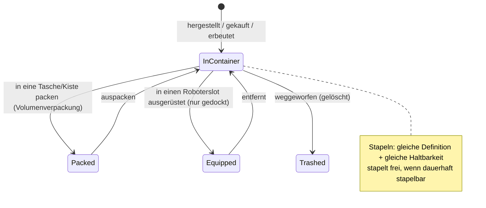

# Gegenstände & Inventar

Dein **Inventar** besteht aus einer Reihe von **Containern** (der öffentliche Container der Basis,
der Frachtcontainer deines Roboters, Taschen/Kisten usw.). Diese Seite behandelt die Handhabung von Gegenständen darin.

> UI-Positionen richten sich nach der [Client-UI-Übersicht](/de/features/ui/). Die folgenden Mechaniken sind
> anhand des Servers bestätigt.

## Container

- **Container auflisten** — den Inhalt anzeigen.
- **Gegenstände umlagern** — Gegenstände zwischen Containern verschieben, auf die du Zugriff hast.

Es gelten Zugriffsregeln: Einige Container (Konzernhangar, Roboterinventar, Systemcontainer) sind
beschränkt — siehe [Roboter](/de/features/robots/) und [Gruppen](/de/features/groups/).

## Packen & Entpacken

- **Gegenstände packen** — Gegenstände in eine Tasche/Kiste (einen volumenreduzierenden Container) legen,
  um sie kompakt zu transportieren.
- **Gegenstände entpacken** — Gegenstände wieder aus einer Tasche/Kiste herausnehmen.

Durch Packen wird auch ein **Roboter** für Lagerung und Transport komprimiert: Der Server entfernt dessen
dynamischen Zustand sowie Komponenten und markiert ihn als *umverpackt* (repacked). Ein Roboter kann nur verpackt
werden, wenn er **unbeschädigt**, **nicht ausgewählt**, **nicht versichert** ist und ein **leeres Inventar** hat.
Das Entpacken baut den Roboter wieder auf und repariert ihn. Nur Gegenstände mit dem Inhalts-Flag *repackable*
können verpackt werden; ein umverpackter Roboter kann erst nach dem Auspacken ausgewählt oder ausgerüstet werden
(siehe [Roboter](/de/features/robots/)).

## Stapeln

Viele Gegenstände lassen sich stapeln. Stapeloperationen:

- **Gegenstände stapeln** / **stapeln auf** / **Auswahl stapeln** — Gegenstände desselben Typs zu
  einem Stapel zusammenfügen (oder einen Stapel auf einen anderen ziehen).
- **Menge abstapeln** — eine bestimmte Menge von einem Stapel abspalten.

Der Server führt Gegenstände nur zusammen, wenn sie **dieselbe Definition und dieselbe Haltbarkeit (Health)** teilen.
Gegenstände mit dem Flag *always stackable* (Erze, Munition, die meisten Rohstoffe) stapeln sich frei;
Gegenstände mit dem Flag *non-stackable* stapeln sich nie; alle anderen stapeln sich **nur im umverpackten Zustand**
(gepackt) — unverpackte, beschädigte Ausrüstung bleibt somit einzeln.

## Benennen & Benutzen

- **Gegenstand umbenennen** — einem Gegenstand einen eigenen Namen geben.
- **Gegenstand benutzen** — einen benutzbaren Gegenstand aktivieren (kontextabhängig; in einer Zone kann
  dies auch mit Zonenobjekten interagieren — siehe [Sammeln](/de/features/gathering/)).
- **Lotterie-Gegenstand benutzen** — einen Gegenstand nach Art einer Lotterie öffnen/aktivieren.

## Müll & Rückerstattung

- **Gegenstände zerstören (Müll)** — Gegenstände verwerfen (löscht sie endgültig).
- **Gegenstand erstatten** — ein Administrations-/Support-Ablauf: Erstellt den Gegenstand und übergibt
  ihn an einen Charakter, protokolliert im Transaktionslog. Spieler rufen dies nicht direkt auf.

## Spezialgegenstände

- **Einlösbare Gegenstände** — einlösbare Gegenstände auflisten, **einlösen** oder **aktivieren** (Codes/Zuweisungen).
- **Goodie-Packs** — Goodie-Packs (Gegenstandspakete) auflisten und **einlösen**.
- **Ein Geschenk öffnen** — ein Geschenk enthält einen **zufälligen** Gegenstand aus einem serverweiten
  Beutepool (Munition, Roherze, Plasma, Forschungskits, Module, Kapseln, Lackierungen, Booster —
  221 mögliche Definitionen, jede mit eigenem Mengenbereich).

## Praktische Hinweise

- **Zugriff ist containerbasiert** — du kannst nur auf Container zugreifen, die dir gehören oder freigegeben sind.
- **Packen spart Platz** — Taschen/Kisten ermöglichen den kompakten Transport von Massengütern.
- **Stapel sparen Platz** — führe gleichartige Gegenstände zusammen; staple Teilmengen ab, um genau die benötigte Menge zu entnehmen.
- **Löschen ist endgültig** — vernichtete Gegenstände sind unwiederbringlich verloren.
- **Einlösbare Items / Goodie-Packs sind einmalig** — das Einlösen verbraucht den Code bzw. Gegenstand.
- **Verpackte Roboter sind inaktiv** — packe sie vor der Auswahl oder dem Ausrüsten aus.
- **Nur verpackte Ausrüstung stapelt** — lassen sich gleichartige Gegenstände nicht stapeln, packe (oder repariere) sie zuerst.

<!-- TODO: only the inventory UI remains.
     Confirmed: stacking rules (Item.cs CanStackTo: same ED + same health; AttributeFlags
     alwaysStackable/nonStackable; others must be repackaged); pack rules (ItemPacker.cs:
     robot must be undamaged, not selected, not insured, empty inventory; repackable
     flag); unpack rebuilds + repairs (ItemUnpacker.cs); gifts = random draw from
     giftloots (221 defs: ammo x1500-2000, epriton/fluxore x600-1000, reactor plasma
     x10-20k, research kits, paints, capsules, named3 modules, boosters, respec tokens);
     goodie packs are campaign-based (GoodiePackRedeem: campaignID + indy selection);
     ReimburseItem = admin tool (opp_reimburselog). AttributeFlags bit positions:
     nonStackable=10, alwaysStackable=11, repackable, consumable=24, deployable=23.
     Developer notes: ListContainer.cs; RelocateItems.cs; PackItems.cs / UnpackItems.cs;
     StackTo.cs / StackSelection.cs / UnstackAmount.cs; SetItemName.cs; UseItem.cs /
     UseLotteryItem.cs; TrashItems.cs; ReimburseItem.cs (PbsReimburseRequestHander.cs);
     RedeemableItemList.cs / RedeemableItemRedeem.cs / RedeemableItemActivate.cs;
     GoodiePackList.cs / GoodiePackRedeem.cs; GiftOpen.cs. Container access:
     ContainerAccess / ContainerAccessChecker.cs. -->
