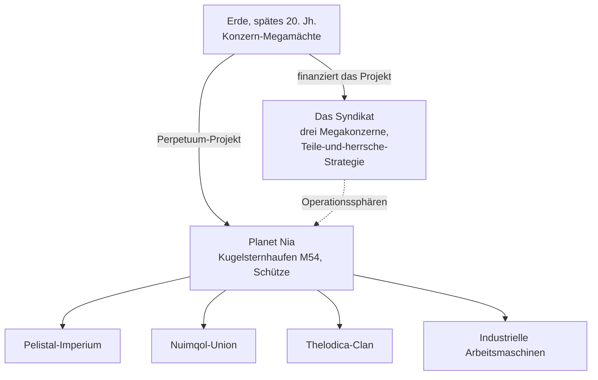

# Hintergrund

## Die Entdeckung von Nia

Der Technologieboom der Erde im späten 20. Jahrhundert — das Internet, die Fusion von Medizin und IT,
die Weltraumforschung — sprengte die alten physischen und mentalen Grenzen. Kommunikation und Handel
wurden schneller und günstiger, und die großen Konzerne wuchsen zu den De-facto-Regierungen
ihrer Regionen heran.

In diese Welt platzte die Entdeckung des **Planeten Nia** im Kugelsternhaufen M54 des Sternbilds
Schütze (der Ursprung des Projektlogos). Nia umkreist einen Doppelstern — als vierter Planet dieses Paares —
und ist verblüffend erdähnlich: Eine mittlere Oberflächentemperatur von etwa 19 °C und eine
nahezu erdgleiche Atmosphärendichte. Zwei Besonderheiten heben ihn jedoch ab: Seine Ozeane bilden unpassierbare
Barrieren für alles elektrisch Betriebene — der dichte Kern des Planeten und seine schnelle Rotation halten sie
unter ständiger Ladung — und nur etwa 17 % der Oberfläche bestehen aus Landmasse, die durch rasante
Plattentektonik fortwährend in Inseln zerrissen wird. Auf diesem Land floriert das Leben.

## Die Nianer

Nias Bewohner sprengen die übliche Bedeutung des Begriffs "Lebensform": Eine synthetische Spezies,
in ihrer Gestalt unseren Robotern nicht unähnlich, jedoch organisiert in getrennten, technologisch
fortgeschrittenen **Gesellschaften** — jede mit eigener Industrie, eigenem Militär und eigener Kultur.
Die Errungenschaft, die für die energiehungrige Erde am bedeutendsten ist, ist ihre **Energieerzeugungstechnologie**.

Drei Alien-Völker kämpfen auf den Inselketten ihrer Herrschaftsgebiete um den endgültigen Sieg — das
**Pelistal-Imperium**, die **Nuimqol-Union** und der **Thelodica-Clan** — mit einer verstreuten
**Industriellen** Bevölkerung aus Arbeitsmaschinen dazwischen (dies sind dieselben vier Gruppen, denen du als
[NPCs](/de/features/npcs/) begegnest).

## Das Syndikat

Der Hauptinvestor des Perpetuum-Projekts ist das **Syndikat** — eine Allianz der drei mächtigsten
terranischen Megakonzerne, von denen jeder seine eigene Operationssphäre auf der Oberfläche betreibt:

| Konzern | Einflussbereich |
|---|---|
| **Truhold-Markson** | Nordamerikanischer Konsumgüter-Industriegigant; stößt in das zerfallende **Pelistal**-Reich vor. |
| **ICS — Institute of Corporate Security** | Europäisch-russische Vereinigung; operiert im abtrünnigen **Nuimqol**-Territorium. |
| **Asintec** | Asiatischer Industriehegemon mit seinen High-Tech-Nachbarn; führt eine umfassende Offensive gegen den **Thelodica-Clan**. |

Die Strategie ist das altbewährte *Teile und herrsche*: Hält man die drei Sphären gegeneinander im
Gleichgewicht, bekämpfen sich die außerirdischen Mächte weiterhin untereinander, statt sich zu vereinen.
Menschliche "Agenten" arbeiten auf der Oberfläche — sie ernten die Energieressourcen der Nianer,
erforschen deren Technologie und sichern den Frieden, den das Syndikat wünscht.

Hier kommst du ins Spiel.

<!--
Developer notes: rewritten 2026 in original prose from the canonical setting.
An earlier version was adapted from the Open Perpetuum community wiki
(perpetuum.miraheze.org: Discovery of Nia, Nia, Syndicate); that text was
fully replaced, not reused.
Consistency with backend: the three alien races + Industrial match the NPC
races (see /features/npcs/); the corporation names match the zone abbreviations
(zone_ICS, zone_ASI, zone_TM — the beta-tier zones in /zones/ are named after
their megacorporations).
-->
