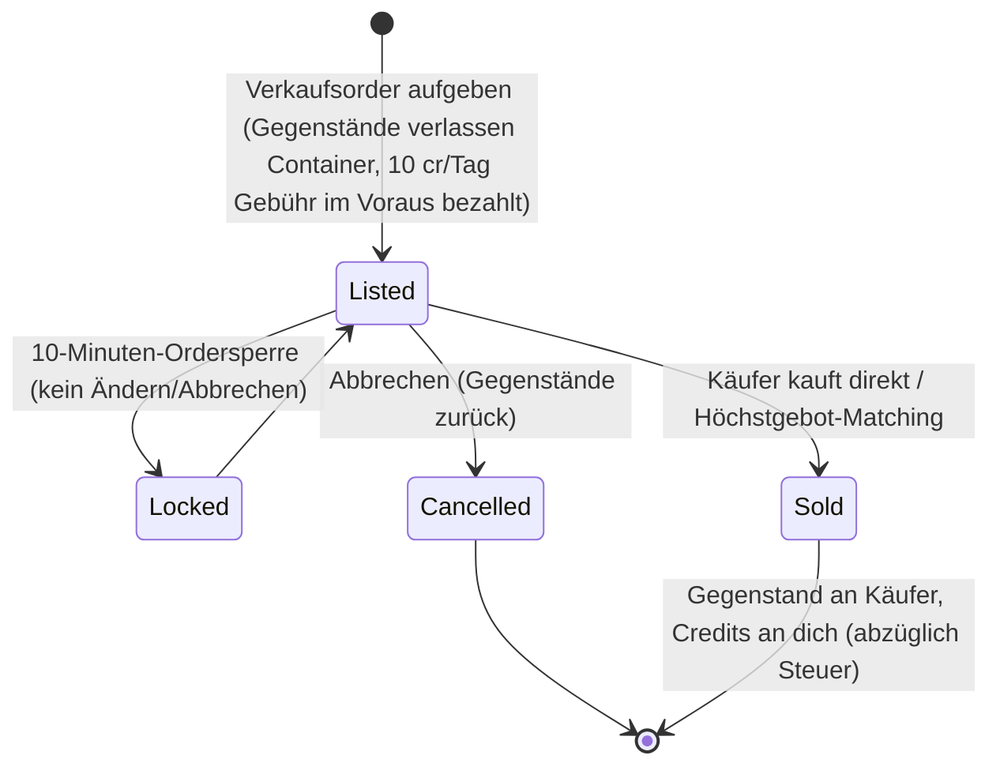

# Markt & Handel

Auf dem **Markt** kaufst und verkaufst du Gegenstände an einer Basis. Sämtliche Marktaktionen sind
**nur im gedockten Zustand** möglich (du handelst an der Basis, an der du angedockt bist).

> UI-Positionen richten sich nach der [Client-UI-Übersicht](/de/features/ui/) (die Kategorie **Markt** in
> der oberen Leiste). Die folgenden Mechaniken sind anhand des Servers bestätigt.

## Marktorders

An deiner aktuellen Basis kannst du zwei Arten von Orders auf dem Markt aufgeben:

### Verkaufsorders
Gegenstände zum Verkauf anbieten.
- Wähle den **Gegenstand**, die **Menge**, den **Stückpreis** und die **Laufzeit** in Tagen
  (mindestens 1 Tag).
- Der Gegenstand wird aus deinem Container entnommen (abgestapelt, falls du einen Teil eines Stapels verkaufst).
- **Einstellgebühr** — du zahlst `10 Credits × Laufzeit` im Voraus (reduzierbar durch die
  Erweiterung *Markt-Transaktionsgebühr*); die Gebühr fließt an die Zentralbank der Basis (Zonen-Gewinnpool).
- **Preisschutz** — sofern aktiviert, muss dein Preis innerhalb von **±30 %** des
  **14-Tage-Durchschnittspreises** des Gegenstands liegen; Preise außerhalb dieser Spanne werden abgelehnt.
  *(Dieser Schutz ist auf diesem Server aktuell **deaktiviert**.)*
- **Ordersperre** — eine Order kann für **10 Minuten** nach dem Aufgeben weder geändert noch abgebrochen werden.
- **Order-Anzahl** — du kannst 1 + (Erweiterung *Markt-Verkaufsorder-Experte*) offene Verkaufsorders
  halten (Kauforders haben einen eigenen Zähler).
- **Für meinen Konzern** — du kannst eine Verkaufsorder auf Mitglieder deines eigenen Konzerns beschränken
  (nur für Nicht-Standard-Konzerne).
- Bezahle je nach Bedarf aus deinem **persönlichen** oder dem **Konzern-Guthaben**.

### Kauforders
Eine Dauer-Order aufgeben, um einen Gegenstand zu einem bestimmten Preis zu kaufen.
- Der Markt erfüllt sie automatisch, sobald ein passendes Verkaufsangebot erscheint.

### Orders verwalten
- **Eine Order ändern** — Preis/Menge/Laufzeit anpassen.
- **Einen Gegenstand / eine Order abbrechen** — zurückziehen (der Gegenstand kehrt in deinen Container zurück).
- **Meine Gegenstände** — deine offenen Orders einsehen.
- **Höchstgebot-Matching** — ein Verkaufsangebot kann direkt an eine bestehende Kauforder vermittelt werden.

## Direktkauf

- **Einen Gegenstand kaufen** — kaufe sofort einen auf dem Markt gelisteten Gegenstand (ohne Dauer-Order).

## Den Markt durchsuchen

- **Gegenstandsliste / Verfügbare Gegenstände / Gegenstände in Reichweite** — durchstöbere Angebote.
- **Markt-Info** — Details über den Markt der Basis.
- **Durchschnittspreise** — Marktdurchschnitt, Durchschnitt pro Definition und **globaler** Durchschnitt.
  Auf diesen Werten basiert der Preisschutz.

## Marktsteuer

- **Marktsteuer ändern** — den Steuersatz des Marktes festlegen. Nur **PBS-Basismärkte**
  werden von Spielern kontrolliert; überall sonst gilt der feste Standardwert.
- **Steuer-Protokoll** — Änderungen an den Steuersätzen einsehen.

Die Steuer wird von dem Betrag abgezogen, den der **Verkäufer** bei einem Marktverkauf erhält. Der Standardsteuersatz
beträgt **12 %** (der Verkäufer erhält 88 % des Verkaufspreises); der Satz kann durch die Erweiterung
*Markt-Transaktionssteuer* gesenkt werden und auf spielerkontrollierten Märkten durch den PBS-Besitzer,
der einen eigenen Steuersatz festlegt.

## Direkter Spielerhandel

Ein **Handel** ist ein direkter Peer-to-Peer-Austausch zwischen zwei angedockten Charakteren:

- **Einen Handel beginnen** — starte eine Sitzung mit einem anderen Spieler.
- **Angebot abgeben / zurückziehen** — lege Gegenstände/Credits auf deine Seite.
- **Annehmen** — beide Seiten stimmen zu, um den Tausch atomar abzuschließen.
- **Abbrechen** — den Handel abbrechen.
- **Handel abgeschlossen / Status** — Abschluss und aktueller Zustand.

Ein Charakter kann **Handelsanfragen blockieren** (siehe [Erste Schritte](/de/features/getting-started/)).

## Der Item-Shop

Der **Item-Shop** ist ein Festpreis-Händler an einer Basis (nicht spielergesteuert). Der vollständige
Katalog (jeder Gegenstand, Menge, Preis pro Währung, Ansehensanforderung) ist generiert unter
[Item-Shop](/de/content/shop/).

- **Auflisten** — sehen, was der Shop verkauft.
- **Kaufen** — einen Gegenstand gegen Credits erwerben.

## Credits übertragen

- **Credits übertragen** — zwischen deinen eigenen Charakteren transferieren (siehe [Erste Schritte](/de/features/getting-started/)).

## Praktische Hinweise

- **Alles ist nur im gedockten Zustand möglich** — du kannst nicht in einer Zone handeln.
- **Kalkuliere die 12 % Steuer in deine Preise ein** — Verkäufer erhalten standardmäßig 88 % des Listenpreises
  (auf hoch besteuerten PBS-Märkten weniger).
- **Die Einstellgebühr ist im Voraus fällig** — ein langes Angebot kostet mehr, selbst wenn es am ersten Tag verkauft wird.
- **Konzern-Orders** sind ein Weg, um Waren intern ohne öffentliche Sichtbarkeit zu bewegen.
- **Handelsvorgänge sind atomar** — beide Seiten müssen zustimmen, sonst wird nichts übertragen.
- **Steuern verändern die effektiven Kosten** — berücksichtige die Marktsteuer bei deiner Preisgestaltung.

<!-- TODO: only the client UI remains (market and trade screen flows).
     Confirmed: MarketInfoService(0.3, 10, false) registered in
     PerpetuumBootstrapper.cs -> margin +-30% vs 14-day average (MARKET_AVERAGE_DAYSBACK
     14), fee 10 credits/day (Market.MARKET_FEE), CheckAveragePrice=false on this
     server; DEFAULT_MARKET_TAX = 0.12 (seller gets 88%), player-controlled tax only on
     PBSDockingBase markets (MarketTaxHelper); order modify/cancel locked 10 min after
     submit (MARKET_CANCEL_TIME); order count = 1 + expert extension bonus;
     fee paid up front to the base's central bank. -->
     Developer notes: Markets/MarketCreateSellOrder.cs (docked, price guard vs average
     price, corp-only, unstack, corp wallet), MarketCreateBuyOrder.cs,
     MarketModifyOrder.cs, MarketCancelItem.cs, MarketBuyItem.cs, MarketItemList.cs,
     MarketAvailableItems.cs, MarketItemsInRange.cs, MarketGetMyItems.cs,
     MarketGetAveragePrices.cs / MarketGetDefinitionAveragePrice.cs /
     MarketGlobalAveragePrices.cs, MarketTaxChange.cs / MarketTaxLogList.cs;
     Trade*.cs (begin/offer/accept/cancel, atomic); ItemShopList.cs / ItemShopBuy.cs;
     CharacterTransferCredit.cs. -->
