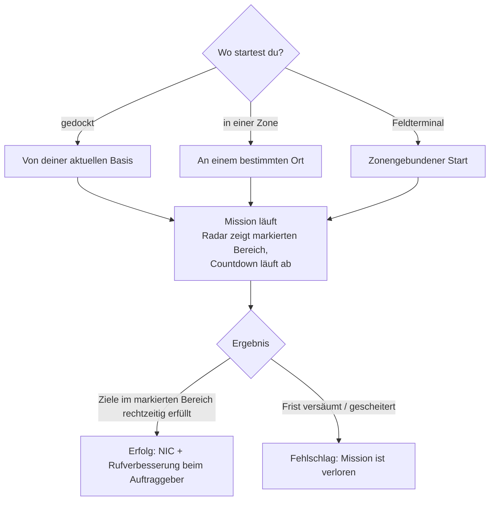

# Missionen

**Missionen** sind strukturierte Aufgaben, die du in einer Zone annimmst — Gegenstände liefern,
Ziele eliminieren, Strukturen bedienen. Durch sie machst du Fortschritte, verdienst Belohnungen und
treibst viele Zoneninhalte an (Alarme, Kioske und einige PBS-/Transport-Mechanismen sind missionsbezogen).

> UI-Positionen richten sich nach der [Client-UI-Übersicht](/de/features/ui/). Die folgenden Mechaniken sind
> anhand des Servers bestätigt.

## Eine Mission starten

Du startest eine Mission, indem du eine **Kategorie** und eine **Stufe** wählst (Stufen werden auf einen
gültigen Bereich begrenzt), an einem **Ort**:

- Wenn du **gedockt** bist, startet die Mission vom Standort deiner aktuellen Basis.
- Wenn du **in einer Zone** bist, gibst du den Ort explizit an.
- Missionen können auch direkt **aus einer Zone** (ein zonengebundener Start) oder **von einem Feldterminal** starten.

Nicht jede Kategorie/Stufe ist überall verfügbar — die Verfügbarkeit wird über den Inhalt gesteuert. Die
vollständige Liste der Missionen (Typ, Kategorie, Stufe, Dauer, Belohnungssumme und Belohnungsgegenstände)
ist generiert unter [Missionen](/de/content/missions/).

## Wozu Missionen dienen

Missionen erfüllen zwei Zwecke zugleich: Sie zahlen NIC und sie bauen dein **Ansehen (Relation)**
beim auftraggebenden Konzern auf. Ein besseres Ansehen ist ein Schlüsselfaktor für eine **höhere Einrichtungsquote**
an den Terminals dieses Konzerns — Produktion und andere Einrichtungsläufe werden für dich günstiger und schneller.
Das Ansehen kann jedoch auch *sinken*: Manche Missionen stehen im Konflikt mit den Interessen eines anderen Konzerns,
und das Briefing warnt dich, wenn dies Ansehen kostet.

- **Trainingsmissionen** — einfach, hervorgehoben für Neulinge; schließe sie alle ab, die Belohnungen sind
  eine willkommene Starthilfe.
- **Reguläre Missionen** gibt es in drei Ausrichtungen:
  - *Kampf* — Aufklärung (feindliche Roboter scannen), Kopfgeldjagd (Ziele in einem markierten Kreis zerstören),
    Zerstörung & Bergung (zerstören + bergen + abliefern), Aufklärung & Bergung, Sonder-Kopfgelder (schwer erreichbare Ziele).
  - *Industrie* — Geologie (mit der passenden Ladung nach einem Mineral scannen), Ernte, Mineralienausbeutung,
    fortgeschrittene Ausbeutung (bewachte Abbaustellen — bringe bewaffnete Hilfe mit).
  - *Logistik* — Transport (ein Paket zwischen Terminals abliefern) und Bergung (ein großes Paket durch
    gefährliches Gebiet eskortieren).
- Es gibt **keine sichere Mission**: Siehst du Feinde auf der Route und hast nicht die Ausrüstung, dich zu
  verteidigen, bitte um Hilfe, bevor du unterwegs alles verlierst.
- **Ziele zählen nur im markierten Bereich** — die Missionskarte markiert ihn mit einem roten Kreis auf dem Radar;
  Abschüsse und Scans anderswo zählen nicht. Versäumst du die Frist, schlägt die Mission sofort fehl.
- **Private Transportverträge** — ein vom Syndikat betriebenes System (zweiter Reiter des Missionsfensters),
  bei dem Spieler Container einstellen, damit andere Spieler sie gegen eine Belohnung zwischen Terminals transportieren,
  mit einem **Pfand**, das der Kurier hinterlegt (bei Erfolg erstattet, verloren bei Zerstörung; bei vorzeitigem
  Abbruch wird nur die Hälfte erstattet). Halte Container klein genug, damit sie tatsächlich transportiert werden können.

## Missionsdaten & Optionen

- **Missionsdaten** — Details einer Mission.
- **Missionsoptionen** — die verfügbaren Auswahlmöglichkeiten/Varianten einer Mission.
- **Missionsversorgung** — die Ressourcen, die eine Mission umfasst.
- **Startgegenstände** — die Gegenstände, mit denen eine Mission beginnt.

## Eine Mission durchführen

- **Laufende Missionen auflisten** — woran du aktuell arbeitest.
- **Abbrechen** — eine laufende Mission abbrechen.
- **Teilnehmer hinzufügen** — einen weiteren Charakter in die Mission aufnehmen (Mehrspieler-Missionen).
- **Missionsprotokoll** — das Ereignisprotokoll einer Mission.

## Lieferung

- **Abliefern** — ein Lieferziel abschließen. Dies kann je nach Mission **gedockt** (an einer Basis) oder
  **in einer Zone** (an einem bestimmten Ort/EID) geschehen.

## Agenten

- **Agenten auflisten** — die verfügbaren Missionsagenten (NPCs/Fraktionen, die Missionen vergeben).

## Feldterminals

- **Feldterminal-Info** — ein Feldterminal in einer Zone untersuchen (eine Struktur, die Missionen starten
  oder abwickeln kann).

## Praktische Hinweise

- **Missionen sind das Bindegewebe** — Alarme, Kioske und manche Strukturen sind Missions-Objekte
  (siehe [Sammeln](/de/features/gathering/) und [Kampf](/de/features/combat/)).
- **Mehrspieler** — du kannst Teilnehmer hinzufügen, um Missionen gemeinsam zu bestreiten.
- **Der Lieferkontext ist entscheidend** — manche Lieferungen erfordern das Andocken, andere deine Anwesenheit
  an einem Zonenort.
- **Stufen werden angepasst** — die Anfrage einer unzulässigen Stufe wird korrigiert, nicht mit einem Fehler abgelehnt.
- **Abbrechen ist dein Ausweg** — läuft eine Mission aus dem Ruder, brich sie ab.

## Missionsstrukturen

Missionen sind in den Zonen an **Strukturen** verankert. Der Server implementiert folgende Typen:

| Struktur | Funktion |
|---|---|
| **Einfacher Schalter (Simple switch)** | Sofortige Interaktion — nähere dich an und das Missionsziel wird erfüllt |
| **Alarmschalter (Alarm switch)** | Zeitbasierte Aufgabe — bleibe für eine Dauer (aus den Missionsoptionen) in Reichweite, alle 2 s geprüft |
| **Objekt-Versorgung (Item supply)** | Zeitbasiert wie ein Alarmschalter, **spawnt dann Gegenstände in den Frachtcontainer deines Roboters** |
| **Kiosk** | Ein **Gegenstands-Einreichungspunkt** — übergebe der Mission die geforderten Gegenstände |

<!-- TODO: the full mission list, categories, level ranges and rewards are generated at
     /content/missions/. Verified: mission structure types
     (MissionEngine/MissionStructures: SimpleSwitch, AlarmSwitch, ItemSupply, Kiosk);
     verify the mission UI.
     Developer notes: Missions/MissionStart.cs (category, level clamp, docked vs zone
     location), Missions/MissionDeliver.cs (docked vs zone delivery), MissionAbort.cs,
     MissionData.cs / MissionGetOptions.cs / MissionGetSupply.cs / MissionStartItems.cs,
     MissionListRunning.cs / MissionListAgents.cs / MissionLogList.cs,
     MissionPlayerAddsParticipant.cs, FieldTerminalInfo.cs, MissionStartFromZone.cs;
     Services/MissionEngine/* (MissionProcessor, mission structures incl. AlarmSwitch,
     Kiosk). -->
