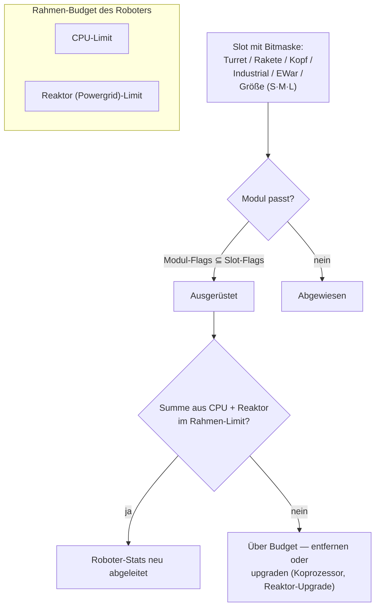

# Module & Ausrüstung

„Einen Roboter zu kaufen, bringt dir nur das Chassis." Erst das Ausrüsten mit
Modulen macht daraus, was du brauchst. *Fitting* meint sowohl die Modul-Ausstattung
(„schick mir dein Fitting") als auch das CPU-/Reaktor-Budget, das sie frisst.

## Slots & Ressourcen

Ein Roboter-Rahmen hat eine feste Menge **Slots**, definiert durch sein Chassis.
Jeder Slot ist per Bitmaske typisiert — Turret, Raketenwerfer, Kopf, Industrial,
EWar/Engineering, Größe (klein / mittel / groß) — und ein Modul passt nur in einen
Slot, wenn seine eigene Typenmaske eine Teilmenge der Slot-Maske ist. Ein
Turret-Slot auf einem Caster akzeptiert also kleine, mittlere *oder* große
Turret-Module, aber kein Raketenwerfer kommt je in einen Turret-Slot. Kopf-Module
(Koprozessoren, Tune-Module) und Chassis-/Bein-Module (Platten, Frames)
belegen eigene dedizierte Slots.

Jedes Modul zieht **CPU** und **Reaktor** (Powergrid) aus dem Rahmen — die Summe
von allem Ausgerüsteten muss unter beiden Limits bleiben, und manche Module ziehen
pro Zyklus zusätzlich **Akkumulator** (Kern). Der verbleibende Rest ist der
*verfügbare Output*, den das Fitting-Fenster anzeigt. Grobe Chassis-Skala
(T1/T2/T3-Beispiele):

| Rahmenklasse | CPU | Reaktor | Beispiel |
|---|---:|---:|---|
| Kleiner Crawler | ~250 | ~140 | Castel |
| Leichter Mech | ~480 | ~300 | Waspish |
| Schwerer Mech | ~1 100 | ~1 000 | Tyrannos |
| Walker | ~3 200+ | ~1 100+ | Gropho |

Wenn dir Kapazität fehlt: **CPU** — Koprozessor-Module (z. B. gibt der T3-
Koprozessor +20 % CPU) oder T2-Module-Varianten (geringerer Verbrauch). **Reaktor**
— Reaktor-Upgrades (z. B. gibt T3 +20 % Reaktor-Output) oder Reaktor-
Abschirmung (senkt die Strahlung, was dich auch vor EnWar schützt — siehe unten).

## Die Modulfamilien

Pro-Modell-Zahlen liegen im [Item-Katalog](/content/) und in der
[Formate-Referenz](/de/formats/); das hier ist der Familienüberblick.

### Waffen & Munition

Vier Waffentechnologien, jede mit eigener Munition und Distanz-Charakteristik:

| Waffe | Munition | Distanz-Charakteristik | Notizen |
|---|---|---|---|
| **Schusswaffen** | Kugeln | Kurzes Optimum, starker Abfall | Geschosse, die *nie daneben schießen* — aber ihre „Präzision" wirkt als Flächenradius, sodass kleine Ziele von breiten Salven reduzierten Schaden nehmen. |
| **Magnet (Railguns)** | Slugs | Mittlere Reichweite, steiler Abfall | Hohe Einschlagsgeschwindigkeit; hoher Energieverbrauch. |
| **Laser** | Zellen | Lange Reichweite | Die energiehungrigsten; gebündelte Strahlen. |
| **Raketen** | Raketen | Lange Reichweite | Treffer oder Fehlschuss entscheidet die *Trefferchance des Roboters*, nicht die Distanz. Der Schaden skaliert mit der Zielgröße relativ zum Explosionsradius — große Raketen auf kleine Ziele treffen deutlich schwächer. |

Der Schaden fällt mit der Distanz auf einer glatten Kosinus-Kurve ab: voller
Schaden auf optimaler Reichweite, null auf Optimum + Falloff (siehe
[Schadensabfall](/de/features/combat/#schadensarten)).

Munition ist dein Schadens-Tuning: Primär- + Sekundär-Schadensarten lassen dich
gegen ein Ziel feinjustieren (siehe [Schadensarten](/de/features/combat/#schadensarten))
— auf Kosten eines kleinen Teils des Gesamtschadens gegenüber reiner Primärmunition.

Turms gibt es in klein/mittel/groß; **Größe zum Roboter passend wählen** (kleine
Bots fahren kleine Module, Mechs und Schwere fahren mittel/groß).

### Verteidigung

- **Rüstungsplatten** — der Haupt-Hitpunkt-Pool; wenn die Rüstung bei null ist,
  explodiert der Roboter. **LWF** (lightweight frame)-Platten tauchen Haltbarkeit
  gegen Geschwindigkeit: eine T2-LWF-Platte multipliziert die Rüstung mit ~0,73,
  gibt aber +19 % Tempo, −0,2 Signatur und −0,2 Masse.
- **Schildgenerator** — eine akkumulatorgespeiste Barriere, die Schaden vor der
  Rüstung absorbiert. Der Schild zahlt *deinen eigenen Kern* fürs Absorbieren: ein
  Treffer, der bei 2× Schild 100 Schaden verursachen würde, zieht 50 Kern statt
  100 Rüstung. Solange der Schild aktiv ist, können deine eigenen Waffen nicht
  feuern. Die Absorptionsqualität skaliert mit dem Schildradius relativ zu deiner
  Signatur — große Schilder auf kleinen Rahmen funktionieren am besten.
- **Rüstungsreparatur** — aktive Reparaturmodule (klein/mittel/groß); **Fern-
  Rüstungsreparatur** erreicht ein verriegeltes Ziel (Verbündete oder eine PBS),
  hat aber kurze Reichweite und längeren Zyklus.
- **Rüstungshärter** — passive Resistenzpunkte pro Schadensart (chemische /
  kinetische / thermische / explosive Varianten).
- **Adaptiver Legierung** — ein Passiv, das den *erhaltenen* Schadensmix lernt und
  einen festen Pool an Resistenzpunkten dorthin umverteilt, wo du am meisten
  getroffen wurdest.
- **Ausweich-/Manöver** — Signatur-Senkungs-Module und NEXUS (unten) machen das
  Ziel kleiner: weniger Schaden von Flächeneffekten und schwerer zu verriegeln.

### Energie

- **Reaktor** — das nachhaltige Output-Limit; Reaktor-Upgrades erhöhen es,
  Reaktor-Abschirmung senkt die Strahlung (weniger erlittener EnWar-Schaden, auf
  Kosten eines kleinen Teils des Reaktors).
- **Akkumulator (Kern)** — der Burst-Energie-Rest, der die Module-Zyklen antreibt.
  Er lädt sich mit der Zeit nach (Chassis-`core_recharge_time`, ~120 ms auf einem
  T1-Crawler); **Akkumulator-Lader** beschleunigen den Ladevorgang.
- **Energieinjektoren (Core-Booster)** — verbrauchen eine Ladung, um den
  Akkumulator sofort vollzumachen.
- **Energietransferatoren** — strahlen Kern von deinem Roboter zu einem
  verriegelten Verbündeten (Spieler können keine NPCs strahlen).

### Elektronik

- **Sensorbooster** — passiv, selbst: verkürzt deine Verriegelungszeit und
  verlängert deine Verriegelungsreichweite.
- **Fern-Sensorbooster** — aktiv, Ziel: derselbe Boost, auf einen verriegelten
  Verbündeten für ~10,5 s angewendet.
- **Koprozessoren** — erhöhen das CPU-Limit des Rahmens (T1 +10 % … T3 +20 %).
- **Waffenstabilisatoren** — verbessern die Waffengenauigkeit (kleinerer
  effektiver Flächenradius) und sparen etwas Masse.
- **Tune-Module** (Kopf-Slots) — flache Boni für bestimmte Familien:
  Schadens-Mods (+25 % Schaden pro Waffenfamilie auf T3), Mining-Upgrades
  (+10 % Mining und Ernte auf T3), Reparatur-Upgrades (+16 % Reparatur, −8 %
  Zyklus auf T3).

### Electronic Warfare (EWar)

Mach den Feind blind und taub:

- **Sensordämpfer** — Reichweiten-Debuff: verlängert die Verriegelungszeit des
  Ziels und senkt seine Verriegelungsreichweite für ~5,5 s. Wirkt nur, wenn deine
  ECM-Stärke die (randomisierte) Sensorstärke des Ziels schlägt.
- **Sensorjammer** — sofort: setzt bei erfolgreichem ECM-Check *alle*
  Verriegelungen des Ziels zurück.
- **ECCM** — Selbst-Buff für 20 s: erhöht Sensorstärke und Verriegelungsresistenz
  und *heilt* ECM-verwundbare Debuffs (Dämpfer, Webs).
- **Neuralyzer** — setzt die Verriegelungen **aller** Spieler innerhalb von
  ~1,65 km zurück. Ein Panikknopf.

Gegenmittel: Sensorstärke (Chassis), ECCM und Distanz halten.

### Stealth & Detektion

- **Stealth-Modul** — ~10,5 s Tarnung; der Verbrauch skaliert mit deinem
  Signaturradius (größerer Rahmen, schnellerer Kern-Verbrauch).
- **Zielmaler** — ~10,5 s Debuff, das die Tarnstärke des Ziels entfernt.
- **Detektionsmodul** — passiver Boost deiner Detektionsstärke.

Detektionsstärke gegen Tarnstärke entscheidet, ob du ein getarntes Ziel überhaupt
sehen (und verriegeln) kannst — siehe [Detektion & Maskierung](/de/features/combat/#scannen-und-zielung).

### Energy Warfare (EnWar)

Entzieh dem Feind Energie oder schneide sie ab:

- **Drainer (Energievampire)** — pumpen Kern aus einem verriegelten Ziel und
  addieren ihn zu deinem eigenen Akkumulator.
- **Neutralisierer** — dasselbe, aber der entzogene Kern wird zerstört.
- Beide werden von der **Reaktor-Strahlung** des Ziels abgeschwächt — Abschirmung
  ist ein echtes Gegenmittel.
- **Demobilisierer (Webs)** — ~5,5 s Tempoverringerung am Ziel; der Effekt
  skaliert mit der Zielmasse (schwere Rahmen werden weniger gebremst) und
  schlägt gegen Ziele außerhalb der optimalen Reichweite des Moduls fehl.
- **Scorcher** — eine elektrische Waffe, die bis zu 5 Ziele *ketten* und
  Schild und Rüstung mit durchschlagendem Schaden trifft.

### Industrial

- **Bohrer** (klein / groß) und **Ernter** (klein / groß) — die
  Sammelmodule; Ertrag, Zykluszeit und Akkumulator-Verbrauch sind die relevanten
  Stats. Mining gibt EP (mit Tageslimit und Liquiditäts-Abzug).
- **Geoskaner** — scannt das Mineralfeld um dich herum mit der Genauigkeit der
  Sonde; das Ergebnis ist eine Karte dessen, was unter dem Boden liegt (siehe
  [Sammeln](/de/features/gathering/)).
- **Bagger** — Aura-Modul: erhöht den Mining-/Ernte-Ertrag in der Nähe
  (T3: +50 %) auf Kosten von Tarnung.
- **Terraforming** (Gamma-Zonen) — Terrain-Locks, die den Boden anheben,
  senken oder eben machen (maximaler Radius 5 m), und Mauerpflanzen wachsen
  lassen; siehe den [Zonen-Bereich](/zones/zone-gamma-z106/).
- **Fernsteuerungen** — Turms und Dronen an der Leine: jedes Controller-Modul
  hat eine Bandbreite (wie viele), einen Einsatzradius und eine Drohnen-
  Lebensdauer (5–10 min je Tier). Varianten: taktisch (Schaden/Zyklus),
  Sturmangriff (Schaden), Unterstützung (Fernreparatur), Industrial
  (Mining-/Ernte-Drohnen), Jäger. Ein **Fernbefehls-Translator**-Modul
  verstärkt Drohnen-Schaden, Rüstung, Mining-Ertrag und Reparatur-Output
  (T3: je +7,5 %) und kann die Bandbreite des Controllers verlängern.

### NEXUS

Networked Extension Utilization Systems: **Truppen-Buffs**. Ein NEXUS-Modul
emittiert eine Aura um seinen eigenen Roboter, die **Gang-Mitglieder** (und ihre
Turms/Drohnen) im Aura-Radius bufft — Standard 10 m, alle 10 s auffrischbar.
Regeln:

- ein Roboter kann höchstens **3 NEXUS-Auren** tragen und höchstens **eine
  je Typ**;
- die Aura erreicht nur Einheiten in deinem **Gang**, keine zufälligen Verbündeten.

Die T3-Typenliste (13): Geschwindigkeit, Rüstung, Schild, Fernverriegelung
(Verriegelungsreichweite), Verriegelungs-Booster (Verriegelungszeit),
Kritischer Treffer, Sturmangriff (Waffenzyklus), EW (EWar-Reichweite),
Ausweich (Signatur), Reparatur, Industrial (Akkumulator-Verbrauch beim
Sammeln), schneller Extraktor (Sammelzyklus), Lader (Kern-Nachladung). Jedes
T3-Modul gibt ungefähr +7,5 % seiner Statistik; z. B. multipliziert die
Geschwindigkeits-NEXUS die Maximalgeschwindigkeit mit 1,075 für jeden
Gang-Kameraden, der innerhalb von 10 m steht.

### NOX

Kultisten-Grad-Gegenmittel: **Negator**-Module, die feindliche Module innerhalb
ihres Radius *deaktivieren* — ein **Schild-Negator** (senkt die
Schildabsorption um ~90 %), ein **Reparatur-Negator** (senkt den
Reparatur-Output) und ein **Teleport-Negator** (blockiert Teleportieren).
Jede Aktivierung **verbraucht Plasma** aus deinem Cargo, und der Einsatz in
einer offenen (nicht-Trainings-)Zone **flaggt deinen Charakter für PvP**.

### Spezialzwecke

- **Siege-Hack-Modul** — das aktive-SAP-Werkzeug: 5 s Zyklus, 3 m Reichweite
  (siehe [Außenposten](/de/features/outposts/)).
- **Selbstzerstörung** — armerst einen 8-Sekunden-Countdown; der Strahl ist aus
  600 m sichtbar. Aufräumen in letzter Verzweiflung.
- **Minendetektor** — verlängert den Minendetektionsradius des Rahmens.
- **Blob-Emitter** — deployt einen Emitter, der ein Blob-Feld ausbreitet; das
  Emissionsmodulator-Modul justiert das Feld (siehe [Kampf](/de/features/combat/)).
- **PBS-Bau** — das Modul, mit dem man PBS-Strukturen auf Gamma-Zonen platziert.

## Faustregeln

1. **Nicht die Waffen mischen.** Magnet + Laser + Raketen auf einem Bot
   unterperformt meist alle drei; kurz- und langreichweitiges Mischen endet
   selten gut.
2. **Achte auf die Masse.** Jede Platte und jedes Schild-Modul fügt Masse und
   Signatur hinzu — manchmal zählt Tempo mehr als Verteidigung.
3. **Nicht alles auf einmal.** Ein Bot, der mined, scannt und schießt, macht
   davon nichts so gut wie ein Spezialist.
4. **Modul-Größe zum Roboter passend wählen** und etwas CPU-/Reaktor-Reserve
   für die Tune-Module lassen, die einen Build erst richtig zum Laufen bringen.
5. …und ja, einige Nischen-Fits brechen all das oben und funktionieren trotzdem.
   Nur ein bisschen nachdenken.

<!--
Developer notes: rewritten 2026 from backend sources; no community-wiki text reused.
Verified against:
- src/Perpetuum/Robots/RobotComponent.cs (slot bitmask fitting: moduleFlagMask & slotFlagMask)
- src/Perpetuum/Modules/SlotFlags.cs (12 slot flag bits)
- src/Perpetuum/Modules/Weapons/WeaponModule.cs + FirearmWeaponModule.cs +
  MissileWeaponModule.cs (accuracy: firearms never miss, explosion radius from
  Accuracy; missiles use ParentRobot.MissileHitChance)
- src/Perpetuum/Modules/Weapons/Damage.cs (cosine falloff, critical 1.75x +/-10%,
  explosion scaling signature/explosionRadius clamped [0,1])
- src/Perpetuum/Units/Unit.cs GetResistByDamageType (resist/(resist+100))
- src/Perpetuum/Zones/DamageProcessors/DamageProcessor.cs (shield draws core,
  electric = penetrating)
- src/Perpetuum/Modules/EffectModules/ShieldGeneratorModule.cs (absorption
  modifier = shieldRadius ratio / shieldAbsorbtion; WeaponModule.cs:112 blocks
  firing while HasShieldEffect)
- src/Perpetuum/Modules/EffectModules/{Webber,SensorDampener,SensorBooster,
  Stealth,TargetPainter,Eccm,Detection,AdaptiveAlloy}.cs (durations from
  effects table: dampener/web 5.5s, stealth/paint/remote-boost 10.5s, ECCM 20s)
- src/Perpetuum/Modules/SensorJammerModule.cs + Neuralyzer.cs (lock reset,
  NEURALYZER_RANGE=1650)
- src/Perpetuum/Modules/{EnergyVampire,EnergyNeutralizer,Scorcher,
  CoreBooster,EnergyTransferer}.cs (EnWar, reactor radiation modifier, chain)
- src/Perpetuum/Modules/GangModule.cs + Zones/Effects/GangEffect.cs +
  EntitiesModule.cs:532-544 (13 aura types, gang-members-only, effects table
  auraradius=10)
- src/Perpetuum/Modules/NoxModule.cs (plasma consumption, PvP flag)
- src/Perpetuum/Modules/RemoteControl/* (bandwidth/range/lifetime, translator
  amplification)
- entitydefaults rows: named1-3 armor plates/hardeners, shield generators
  (absorbtion 2.0-2.3, radius 5-33), LWF (mass_reductor), cpu/powergrid
  upgrades, damage/mining/repairer tuning, NEXUS named3 values, NOX cultist
  values, siege hack (5s/3m), chassis core_max/powergrid_max.
Corrections vs ingested page: NEXUS auras reach gang members only (not "all
friendly units"); no "co-reactor" module exists (reactor upgrades/sealing do
that); demobilizer effect scales with target mass, no "resistance stat";
sensor suppressor = sensor dampener (5.5s debuff).
-->
