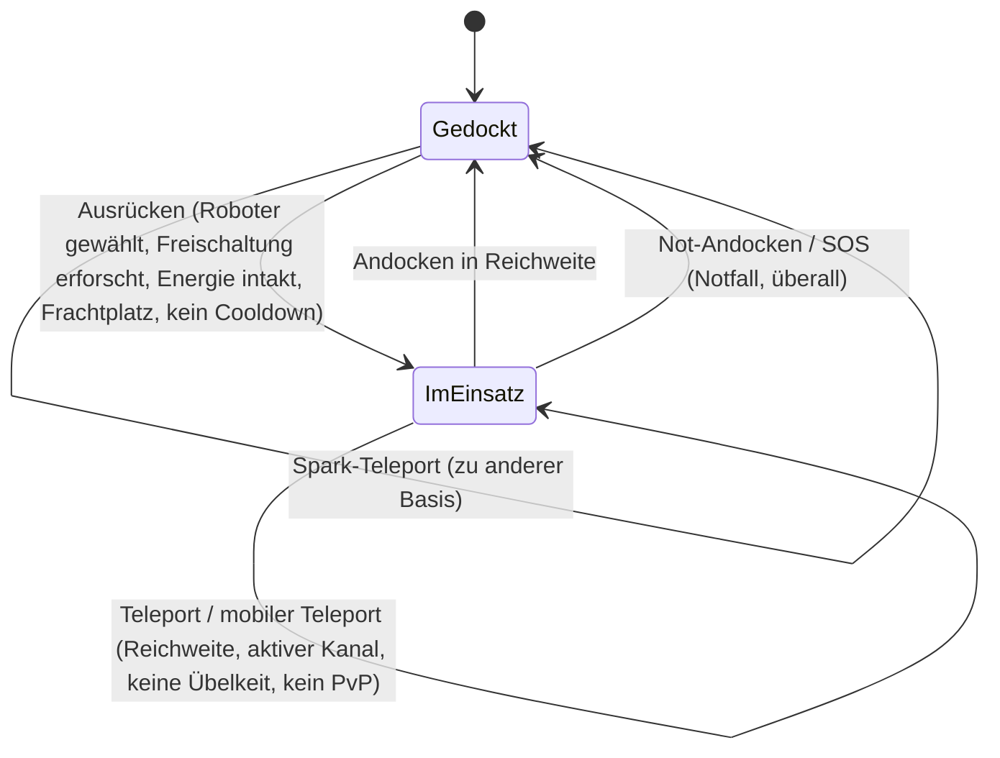

# Bewegung & Zonen

Du befindest dich immer in einem von zwei Zuständen: **Gedockt** an einer Basis oder **ungedockt** im Einsatz
in einer Zone, wo du deinen aktiven Roboter fernsteuerst. Alles auf dieser Seite dreht sich um den Wechsel zwischen
diesen Zuständen und zwischen Zonen.

> UI-Positionen richten sich nach der [Client-UI-Übersicht](/de/features/ui/): Der **Ausrücken-/Andocken-Umschalter**
> befindet sich in der Mitte der oberen Leiste. Die folgenden Mechaniken sind anhand des Servers bestätigt.

## Gedockt vs. ungedockt (im Einsatz)

- **Gedockt** — du befindest dich an einer Basis. Deine Roboter und Gegenstände liegen in Containern. Du kannst
  weder einen Roboter steuern, noch Teleporter nutzen oder scannen, kannst aber herstellen, handeln, forschen
  und Basiseinrichtungen nutzen.
- **Ungedockt** — du befindest dich in einer Zone und steuerst deinen aktiven Roboter. Du kannst dich bewegen,
  scannen, kämpfen und mit Zonenobjekten interagieren, doch die meisten reinen Basisfunktionen sind gesperrt.

## Abdocken

Drücke **Ausrücken** (Mitte der oberen Leiste). Der Server prüft daraufhin sämtliche folgenden Punkte:

1. Du hast einen **aktiven Roboter ausgewählt**.
2. Die Klasse dieses Roboters verfügt über die erforderliche erforschte **Befähigungs-Erweiterung**
   auf deinem Charakter (siehe [Forschung](/de/features/research/)).
3. Das **Energiesystem des Roboters ist intakt**.
4. Der **Frachtcontainer des Roboters hat freie Kapazität**.
5. Du befindest dich in keiner **Abdock-Abklingzeit** (ein kurzer Timer nach bestimmten Ereignissen).

Schlägt eine dieser Prüfungen fehl, wird das Abdocken verweigert.

## Wieder andocken

- **Andocken** an einer Basis, sobald du dich innerhalb ihrer Andockreichweite befindest.
- **Not-Andocken (Force Dock)** ist die Notfallaktion: Es zieht dich sofort aus der Zone und dockt dich
  an der Hauptbasis (TMA) an, selbst mitten im Kampf. Nutze es, wenn du einen Kampf verlierst.
- **SOS** — eine Zonen-Hilfsaktion, die dich an der aktuellen Basis andockt und den Vorfall markiert.

## Die Zonen-Einlasswarteschlange

Manche Zonen sind stark frequentiert und nutzen eine **Einlasswarteschlange**, wenn du abdocken oder einreisen willst:

- Den Zustand der Warteschlange abfragen (`zoneGetQueueInfo`).
- Deine bevorzugte Warteschlangenlänge festlegen (`zoneSetQueueLength`).
- Das Warten abbrechen, falls du es dir anders überlegst (`zoneCancelEnterQueue`).

## Teleporter

**Teleporter** sind Strukturen innerhalb einer Zone. Um einen zu nutzen:

- Musst du dich **innerhalb der Reichweite des Teleporters** befinden.
- Der **Kanal** (das Ziel) muss **aktiv** und gültig sein.
- Du darfst **nicht** unter *Teleport-Übelkeit* leiden — einer kurzen Abklingzeit nach jedem Teleport,
  während der du nicht erneut teleportieren kannst.
- Bestimmte Effekte (z. B. *Nox*-Blockade) oder das Befinden **im PvP-Kampf** können Teleporter blockieren.

Teleport-Kanäle gibt es in drei Ausführungen:

| Typ | Wirkung |
|---|---|
| **Innerhalb der Zone** | Bringt dich zu einem zufälligen Punkt in derselben Zone |
| **Andere Zone** | Bringt dich zu einem zufälligen Punkt in einer anderen Zone |
| **Trainingsausgang** | Verlässt eine Trainingszone (mit Option auf Belohnungsstufe) |

**Mobile Teleporter** sind *im Besitz befindliche* Teleportgegenstände (z. B. mobile Stronghold-/Welten-Teleporter).
Dafür gelten zusätzliche Regeln:

- Nur der **Besitzer oder ein Mitglied der Flotte (Gang) des Besitzers** darf ihn nutzen.
- Sie **können nicht während eines PvP-Kampfes genutzt werden**.
- Jede Benutzung löst eine **Abklingzeit** für diesen Teleporter aus.

Du kannst Teleporter und ihre Kanäle auflisten sowie weltweite Kanäle abfragen.

## Spark-Teleporter

**Spark-Teleporter** sind ein Schnellreisesystem zwischen Basen:

- Du **legst ein Spark-Ziel** an einer Basis fest und **nutzt** es anschließend (im gedockten Zustand),
  um sofort zu einer anderen Basis zu springen.
- Du kannst deine Spark-Teleporter **auflisten, festlegen, nutzen und löschen**.
- Die Zielbasis muss dir das **Andocken gestatten**.
- Bei der Ankunft wählt der Server einen passenden Roboter für dich aus (einen, dessen Freischaltungs-Erweiterungen
  du erforscht hast).
- Die **Anzahl der Spark-Teleporter, die du besitzen darfst**, ist durch eine Erweiterung begrenzt
  (siehe [Forschung](/de/features/research/)); ein Überschreiten wird abgelehnt.

## Tore

**Tore** sind Zonenstrukturen, die von überall aus genutzt werden können (nicht reichweitenbegrenzt wie Teleporter).
Ein Basisbesitzer kann seine Tore **umbenennen**.

## Basisinformationen

Du kannst jede Basis untersuchen:

- **Info** — worum es sich handelt und wo sie liegt.
- **Besitz** — wer sie besitzt.
- **Einrichtungen** — was sie anbietet (Produktion, Markt, Shop, …).
- **Meine Gegenstände** — deine an dieser Basis gelagerten Gegenstände.
- **Andockrechte** — ein Basisbesitzer kann festlegen, wer dort andocken darf.

## Was schiefgehen kann

| Symptom | Wahrscheinliche Ursache |
|---|---|
| Abdocken verweigert | Kein aktiver Roboter, fehlende Befähigungs-Erweiterung, beschädigtes Energiesystem, voller Frachtcontainer oder Abdock-Abklingzeit |
| Teleport verweigert | Außer Reichweite, Kanal inaktiv, Teleport-Übelkeit, Nox-Effekt oder im PvP |
| Mobiler Teleport verweigert | Kein Besitzer/Flottenmitglied oder im PvP |
| Spark-Teleport verweigert | Zielbasis verbietet Andocken, kein gültiger Roboter zur Auswahl oder Limit für Spark-Teleports erreicht |
| Am Zoneneingang blockiert | Zonen-Warteschlange — Warteschlangenstatus prüfen oder abbrechen |

<!-- TODO(Phase 1): verify client UI flow (dock/undock buttons, teleport screen).
     Developer notes: Dock.cs / Undock.cs / ForceDock.cs (TMA = baseEid 561) /
     ZoneSOS.cs; Zone/TeleportUse.cs (TeleportPlayerValidator, three
     TeleportDescriptionType strategies, mobile-teleport gang/PVP rules);
     Sparks/SparkTeleportUse.cs (docked-only, extension-count limit);
     Zone/ZoneCancelEnterQueue.cs + ZoneEnterQueueService; GateSetName.cs. -->
