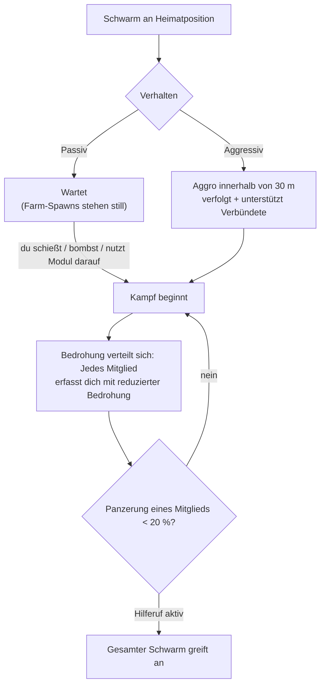

# NPCs & PVE-Jagd

NPCs sind die Hauptquelle des Spiels für [Reaktorplasma](/de/content/ores/),
[Kerne](/de/features/research/) und Module sowie eine verlässliche Methode, um auf jedem Level
Erweiterungspunkte zu verdienen. Sie existieren in **Schwärmen** (Flocks): Gruppen, die sich
eine Heimatposition, ein Revier, eine Respawn-Zeit und ein Verhalten teilen.

## Wer da draußen ist

NPCs gehören vier Völkern an — **Nuimqol, Pelistal, Thelodica und Industrial** —
jedes mit mehreren Roboterklassen (Runner, Crawler, Mechs, schwere Mechs) und
den Rängen 1–5, die bei Werten und Beute nach oben skalieren. Über die regulären Ränge hinaus:

- **Goblins** — EWar-Wächter auf den geschützten Inseln. Fragil, aber ihre
  Zielerfassungs-Modifikatoren sind extrem (sie erfassen dich ~5× schneller als normal, aus
  ~2× größerer Entfernung): Ein Goblin-Lager macht Kämpfen oder Minen in der Nähe zur Qual.
- **Elites** — Seltene Varianten der rangbasierten NPCs mit ungefähr verdoppelten
  Basiswerten und besserer Beute.
- **Beobachter (Observers)** — Umherstreifende, aggressive NPCs (Arbalest, Baphomet, Waspish,
  Tyrannos, Artemis, Kain, Gropho, Sequer, Seth, Mesmer…). Sie patrouillieren über weite
  Teile der Insel und sind deutlich zäher als reguläre NPCs derselben Klasse — *Große*
  Beobachter auf geschützten Inseln und ihre Varianten auf offenen Inseln sind die stärksten
  regulären Jäger überhaupt.
- **Bosse** — Seltene, individuell konfigurierte NPCs. Sie fliehen niemals, können ihr
  Erscheinen serverweit ankündigen und manche sind an Außenposten gekoppelt (ihr Tod
  verschiebt die [Außenposten-Stabilität](/de/features/outposts/)) oder spawnen bei Zerstörung
  Relikt-Risse. Schwächere Bosse sind auf geschützten Inseln solo machbar; die stärksten
  erfordern eine feste Gruppe.
- **Syndikats-Spawns** — Eine spezielle Fraktion (das Syndikat mit seinen eigenen
  benannten NPCs), die eigene statische Farm-Spawns betreibt, meist auf geschützten und
  niedrigstufigen offenen Inseln.

## Passiv vs. aggressiv

- **Passive Schwärme** greifen niemals von sich aus an — du musst zuerst auf sie schießen,
  sie bombardieren oder ein aktives Modul gegen sie einsetzen. Die meisten klassischen statischen
  Farmen sind passiv.
- **Aggressive Schwärme** erzeugen von selbst Aggro, sobald du ihnen auf **30 m** nahe kommst,
  verfolgen dich und unterstützen kämpfende Verbündete. Alle Beobachter, die meisten patrouillierenden
  Spawns sowie Außenposten-Wächter/-Invasoren sind aggressiv.

Beginnt ein Kampf, **verbreitet sich die Bedrohung im Schwarm**: Jedes Mitglied erfasst
dich mit reduzierter Bedrohung, und fällt die Panzerung eines Mitglieds unter **20 %**,
greift die gesamte Gruppe ein (bei Schwärmen mit aktiviertem Hilferuf). Gehe davon aus, dass
du gegen den gesamten Spawn kämpfst, sobald der erste Bot das Feuer eröffnet.

## Spawns und Respawning

- **Statische Spawns** verweilen an einer festen Heimatposition mit festem Revier; Mitglieder
  respawnen **individuell** nach ihrem eigenen Timer. Ein Schwarm, der intensiv abgefarmt wurde,
  respawnt schneller; ein unberührter Spawn respawnt langsamer.
- **Patrouillierende Spawns** wandern über die Insel — dazu gehören die Beobachter und
  Konvoi-Schwärme, und sie sind üblicherweise aggressiv.
- **Verstärkung an Abbaustellen** — Industrielle NPCs, die an einem Ressourcenknoten arbeiten,
  besitzen vorkonfigurierte Verstärkungswellen: Zieht sich der Kampf hin, treffen weitere
  Wellen am Knoten ein. Auch Bosse rufen bei Schaden Verstärkung herbei.
  Ein scheinbarer Kampf gegen einen einzelnen Roboter kann so zu einer Gruppenschlacht werden;
  überprüfe das Gebiet, bevor du angreifst.

## Was sie hinterlassen

Beute wird pro NPC-Typ konfiguriert: **Reaktorplasma des Inselvolks**, **Kerne**
(Gewöhnlich, High-Tech, Industriell und volksspezifisch), Modulkomponenten und seltener
fertig verpackte Module. Höhere Ränge und Spezialtypen lassen mehr fallen.

Jeder Abschuss vergibt zudem **Erweiterungspunkte**, konfiguriert pro NPC-Typ — und
auf offenen (Beta-Tier) Inseln verdoppelt.

## Vorteile der Zonen-Tiers

Inseln unterteilen sich in drei Tiers — geschützt (Alpha), offenes PvE (Beta) und offenes
PvP (Gamma). Die Jagd wird gefährlicher, aber auch lohnender, je tiefer du vordringst:

- **Todesexplosionen** — Auf geschützten Inseln explodiert ein sterbender Roboter *nicht*.
  Auf offenen Inseln (Beta und Gamma) detoniert jeder zerstörte Roboter — ob Spieler oder NPC —
  und verursacht Flächenschaden. Kettenexplosionen beschleunigen das Farmen und machen
  Gank-Punkte tödlicher.
- **Doppelte EP** — Die Basis-EP-Belohnung jeder Aktivität ist auf Beta-Inseln verdoppelt.
- **Bessere Missionen** — Die höheren Missionsstufen liegen auf den offenen Inseln, und
  deren Missions-EP sind ebenfalls verdoppelt.
- **Fraktions-Missionsmünzen** — Missionen auf den offenen Inseln zahlen Missionsmünzen des
  jeweiligen Volkes aus (Nuimqol-/Pelistal-/Thelodica-Münzen) statt der universellen Münze.
  Die Fraktionsmünzen werden auch direkt an Terminals offener Inseln gehandelt, und die universelle
  Münze kann dort gekauft werden, wo Fraktionsmünzen nicht akzeptiert werden.

## Praktische Hinweise

- **Überprüfe den Schwarm vor dem Angriff** — zähle die Mitglieder, achte auf die Ränge
  und darauf, ob der Spawn aggressiv ist; selbst ein passiver Farm-Spawn kann fünf Bots tief sein.
- **Halte Abstand (Outrange)** — Statische Spawns bleiben in ihrem Revier; eine Positionierung
  für freie Schüsse auf maximale Distanz ist meist der günstigste Weg zum Sieg.
- **Ressourcenknoten sind Fallen** — Verstärkungen an Abbaustellen bedeuten: Je länger du
  kämpfst, desto mehr Gegner stehen vor dir.
- **Beobachter in Bewegung** — Wenn du erkundest, Artefakte suchst oder lange Frachtwege fährst,
  bedeutet ein aggressiver Beobachter auf deinem Weg entweder einen Kampf oder einen Umweg.

<!--
Written from scratch against the server backend, 2026-09-27:
Zones/NpcSystem/Flocks/ (Flock.cs, NormalFlock.cs — group respawns, adaptive
respawn multiplier), AI/Behaviors/ (Passive vs Aggressive; threat spread at
50%, call-for-help at 20% armor in SmartCreature.cs), AI/BodyPullThreatHelper.cs
(30 m aggro range, aggressive-only body-pull), Reinforcements/ + npcreinforcements
(mining-site and boss waves at HP thresholds), NpcSpecialType + npcbossinfo
(boss respawn noise, outpost stability links, server-wide announce),
entitydefaults (rank1-5 + dps/interceptor/scout/miniboss/elite variants, 30
elite definitions with ~2x modifiers; 13 def_npc_roaming_* observers; goblin
lancer/shark with 5x lock-time / 2x lock-range modifiers),
npcloot (26k rows: race plasma, common/hitech/industrial/race kernels,
modules), NpcEp.cs + GetNpcKillEp (EP per NPC, x2 on beta),
Unit.DoExplosion (death AoE suppressed on protected zones, active on
beta/gamma; radius from signature, damage from remaining core),
MissionLocation.cs (race-specific mission coins; universal coin on protected
zones), ZoneConfiguration (IsAlpha/IsBeta/IsGamma).
An earlier version of this page was adapted from the Open Perpetuum
community wiki (perpetuum.miraheze.org) and has been fully rewritten from
backend sources; no text was reused.
The ingested "TAP" section was dropped: no teleport-attractor concept exists
in this backend (no definition, code or table).
-->
