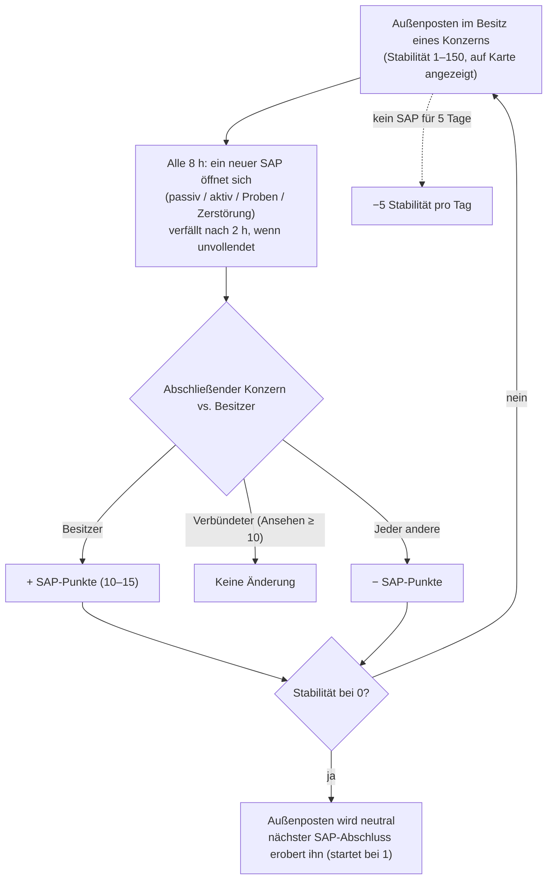

# Außenposten & SAP

Auf den offenen PvP-Inseln können **Außenposten von Spieler-Konzernen besessen werden**.
Die Kontrolle wird durch eine **Stabilitätsanzeige** (0–150) gemessen, die in der Kartenansicht
über dem Außenposten dargestellt wird. Das **SAP-System** (Service Access Point) bestimmt,
wie sich diese Anzeige bewegt — und wie Außenposten den Besitzer wechseln.

## Die Regeln

- Wenn der **besitzende** Konzern einen SAP abschließt, steigt die Stabilität um den Punktwert des SAP **an**.
- Wenn ein **mit dem Besitzer verbündeter Konzern** (beidseitiges Ansehen bei +10 oder höher)
  einen abschließt, **verändert sich die Stabilität nicht**.
- Wenn **irgendjemand sonst** einen abschließt, sinkt die Stabilität um denselben Betrag **ab**.
- Bei **null** verliert der Konzern den Besitz und der Außenposten wird neutral. Das Abschließen
  eines beliebigen SAP an einem neutralen Außenposten **erobert** ihn (der abschließende Konzern
  wird neuer Besitzer mit Stabilität 1).
- **Verfall (Decay)**: Wird für **5 Tage** kein SAP abgeschlossen, verliert der Außenposten
  täglich **5 Stabilität**, bis wieder einer abgeschlossen wird (oder er verloren geht).

## Die vier SAP-Typen

Alle 8 Stunden schaltet ein Außenposten einen neuen SAP frei — einen von vier Typen. Jeder Typ besitzt
einen eigenen Punktwert und eine eigene Abschlussmethode:

| Typ | Durchführung | Punkte | Belohnungsart |
|---|---|---|---|
| **Passiv** | Stehe für **8 Minuten** im Strahl des SAP. Der Fortschritt ist individuell (die eigene ununterbrochene Zeit jedes Spielers im Strahl); der Spieler mit dem höchsten Einzelfortschritt entscheidet den SAP für sich. | +10 | Fraktionsplasma (skaliert mit Stabilität), Forschungskits, EP-Booster. |
| **Aktiv** | Visiere den SAP an und halte ein **SAP-Hackingmodul** aktiv — ca. 120 Modulzyklen (je 5 s), d. h. ~10 Minuten. Fortschritt bleibt beim Abbrechen oder Verlassen erhalten; individuell. | +15 | Plasma, Kerne, Forschungskits und **Reaktorkerne** (Roboterproduktion). |
| **Proben (Specimen)** | Bringe **Proben-Gegenstände** zum SAP (innerhalb von 7 m) und reiche die 5–6 geforderten Exemplare ein. Jede Einreichung hat eine 90-Sekunden-Abklingzeit; individuell. | +15 | Plasma, Kerne, Forschungskits. |
| **Zerstörung** | Schieße ihn ab: **30.000 Panzerung** und **150 Resistenz gegen alle vier Schadensarten** (60 % Reduktion), **6 m Signatur** — kleine Waffen treffen ihn am besten. Schadensfortschritt ist **konzernbasiert, nicht individuell**, sodass ganze Flotten gemeinsam angreifen können; der Konzern mit dem meisten Schaden bei Zerstörung entscheidet das Ergebnis. | ±15 | Fraktions-**PvP-Munition**, Plasma, Kerne. |

Alle vier SAPs **übertragen die aktuelle Bestenliste** (Top 10) an alle Spieler in der Nähe
und **verfallen nach 2 Stunden**, falls sie nicht abgeschlossen werden.

### Dem Feind den Sieg verwehren

Da Zerstörungsfortschritt konzernbasiert ist und das Vorzeichen der Stabilitätsänderung davon abhängt,
wer gewinnt, ist eine verbreitete Taktik, **genug Schaden anzurichten, um die Bestenliste anzuführen,
den SAP jedoch nicht zu beenden**: Schließt die Besatzung des Besitzers ihn anschließend ab,
bleibt dennoch *dein* Konzern der Sieger, und der Stabilitätsabzug trifft den Besitzer.

## Beobachten und Vorhersagen

- Die **Intrusions-Scanladung** in einem Geoscanner, aktiviert nahe dem Außenposten, meldet die
  **Zeit bis zum nächsten SAP** für Außenposten in Reichweite (auf offenen PvP-Inseln meldet
  dieselbe Ladung stattdessen den Status von NPC-Verstärkungen).
- SAPs kündigen sich Spielern in der Nähe kurz vor der Öffnung an.
- Die Übertragung der Bestenliste ermöglicht es dir, **einen umkämpften SAP in Echtzeit zu beobachten**
  und zu entscheiden, ob du eingreifen möchtest.

## Andere Wege, wie sich Stabilität verändert

- **SAP-Relikte** — Relikt-Objekte, die 90–350 m vom Außenposten entfernt spawnen (4-Stunden-Respawn,
  bis zu 12 Stunden Lebensdauer). Das Bergen eines Relikts wendet **sofort ±1 Stabilität an**
  (für deinen Konzern), markiert dich für PvP und belohnt dich mit EP sowie einem Plasma-Container.
- **Wächter und Invasoren** — die NPC-Bosse des Außenpostens:
  - **Wächter-NPCs (Guards)** halten sich nahe am Außenposten auf (~35 m). Das Zerstören eines Wächters
    **senkt die Stabilität immer um 3**, unabhängig davon, wer ihn zerstört; Respawn nach ~6 Stunden.
  - **Invasoren-NPCs (Invaders)** patrouillieren bis zu ~300 m weit. Das Zerstören eines Invasors
    **erhöht die Stabilität um 2** für den tötenden Konzern; Respawn nach ~6 Stunden.

## Warum Außenposten wichtig sind

Der Besitz eines Außenpostens gewährt dem Konzern dessen Boni (Produktion, Verteidigungseinrichtungen,
Effekte) und bildet das Rückgrat des territorialen Spiels im offenen PvP — siehe [PBS](/de/features/pbs/)
für die Strukturen, die einen Außenposten zu einer vollwertigen Operationsbasis machen.

<!--
Written from scratch against the server backend, 2026-09-27:
Zones/Intrusion/Outpost.cs (stability 0-150, capture at 1, ally threshold
+10, EP to participants), OutpostDecay.cs (5-day grace, -5/day), SAP.cs +
PassiveHackingSAP.cs / ActiveHackingSAP.cs / SpecimenProcessingSAP.cs /
DestructionSAP.cs (8-min passive, 120x5s active, 5-6 specimen items with 90s
cooldown, corporate destruction score, 2h expiry, top-10 broadcast),
entitydefaults options (#increase=n10/n15), siegeitems (def_specimen_sap_item
2-3 x 5-6), def_sap_destruction stats (30k armor, 150 res all types, 6m
signature), def_siege_hack_module (5s cycle), intrusionsitestabilitythreshold
+ intrusionsaps, intrusionloot (plasma/kernels/research kits/cores/PvP ammo
by stability tier), npcbossinfo + npcflock (guard -3 @ ~35m, invader +2 @
~300m, 6h respawn), OutpostRelicManager.cs + SAPRelic.cs (90-350m spawn,
4h respawn, 12h lifespan, +1 stability, PvP flag), Scanner.Intrusion.cs
(next-SAP-time scan), EntitiesModule.cs (8h SAP interval).
An earlier version of this page was adapted from the Open Perpetuum
community wiki (perpetuum.miraheze.org) and has been fully rewritten from
backend sources; no text was reused.
Note: the ingested text had several numbers this server contradicts (3-day
decay vs 5-day, 10-min passive vs 8-min, "no resistances" vs 150 all types,
3 km invader range vs 300 m).
-->