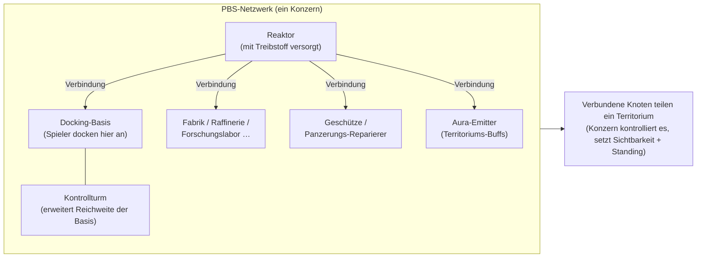
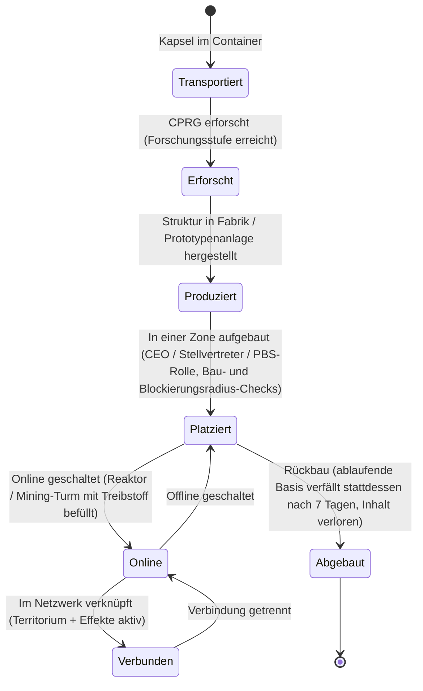

# Power Base Stations (PBS)

Eine **PBS** (Power Base Station) ist eine platzierbare Struktur in einer Zone. PBS-Objekte können zu einem **Netzwerk** **verbunden** werden, das **Territorien** definiert und **Effekte** aktiviert. Dies ist eine Aktivität auf Konzernebene (Corporation) — die meisten Aktionen erfordern die entsprechende Konzernrolle.

> UI-Positionen orientieren sich an der [Client-UI-Übersicht](/de/features/ui/). Die nachfolgenden Mechaniken wurden anhand des Servers verifiziert.

## Funktionen einer PBS

- Sie dient als **Knoten** in einem PBS-**Netzwerk**.
- Verbundene Knoten bilden ein gemeinsames **Territorium**, das der besitzende Konzern kontrolliert.
- Ein Netzwerk kann **Effekte** (Buffs/Kontrollen) über sein Territorium projizieren.
- Einige PBS-Strukturen können mit Gegenständen (Treibstoff) **versorgt** werden, um zu arbeiten.

## Strukturfamilien

Jede PBS-Struktur ist in den Stufen **Klein / Mittel / Groß** (small / medium / large) verfügbar. Man transportiert die **Kapsel**, erforscht den Gegenstand (CPRG) und **platziert** (deployt) das Objekt — das Aufstellen ist rollenbeschränkt (siehe unten). Die Familien:

| Familie | Strukturen | Rolle |
|---|---|---|
| Energie | Reaktor, Energiequelle (energy well), Kernbatterie, Kernüberträger | Erzeugen, speichern und verteilen die **Kernenergie** (Core Energy), die alles antreibt |
| Docking | Docking-Basis, ablaufende Docking-Basis, Kontrollturm | Wo Spieler andocken; der Kontrollturm erweitert die Reichweite der Basis |
| Produktion | Fabrik (mill), Raffinerie, Wiederverwerter (reprocessor), Reparatur, Prototyper, Forschungslabor, Kalibrierungsschmiede (CPRG forge), Forschungsset-Schmiede, Produktionsupgrade | Die [Produktionsanlagen](/de/features/production/), direkt in der Zone statt an einer Heimatbasis |
| Verteidigung | Geschütztürme (Laser / Rail / Rakete / Elektronische Kampfführung), Panzerungs-Reparierer | Automatisierte Verteidigung des Territoriums |
| Effekte | Aura-Emitter, Effekt-Lieferant, Maskierungsturm (maskertower), Mining-Turm | Projizieren die Effekt-Boni des Territoriums; der Mining-Turm baut automatisch Erz ab |
| Transport | Highway-Knoten | Verbindet mit dem **Highway** der Zone (Schnellreiselinen) |
| Konstruktion | Konstruktionsmodul | Das Bauwerkzeug, das die anderen Strukturen errichtet |

### Aura-Emitter-Effekte

Der Aura-Emitter liefert den primären Territoriums-Buff. Jede Größenstufe projiziert einen von drei **stufenspezifischen Basis-Boni**:

- **klein (small)** — Sensoren Stufe 1 / Ingenieurwesen Stufe 1 / Industrie Stufe 1
- **mittel (medium)** — dieselben drei auf Stufe 2
- **groß (large)** — dieselben drei auf Stufe 3

Sensoren erweitern die Scan-/Aufklärungsreichweite, Ingenieurwesen beschleunigt den Bau, Industrie beschleunigt die Produktion.

### Die ablaufende Docking-Basis (Expiring Docking Base)

Eine spezielle PBS-Basis mit einer festen **Lebensdauer von 7 Tagen** (168 Stunden). Sie **kann nicht abgebaut werden** — sie **läuft entweder ab oder wird zerstört**. Die verbleibende Lebensdauer wird im Spiel angekündigt (Basis-Kanalthema, E-Mail und MOTD); nach Ablauf wird die Basis vernichtet und ihr gesamter Inhalt geht verloren. Dies ist das temporäre Nutzungsmodell: Man zahlt keine Miete, erhält jedoch ein festes Zeitfenster.

## Platzierung (Deployment)

- **Platzierung prüfen (Check deployment)** — vor dem Aufstellen prüfen, ob eine PBS an der Position platziert werden kann (Steigung, Hindernisse und Berechtigungsprüfungen). Erfordert eine Konzernrolle (**CEO / Stellvertreter / PBS bearbeiten**).
- Die Platzierung nutzt den **Konstruktionsradius** und den **Blockierungsradius** der Struktur.

## Netzwerk & Verbindungen

- **Netzwerk abrufen (Get network)** — das eigene PBS-Netzwerk einsehen.
- **Knoten-Info (Node info)** — Details zu einem PBS-Knoten.
- **Knoten umbenennen (Rename node)**.
- **Verbindung herstellen (Make connection)** — zwei PBS-Knoten verknüpfen (das Verbinden mit einem Netzwerk, das bereits eine Docking-Basis enthält, löst eine Übergabe des Besitzes aus).
- **Verbindung trennen (Break connection)** — zwei Knoten trennen.
- **Verbindungsgewichtung festlegen (Set connection weight)** — Stärke/Priorität einer Verbindung anpassen.

## Steuerung & Status

- **Online schalten (Set online)** — einen Knoten online/offline schalten.
- **Effekt einstellen (Set effect)** — den vom Knoten projizierten Effekt konfigurieren.
- **Basen-Rückbau einleiten (Set base deconstruction)** — eine Basis für den Abbau markieren.

## Territorium

- **Territorien abrufen (Get territories)** — vom Netzwerk kontrollierte Territorien auflisten.
- **Territoriums-Sichtbarkeit festlegen (Set territory visibility)** — steuern, ob das Territorium für andere sichtbar ist.
- **Standing-Grenze setzen (Set standing limit)** — Zugang basierend auf Ansehen (Standing) einschränken.
- **Verstärkungs-Offset festlegen (Set reinforce offset)** — Verstärkungsverhalten anpassen.

## Versorgung (Feeding)

- **Versorgungs-Info (Feedable info)** — Anforderungen und aktueller Füllstand einer PBS.
- **Gegenstände einspeisen (Feed items)** — Treibstoff zuführen, um die PBS mit Energie zu versorgen.

Zu den versorgbaren Strukturen gehören der **Reaktor** und der **Mining-Turm**. Das Einspeisen wandelt Gegenstände mit einem Energiewert (`corecalories` pro Stück) in den Kernenergiepuffer des Knotens um, bis zu dessen Maximum — jeder Spieler in Reichweite kann einen Knoten versorgen. Verwendbare Treibstoffe:

| Treibstoff | Kernenergie pro Stück |
|---|---|
| Reaktor-Booster Klasse C | 8.000.000 |
| Reaktor-Booster Klasse B | 4.000.000 |
| Reaktor-Booster Klasse A | 2.000.000 |
| SAP-Probe (Intrusion) | 600.000 (Flux-Variante: 28.000) |
| Gamma-Energieblock | 2.000 |
| Core-Booster-Munition | 1.000 |
| Roherz (Espitium) | 400 |
| Roherz (Vitricyl / Prilumium / Chollonin) | 300 |
| Roherz (Axicol) | 40 |

Booster sind der effiziente Treibstoff; Roherz dient als günstige Notlösung.

## Kostenerstattung (Reimburse)

- **Erstattungs-Info abrufen / festlegen (Get / set reimburse info)** — Kostenerstattung für PBS-bezogene Ausgaben konfigurieren.

## Protokolle (Logs)

- **PBS-Protokolle (PBS logs)** — PBS-Aktivitäten überprüfen (Verbindungen, Aufstellungen etc.).

## Praktische Hinweise

- **Aufgabe für Führungskräfte** — Platzierung und die meisten Steuerungsoptionen erfordern entsprechende Konzernrollen.
- **Verbindungen definieren das Territorium** — das aufgebaute Netzwerk entspricht dem kontrollierten Bereich.
- **Platzierung vorher prüfen** — der Check zeigt vorab Gründe für ein Fehlschlagen (Geländeneigung, Blockaden, Rechte).
- **Versorgung sichert den Betrieb** — Reaktoren und Mining-Türme verbrennen Treibstoff (Booster oder Roherz), um ihren Kernpuffer zu halten.
- **Ablaufende Basen haben ein festes Zeitfenster** — 7 Tage, kein Rückbau möglich; das rechtzeitige Räumen einplanen.
- **Sichtbarkeit & Standing** erlauben es, das Territorium für andere Spieler zu öffnen oder zu sperren.

## Verteidigungsgeschütze

Nicht von Spielern steuerbar — werden als PBS-Verteidigungsstrukturen platziert. Geschütze bestehen wie Roboter aus Modulen, sind jedoch fest auf einem PBS-Sockel montiert und können nicht gesteuert werden.

| Geschütz | Rolle |
|---|---|
| PBS-Geschütz | Allgemeine PBS-Verteidigung |
| PBS-EW-Geschütz | Elektronische Kampfführung (Schild-/Panzerungsstörung) |
| PBS-Lasergeschütz | Strahlenwaffen-Verteidigung |
| PBS-Raketengeschütz | Flugkörper-Verteidigung |
| PBS-Rail-Geschütz | Projektil-(EM)-Verteidigung |
| Polizei-Wachturm | NPC-Polizeiverteidigung der Zone |

Details zu den Komponenten finden sich in der [Roboter-Referenz](/content/robots/).
