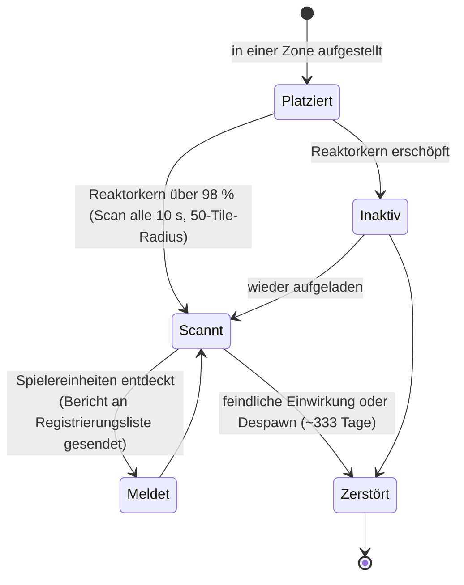

# Näherungssonden

Sonden unterteilen sich in zwei Familien:

- **Sichtbarkeits- (Näherungs-) Sonden** — kleine Geräte, die du in einer Zone platzierst, um ein
  **Gebiet zu überwachen**. Solange sie mit Energie versorgt sind, scannen sie nach Spielereinheiten in der
  Umgebung und senden Berichte an die von dir registrierten Charaktere. Dies ist ein Werkzeug zur Überwachung und Aufklärung.
- **Bergbausonden** — ein in deinen Roboter eingebautes **Modul** (Stufen von *Noob* über
  *Standard*, *Industrial*, *Named*, *Elite* bis hin zu *Artefakt*) plus **erzspezifische Sondenmunition**
  (Tile-/Richtungs-/Gebiets-Varianten für jedes Erz). Das Abfeuern erzeugt ein Scanergebnis für dieses Erz
  in dem Gebiet, das pro Charakter gespeichert wird (siehe [Sammeln → Scannen](/de/features/gathering/)).

> UI-Positionen richten sich nach der [Client-UI-Übersicht](/de/features/ui/). Die folgenden Mechaniken sind anhand
> des Servers bestätigt.

## Verwalten deiner Sonden

- Sonden **auflisten** — sieh nach, welche Sonden du besitzt.
- **Registrierungsinformationen** — der Registrierungsstatus/-info einer Sonde.
- **Registrierung festlegen** — Charaktere an die Berichtsliste der Sonde binden.
- **Einen Namen vergeben** — einer Sonde eine Bezeichnung zuweisen.
- Die Registrierung einer Sonde **entfernen** (in einer Zone) — Überwachung beenden / löschen.

### Wie eine Sichtbarkeitssonde funktioniert

- Sie wird über den **Reaktorkern betrieben**: Sie scannt nur, wenn ihr Kern nahezu voll ist (über 98 % von
  `core_max`); eine leere Sonde bleibt inaktiv.
- Im aktiven Zustand scannt sie **alle 10 Sekunden** nach Spieler-Robotern innerhalb ihres **Erfassungsradius
  (50 Tiles)** und sendet einen Bericht (Charakter-ID und Position jedes Kontakts) an jeden auf der Registrierungsliste.
- **Registrierung** ist eine Konzernaktivität: Du kannst nur **Mitglieder deines eigenen Konzerns** registrieren,
  und **CEO sowie Stellvertreter stehen immer automatisch auf der Liste**. Die Liste hat eine maximale Größe.
- **Lebensdauer**: Eine platzierte Sonde verschwindet nach ihrer inhaltsdefinierten `despawn_time`
  (die Sichtbarkeitssonde ist auf ~333 Tage eingestellt) oder wird zerstört.

## Lebenszyklus-Ereignisse

Der Server meldet Lebenszyklus-Ereignisse von Sonden in Echtzeit:
- **erstellt**, **aktualisiert**, **zerstört** — eine Sonde wird aufgestellt, meldet Kontakte oder wird zerstört.

Diese treffen als Push-Nachrichten ein; du sendest sie nicht selbst, sondern reagierst darauf.

## Praktische Hinweise

- **Erst registrieren, dann lesen** — eine Sonde berichtet nur an ihre registrierten Charaktere.
- **Sonden können zerstört werden** — feindliche Angriffe oder Ablauf der Zeit können eine Sonde vernichten;
  behalte die Lebenszyklus-Ereignisse im Auge.
- **Gib ihnen Namen** — bei mehreren Sonden im Feld bewahren dich Bezeichnungen vor Verwirrung.
- **Aufklärung, kein Kampf** — Sonden sammeln Informationen; sie kämpfen nicht.

<!-- TODO: only the UI remains (probe list, registration picker).
     Confirmed: visibility probe (def_visibility_probe): core_max 50, active only at
     core>98%, 10 s scan interval (ProximityDevice.cs _probingInterval), detection via
     blob_emission 10 / blob_emission_radius 50, report = characterID + x/y per contact
     pushed to registered characters (ProximityProbe.OnUnitsFound); registration =
     own-corp members only, CEO+Deputy always included, max count
     (ProximityProbeRegisterSet.cs); despawn_time 28,800,000 s (~333 d) on the capsule;
     stealth_strength 275 / detection_strength 45. Mining probes: tiered modules
     (noob/standard/industrial1-2/named1-3/elite t2-t4/artifact) + per-ore tile/
     direction/area ammo (79 def_*probe* definitions).
     Developer notes: ProximityProbeList.cs / ProximityProbeGetRegistrationInfo.cs /
     ProximityProbeRegisterSet.cs / ProximityProbeSetName.cs; Zone/ProximityProbeRemove.cs;
     Zones/ProximityProbes/ProximityProbe.cs + ProximityProbeDeployer.cs +
     ProximityDevice.cs; Zones/Blobs/* (blob emission/stealth); lifecycle events via
     ProximityProbeCreated/Update/Dead/Info commands. -->
     Developer notes: ProximityProbeList.cs / ProximityProbeGetRegistrationInfo.cs /
     ProximityProbeRegisterSet.cs / ProximityProbeSetName.cs; Zone/ProximityProbeRemove.cs;
     Zones/ProximityProbes/ProximityProbe.cs + ProximityProbeDeployer.cs; lifecycle
     events via ProximityProbeCreated/Update/Dead/Info commands. -->