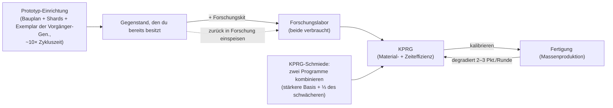

# Produktion

Durch Produktion verwandelst du Rohressourcen und Komponenten in nutzbare Gegenstände. Sie findet in
einer **Produktionseinrichtung** (einer Fertigungsstätte / Mill) an deiner angedockten Basis statt.
Alles hier ist **nur im gedockten Zustand** möglich.

> UI-Positionen richten sich nach der [Client-UI-Übersicht](/de/features/ui/) (die Kategorien **Raffinerie /
> Recycling / Reparatur / Versicherung** in der oberen Leiste). Die folgenden Mechaniken sind anhand des Servers bestätigt.

## Produktionslinien

Eine **Produktionslinie** ist ein gespeicherter Bauplan: Sie definiert, was du herstellst und woraus. Die
vollständige Komponentenliste für jeden herstellbaren Gegenstand (inklusive Forschungsstufen) ist generiert unter
[Baupläne](/de/content/recipes/). Du führst eine Linie für eine bestimmte Anzahl von **Runden** aus.

- **Linien auflisten** — deine verfügbaren Linien einsehen.
- **Eine Linie starten** — sie in einer Einrichtung für eine gewählte Anzahl von Runden (mindestens 1) ausführen.
  - Du kannst aus deinem **persönlichen Guthaben** oder dem **Konzern-Guthaben** bezahlen.
  - Ausgangskomponenten können aus deinem **Inventar** oder deinen **Robotern** bezogen werden.
- **Eine Linie kalibrieren** — die Einstellungen einer Linie anpassen.
- **Rundenanzahl festlegen** — wählen, wie viele Runden produziert werden sollen.
- **Nächste Runde abfragen** — Vorschau anzeigen, was die nächste Runde verbrauchen und produzieren wird.
- **Abbrechen** — eine laufende Produktion stoppen.
- **Eine Linie löschen** — eine gespeicherte Linie entfernen.

Das Ausführen einer Linie verbraucht Komponenten (und Credits) und stellt über die Runden den Zielgegenstand her.

## Einmal-Operationen

Dies sind einzelne Aktionen statt mehrrundiger Linien. Jede verfügt über eine **Vorschau-Funktion (Query)**,
um Kosten und Ertrag vorab zu prüfen.

- **Raffinieren** — Rohstoffe → Handelsware, gemäß dem Rezept des Gegenstands (siehe [Baupläne](/de/content/recipes/)).
  Du wählst, wie viele Einheiten des Zielgegenstands hergestellt werden sollen; die nominalen Eingaben des Rezepts
  werden durch einen Materialmultiplikator von `1 + 50/(Bonus + 100)` skaliert, wobei *Bonus* deine Raffinierungs-Fähigkeit
  ist (Erweiterungen + Einrichtungspunkte + Ansehenspunkte). Ohne Bonus verbrauchst du **150 %** des nominalen
  Rezepts; mit Maximalbonus sinkt der Verbrauch in Richtung **100 %**.
- **Recyceln / Wiederaufbereiten** — zerlegt einen Gegenstand wieder in seine Rezeptkomponenten (das umgekehrte
  Rezept). Die Ausbeute beträgt `nominal × (1 − 75/(Bonus + 100)) × Haltbarkeitsanteil des Gegenstands` —
  ohne Fähigkeitenbonus sind das standardmäßig **25 %**, ansteigend in Richtung 100 %, und ein **beschädigter Gegenstand
  wirft proportional weniger ab** (repariere wertvolle Gegenstände vorher). Nur vollständige „Chargen“
  (volle Standardmengen) werden recycelt; der Rest verbleibt. Missionsgegenstände werden gelöscht, nicht recycelt.
- **Reparieren** — stellt den vollen Zustand eines beschädigten Gegenstands/Roboters wieder her. Der Preis beträgt
  `(fehlende Haltbarkeit %) × Materialwert des Gegenstands × 75/(Bonus + 100)`. Der „Materialwert“ wird rekursiv berechnet:
  Das Rezept des Gegenstands wird bis zu den Rohstoffen aufgeschlüsselt und mit den **Weltmarktdurchschnitten** bewertet;
  Reparaturkosten passen sich somit dem Markt an. Der Fähigkeitenmultiplikator beginnt bei **75 %** ohne Bonus
  und tendiert gegen 0 bei maximalem Bonus.
- **Forschungskomponenten** — Forschungskomponenten herstellen (Vorschau + Ausführen).

## Der Lebenszyklus von Gegenständen (der Kreislaufprozess)

Die Gegenstandserstellung ist ein Kreislauf aus drei miteinander verknüpften Einrichtungen:

1. **Forschung (Reverse Engineering)** — führe ein Exemplar des gewünschten Gegenstands zusammen mit einem
   **Forschungskit**, dessen Stufe der Forschungsstufe des Gegenstands entspricht (Kits gibt es von Stufe 0 bis 10),
   in das Forschungslabor ein. Beide Eingaben werden **verbraucht**, und der Auftrag bringt ein **KPRG** (Kalibrierungsprogramm)
   für diesen Gegenstand hervor. Die Effizienzwerte des resultierenden Programms starten beim gegenstandsspezifischen Basiswert
   (die meisten Gegenstände 50, Munition höher, Geschütztürme bis zu 90) und steigen um *Kit-Stufe über der erforderlichen Stufe × 5*
   plus deinen Forschungs-Fähigkeitenbonus (bis zu +50 zusätzlich). Ein Kit, das einige Stufen über dem Gegenstand liegt —
   zusammen mit soliden Produktionserweiterungen — verwandelt ein frisches 50/50-Programm in ein konkurrenzfähiges Werkzeug.
   So gelangen neue Gegenstände in dein Produktionsrepertoire.
2. **Die Fertigung (Massenproduktion)** — Massenproduktion anhand des Programms. Jede Runde **degradiert**
   die Effizienz der Linie (2–3 Punkte pro Runde je Gegenstandskategorie; siehe [KPRG](#kprg-kalibrierungsprogramme)) —
   wenn der Ausschuss zu groß wird, kalibriere ein frisches Programm auf die Linie. Prototyp-Gegenstände erfordern zudem
   ein **Exemplar der Vorgängergeneration** als Komponente (ein Standardmodul für einen T2-Prototyp, ein T2 für ein T3),
   welches beim Vorgang verbraucht wird.
3. **Die Prototyp-Einrichtung** — stellt einen **Prototyp** eines Gegenstands direkt her: Die Materialien des Rezepts
   plus Roboter-Fragmente (Shards) *und* das Exemplar der vorherigen Generation, bei ungefähr der **10-fachen Zykluszeit
   der Fertigung** (plus üblicher Zeitmultiplikator). Du kannst nur Gegenstände als Prototyp bauen, die in deinem
   Technologiebaum freigeschaltet sind. Prototypen kosten drastisch mehr als ihre Standard-Äquivalente; ihr Hauptzweck
   besteht darin, **zu hochwertigen Programmen erforscht zu werden** (das Erforschen eines Prototyps schaltet die nächste Stufe frei) —
   oder auf dem Roboter eingesetzt zu werden, wenn der Gegenstand zu selten als Beute fällt und auf dem Markt zu teuer ist.

## Stufenfortschritt (Tier-Progression)

Die meisten Module und Roboter existieren in den **Stufen T1 → T4** (die Stufen-Plakette im Client; die Definitionsreihen
`standard → named1 → named2 → named3`, gefolgt von den Sonderreihen `elitet4`/`artifact`). Die Regeln:

- **Jede Stufe ist ein eigener Gegenstand mit eigenem Knoten im Technologiebaum.** Das Freischalten eines Knotens
  kostet Forschungspunkte (erforscht aus Kernen) und erfordert den **übergeordneten Knoten** — Stufen müssen also
  der Reihe nach freigeschaltet werden. Du kannst einen Gegenstand nur dann als **Prototyp** (oder in Massenproduktion)
  herstellen, wenn sein Knoten bereits freigeschaltet ist: Es gibt keinen Weg zu einer höheren Stufe ohne die Forschung.
- **Jede höhere Stufe verbraucht ein Exemplar der vorherigen Stufe** als Komponente (plus Materialien und Roboter-Fragmente).
  Ein T1-Gegenstand kann daher niemals direkt zu einem T3 „aufgewertet“ werden — der T3-Prototyp benötigt ein **T2**-Exemplar,
  und dieses Exemplar wird **verbraucht**, nicht umgewandelt: Das Ergebnis ist ein vollkommen neuer Gegenstand.
- Jede Gegenstandsseite zeigt ihre **Stufenreihe** — die gesamte Kette `T1 → T2 → T3 → T4` als Verlinkungen — und die
  [Technologiebaum-Knotenseiten](/de/content/techtree/) zeigen den Eltern-/Folgeknoten sowie die Punktekosten jeder Stufe.

Beispiel am kleinen Bergbaumodul: [standard small miner (T1)](/content/items/standard-small-driller/) →
[Biroter 5050 small miner module (T2)](/content/items/named1-small-driller/) →
[Sublimator Low-D small miner module (T3)](/content/items/named2-small-driller/) →
[Scraper-990 small miner module (T4)](/content/items/named3-small-driller/) —
und dasselbe Muster für jede Modul- und Roboterfamilie.

## Prototypen & Forschungskits

- **Prototyp** — einen Prototyp-Gegenstand herstellen (Start + Vorschau). Ein Prototyp pro Slot;
  mehr parallele Prototyp-Aufträge erhältst du über Produktionserweiterungen.
- **Forschungskits zusammenführen** — mehrere Forschungskits zu einem höherwertigen Kit kombinieren
  (Ausführen + Vorschau). Ein höheres Kit verkürzt die Forschungszeit und steigert die Effizienzwerte des Programms.

## KPRG (Kalibrierungsprogramme)

Ein **KPRG** (Kalibrierungsprogramm / CPRG) ist die Grundlage, auf der eine Fertigungslinie arbeitet — ein gegenstandsspezifisches
Programm mit **Materialeffizienz-** und **Zeiteffizienzpunkten** (jeweils 0–100). Du erhältst eines durch das
**Erforschen des Gegenstands** im Forschungslabor (die Forschungsstufe regelt, welche Gegenstände du überhaupt
herstellen kannst) oder durch das Aktivieren einer **Kalibrierungskapsel**.

- Ein frisch erforschtes KPRG startet bei **50/50** Punkten.
- **KPRGs schmieden** in der Kalibrierungsprogramm-Schmiede: Kombiniere zwei KPRGs desselben Gegenstands;
  das Resultat übernimmt die Punkte des stärkeren Programms als Basis und addiert ein Drittel des schwächeren Programms.
  Das Schmieden benötigt Zeit und kostet Credits (Zeit × Preis der Einrichtung pro Sekunde).
- **Eine Linie kalibrieren** mit einem KPRG, um ihre Effizienzwerte festzulegen. Jede Produktionsrunde
  **degradiert** die Effizienz der Linie (ein gegenstandsspezifischer Dekalibrierungswert), sodass Linien mit der Zeit
  schlechter werden — berechne sie vor langen Durchläufen neu.

Die Effizienzwerte fließen in die Formeln der Fertigung ein (pro Produktionszyklus):

- **Verbrauchte Materialien** = Rezept × `1 + 50/(Materialpunkte + Fähigkeit + 100 + Fertigungsbonus)`
  — ein neues 50-Punkte-KPRG ohne Fähigkeiten und ohne Massenproduktionsbonus aus dem Technologiebaum verbraucht
  ≈ **133 %** des nominalen Rezepts.
- **Produktionszeit** = Basiszeit der Einrichtung (3.600 s pro Zyklus bei einer Fertigungsstätte) ×
  `1 + 100/(Zeitpunkte + Fähigkeit + 100)` × Dauermodifikator des Gegenstands — ein neues KPRG ohne Fähigkeiten
  benötigt ≈ **1 Stunde 40 Minuten** pro Gegenstand.
- **Preis** = Produktionszeit × Preis der Einrichtung pro Sekunde (7 Credits/s für die PBS-Fertigungsstätte,
  3 für große/mittlere PBS-Forschungslabore) × Preismodifikator des Gegenstands (1–10).
- Missionsbezogene KPRGs sind kostenlos und auf 10 Sekunden fixiert.

## Versicherung

Die Versicherungseinrichtung versichert **deine Roboter**, nicht deine Produktionsausbeute:

- Eine Police für einen Roboter **kaufen** (er muss unbeschädigt, unverpackt und kein Starter-Bot sein),
  deine Policen **auflisten**, eine Police **abfragen**, eine Police **löschen**.
- Der Versicherungsschutz gilt für **15 Tage** (+ Erweiterungs-Bonustage); du kannst Policen für
  1 + (Erweiterungsbonus) Roboter halten.
- Jeder Roboter hat eine inhaltsdefinierte **Gebühr** und **Auszahlung** (die Tabelle `insuranceprices`,
  67 Roboterdefinitionen); die Gebühr wird durch einen Gebührenerweiterungs-Bonus rabattiert und kann aus
  dem Konzern-Geldbeutel bezahlt werden.
- Wird der versicherte Roboter zerstört, erfolgt die **Auszahlung in Credits** (der Roboter bleibt
  dennoch verloren) — siehe [Kampf](/de/features/combat/).

## Einrichtung & Status

- **Einrichtungs-Info / Beschreibung** — was eine Produktionseinrichtung anbietet.
- **In Arbeit (Meine / Konzern)** — was aktuell produziert wird.
- **Produktionsverlauf** — deine vergangenen Produktionsläufe.
- **Komponentenliste** — verfügbare Produktionskomponenten.
- **Server-Info** — Status des Produktionsservers.

## Praktische Hinweise

- **Du musst an einer Basis mit Produktionseinrichtung angedockt sein.**
- **Vorschau vor dem Start** — die Vorschau-Funktionen zeigen Kosten und Ertrag, damit du keine Komponenten
  durch Irrtümer verschwendest.
- **Konzern-Geldbeutel** — du kannst Konzerngelder für die Produktion nutzen, sofern berechtigt.
- **Komponenten stammen auch aus Robotern** — eine Linie kann Ausgangsmaterialien aus deinen ausgerüsteten
  Robotern heranziehen, nicht nur aus dem Inventar.
- **Nur bei voller Gesundheit recyceln** — ein beschädigter Gegenstand liefert weniger; repariere teure
  Gegenstände vor dem Wiederaufbereiten.
- **Fähigkeitenmultiplikatoren steuern die Wirtschaft** — die Boni für Raffinieren/Recyceln/Reparieren/Fertigung
  skalieren alle auf dieselbe Weise; Investitionen in Produktionserweiterungen amortisieren sich durch Materialersparnis
  bei jedem Durchlauf.
- **Versicherung ist das Sicherheitsnetz für Roboter** — schließe sie für teure Ausrüstungen vor PvP-Einsätzen im Tiefraum ab.
- **Forschungskits sind die Eingangsschwelle** — die Forschungsstufe eines Gegenstands (1–9) entscheidet,
  welche Kits ihn decodieren können; ein Kit mehrere Stufen über dem Gegenstand einzusetzen ist der
  günstigste Weg zu hohen Effizienzwerten im Programm.

<!--
Developer notes: rewritten 2026 from backend sources; no community-wiki text reused.
Verified against:
- refine = 1 output per unit, input = nominal x (1+50/(bonus+100)) (Refinery.cs);
- recycle = reverse recipe x (1-75/(bonus+100)) x healthRatio, whole batches only,
  mission items deleted (ReprocessSessionMember.cs);
- repair price = (1-healthRatio) x PriceCalculator world-market value x
  75/(bonus+100) (Repair.cs + PriceCalculator.cs);
- ResearchLab.cs (StartResearch/EndResearch: source item + research kit both
  consumed; kit level must be >= itemresearchlevels.researchlevel (1-9);
  efficiency = per-item base + levelDifference*5 + (1-100/(100+skill))*50);
- itemresearchlevels (1101 rows, levels 1-9), research kits def_research_kit_0..10
  (#level option), RandomResearchKit (mission kits, fake 100/100);
- calibrationdefaults (per-CPRG base efficiencies 50-90; default fallback 50/50;
  CalibrationProgram.OnInsertToDb sets 50/50);
- PBSFacilities.cs CalculateResultingPoints (forge = better base + weak/3 +
  (1-100/(100+skill))*25);
- productiondecalibration (2-3 points decrease per round per category,
  distorsion 0.5-1%);
- Prototyper.cs (StartPrototype: components include previous-gen specimen via the
  components table — e.g. T2 NEXUS consumes 1x standard module, T3 consumes 1x T2;
  time = 10x cycle x multiplier; tech-tree unlock check in
  ProductionPrototypeStart.cs);
- prototypes table (339 rows, standard->prototype mapping);
- Mill.cs (CalculateFinalMaterialMultiplier 1+50/(pts+skill+100+millBonus) with
  tech-tree mass-production bonus; CalculateFinalTimeMultiplier;
  productionduration table);
- Insurance: InsuraceFacility.cs (15d + time-extension bonus, 1+slot-extension
  policies, noob bot excluded, must be single+unpacked), InsuranceDescription.cs
  (payout in credits via central bank), insuranceprices (67 robot definitions,
  payout = 80x fee except noob/arkhe2 at 4x).
- Facility options (entitydefaults): def_pbs_facility_mill #perSecondPrice=7
  #productionTime=3600; refinery #materialEfficiency=0.95;
  calibration_program_forge #perSecondPrice=7; def_production_public_factory
  #materialEfficiency=0.6 #manufactureTime=3600 #perSecondPrice=3.
Developer files: Production/ProductionLineStart.cs (PrepareProductionForPublicContainer,
LineStartInMill, corp wallet, search-in-robots, rounds); Production/ProductionLine*.cs;
Production/ProductionRefine*.cs, ProductionReprocess*.cs, ProductionRepair*.cs,
ProductionResearch*.cs (query+run pairs); Production/ProductionPrototype*.cs,
ProductionMergeResearchKitsMulti*.cs; Production/ProductionCPRG*.cs,
ProductionGetCPRGFromLine*.cs; Production/ProductionInsurance*.cs;
Production/ProductionFacility*.cs, ProductionInProgress*.cs, ProductionHistory.cs;
Services/ProductionEngine/Facilities/*.cs; Services/ProductionEngine/PBSFacilities.cs;
Services/ProductionEngine/ResearchKits/*.cs; Services/ProductionEngine/CalibrationPrograms/*;
Services/Insurance/InsuranceHelper.cs; Items/PriceCalculator.cs.
Corrections vs ingested page: no "decoder" item exists (research kits are the
level-gated inputs); the "researched to 100%" claim is wrong (tech-tree unlock is
the gate; research levels run 1-9); prototype time is 10x the mill cycle; specimen
consumption verified from the components table; insurance payout is 80x the fee.
-->
