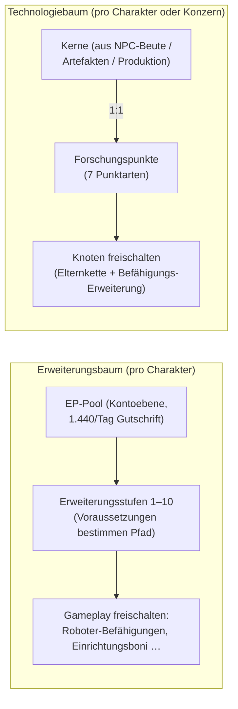

# Forschung

Es gibt **zwei getrennte Fortschrittssysteme**. Beide sind nur im gedockten Zustand zugänglich.

> UI-Positionen richten sich nach der [Client-UI-Übersicht](/de/features/ui/) (Charakterfenster → Erweiterungen;
> der Technologiebaum hat ein eigenes Fenster). Die folgenden Mechaniken sind anhand des Servers bestätigt.

## Der Erweiterungsbaum (Charakterfähigkeiten)

Erweiterungen (Extensions) sind charaktergebundene Fähigkeitenstufen, die Gameplay-Möglichkeiten eröffnen —
allen voran die **Befähigungs-Erweiterungen**, mit denen du eine Roboterklasse steuern kannst
(erforderlich zum Abdocken und Auswählen eines Roboters; siehe [Bewegung](/de/features/movement/) und [Roboter](/de/features/robots/)).

### Wie das Erlernen funktioniert

- Du musst **gedockt** sein, um Fähigkeiten zu lernen.
- Jede Erweiterung kann bis auf **Stufe 1–10** gesteigert werden (Stufe 10 ist das Maximum).
- **Stufe 1 kostet Credits** (den `price` der Erweiterung), bezahlt aus deinem Geldbeutel.
- **Jede weitere Stufe kostet Erweiterungspunkte (EP)** gemäß einer festen Rang-×-Stufe-Tabelle —
  für die Stufen 1–5 betragen die Kosten `60 × Rang × Stufe`; die Stufen 6–10 springen auf
  `Rang × (1440, 2520, 3840, 5400, 12000)`. Die zehn Stufen einer Rang-1-Erweiterung kosten
  60 → 6.000 EP (insgesamt 13.500 EP); eine Rang-10-Erweiterung kostet auf jeder Stufe das Zehnfache.
- **Voraussetzungen** müssen bereits erlernt sein, bevor du eine Erweiterung wählen kannst (die Liste der Voraussetzungen).
- EP ist ein **kontoweiter Pool**: Er wird zwischen deinen Charakteren geteilt und über Zeit angesammelt (siehe „EP-Quellen“ unten).

### Erweiterungen verwalten

- **Kategorieliste / Alle abrufen / Gelernte Liste / Voraussetzungen** — durchsuche den Baum und sieh, was du bereits besitzt.
- **Verfügbare Punkte** — deinen aktuellen EP-Pool einsehen.
- **Eine Stufe entfernen** — eine einzelne Stufe einer Erweiterung zurücknehmen.
- **Charakter-Erweiterungen zurücksetzen** — den gesamten Baum eines Charakters zurücksetzen.
- **Gesperrte EP freigeben** — EP freisetzen, die gesperrt sind (z. B. nach dem Entfernen von Stufen).
- **Einen EP-Boost kaufen** — ein bezahlter Beschleuniger, der den EP-Gewinn erhöht.
- **Tägliches Protokoll für Aktivitäten-EP** — überprüfen, wie viel EP du durch das Spielen verdient hast.

### EP-Quellen

EP ist keine kaufbare Verbrauchs-Währung — es sammelt sich in einem **täglichen Durchlauf** an:

- Jedes Konto erhält **1.440 EP pro Tag** (einmal täglich zwischen 08:00 und 11:00 Serverzeit durch die
  Prozedur `extensionPointsAdd` gutgeschrieben). Der Code definiert auch eine verdoppelte Gutschrift von
  **2.880 EP** für Abonnenten-Konten, doch die aktuelle Prozedur gewährt allen Konten die Basisgutschrift.
- **Gekaufte Boosts** (EP-Boost-Käufe) kommen obendrauf.
- Deine **verfügbaren EP** = alle erhaltenen Tagesgutschriften − Strafen − im Spiel ausgegebene EP.
  (Das Aktivitäts-EP-Protokoll schlüsselt die täglichen Einnahmen auf.)

**Vollständiger Katalog** — jede Erweiterung (Rang, Stufe-1-Preis, Bonus, Voraussetzungen) steht unter
[Erweiterungen](/de/content/extensions/), und jeder Knoten des Technologiebaums (freigeschalteter Gegenstand,
Befähigungs-Erweiterung, Punktekosten) steht unter [Technologiebaum](/de/content/techtree/).

## Der Technologiebaum (Freischaltungen)

Der Technologiebaum ist ein Graph aus **Knoten**, die du durch das Ausgeben von **Forschungspunkten**
freischaltest. Anders als EP (Konto-Pool) werden Technologiebaum-Punkte **durch das Verbrauchen von „Kernen“
(Kernels) erworben** — Gegenstände, die du erforschst und anschließend einreichst.

### Wie es funktioniert

- **Kerne erforschen** — reiche Kern-Gegenstände aus einem Container ein. Jeder Kern wandelt sich
  **1:1** in Forschungspunkte der entsprechenden **Punktart** um; die Kerne werden dabei verbraucht.
  Es gibt sieben Kern-Typen, einen pro Punktart: Theodica, Pelistal, Nüimqol, Industrial, Common, HiTech und NewTech.
- **Einen Knoten freischalten** — gib die erforderlichen Forschungspunkte aus. Ein Knoten kann nur freigeschaltet werden, wenn:
  - alle seine **Elternknoten** bereits freigeschaltet sind, und
  - du die **Befähigungs-Erweiterung** des Knotens auf deinem Charakter erlernt hast.
- **Konzern-Freischaltungen** — mit der entsprechenden Konzernrolle kann ein Knoten **für den Konzern**
  freigeschaltet werden (geteilt). Konzern-Freischaltungen kosten mehr (ein Konzern-Preismultiplikator greift)
  und werden aus den Punkten des Konzerns bezahlt.
- **Spenden** — Forschungspunkte spenden (z. B. an deinen Konzern).
- **Info / Protokolle** — Knotendetails sowie deine Freischaltungs-/Forschungshistorie einsehen.

### Warum es wichtig ist

Freigeschaltete Knoten im Technologiebaum gewähren Zugang zu höherwertigen Inhalten und Features.
Überprüfe die Voraussetzungen eines Knotens (Elternkette + Befähigungs-Erweiterung), bevor du Punkte ausgibst.

## Praktische Hinweise

- **Befähigungs-Erweiterungen sperren Roboter** — du kannst keine Roboterklasse steuern, die du nicht erforscht hast
  (dies ist dieselbe Prüfung, die das Abdocken und Auswählen blockiert).
- **Stufe 1 ist der einzige Credit-Kostenpunkt** im Erweiterungsbaum; darüber hinaus kostet alles ausschließlich EP.
- **Der Technologiebaum ist irreversibel** — für eine Freischaltung ausgegebene Punkte sind unwiederbringlich verbraucht;
  plane deinen Pfad sorgfältig.
- **Konzern-Technologie ist Teamarbeit** — sie nutzt geteilte Punkte und erfordert einen Preismultiplikator.

<!-- TODO: only the research UI remains (window layout, point display).
     Confirmed: EP earn = 1440/day flat via dbo.extensionPointsAdd (08:00-11:00 window,
     once per day; 2880 bonus constant exists in GiveExtensionPointsService for paid
     subscriptions but the current SP pays base to all); available = batches -
     penalties - spent (extensionPointsAvailable fn); EP cost table in
     Services/ExtensionService/ExtensionPoints.cs (60*rank*level for levels 1-5, then
     rank*(1440,2520,3840,5400,12000)); kernels convert 1:1 (TechTreeResearch.cs), 7
     kernel definitions -> point types n1..n7 (Theodica/Pelistal/Nuimqol/Industrial/
     Common/HiTech/NewTech).
     Developer notes: Extensions/ExtensionBuyForPoints.cs (docked, prereq, level cap 10,
     level-1 credit price, EP by rank/level, account pool, training-char free);
     Extensions/ExtensionGetAvailablePoints.cs; Extensions/ExtensionBuyEpBoost.cs,
     ExtensionFreeLockedEp.cs, ExtensionRemoveLevel.cs, ExtensionResetCharacter.cs;
     EpForActivityDailyLog.cs; TechTree/TechTreeResearch.cs (kernels → points);
     TechTree/TechTreeUnlock.cs (parent chain + enabler extension, corp multiplier);
     TechTree/TechTreeDonate.cs; Services/ExtensionService/GiveExtensionPointsService.cs;
     Services/ExtensionService/ExtensionPoints.cs. -->
     Developer notes: Extensions/ExtensionBuyForPoints.cs (docked, prereq, level cap 10,
     level-1 credit price, EP by rank/level, account pool, training-char free);
     Extensions/ExtensionGetAvailablePoints.cs; Extensions/ExtensionBuyEpBoost.cs,
     ExtensionFreeLockedEp.cs, ExtensionRemoveLevel.cs, ExtensionResetCharacter.cs;
     EpForActivityDailyLog.cs; TechTree/TechTreeResearch.cs (kernels → points);
     TechTree/TechTreeUnlock.cs (parent chain + enabler extension, corp multiplier);
     TechTree/TechTreeDonate.cs. -->
