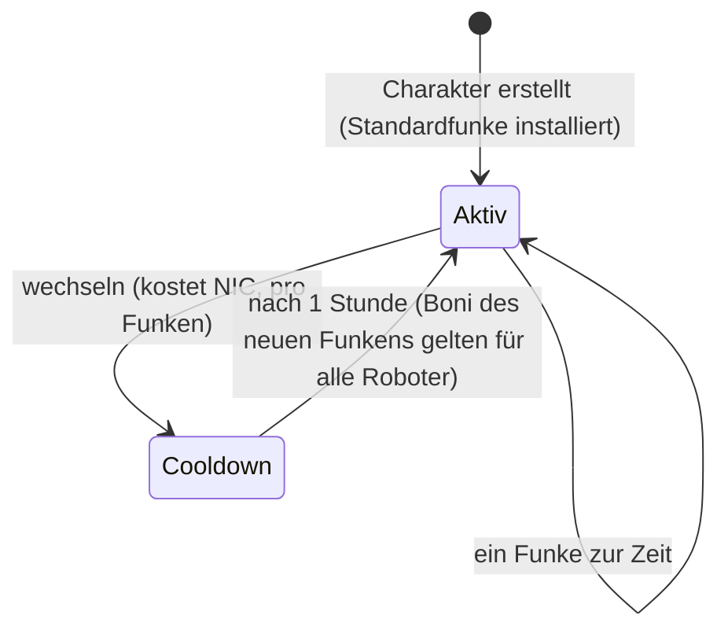

# Funken

Ein **Funke** ist eine Nanobot-Spezialisierung, die auf deinem Charakter installiert
ist. Während er aktiv ist, gelten seine Boni für jeden Roboter, den du pilotierst —
der Funke der Kampf-Linie einer Fraktion erhöht z. B. pro Stufe den Waffenschaden und
das Krit-Chance-Niveau, während eine industrielle Linie Kernkapazität und
Abbaueträge erhöht.

Jeder Charakter hat einen **Standardfunken**, der bei der Erstellung vergeben wird.
Darüber hinaus gibt es Funkenfamilien — die basischen Standard-Linien, die
Fraktions-Kampf-/Industrie-/Sozial-Linien (je drei Stufen), die bezahlten
Syndicate-Linien und die besonderen Limitierten — und die exakten Boni eines Funkens
sind einfach ein Bündel fester Skill-Level, die du auf der
[Erweiterungsseite](/content/extensions/) sehen kannst. Die [Familienübersicht
unten](#funkenfamilien) springt direkt zu den Funken jeder Familie.

## Einen Funken freischalten (autorisieren)

Die Installation eines Funkens, den du noch nicht besitzt, erfordert zuerst die
**Freischaltung** (nur gedockt). Je nach Funke prüft der Server:

- einen **Preis** in NIC (die bezahlten Linien — z. B. die Syndicate-Nutzfunken und
  die limitierten Spezialfunken),
- **Standing** bei der Entwickler-Megakorporation (die Fraktions-Linien brauchen ein
  minimales Standing bei der Megacorp dieser Fraktion, aufgebaut durch das
  Abschließen ihrer [Missions](/de/features/missions/)),
- oder ein **Item** aus deinem Inventar (manche Spezialfunken werden mit einem
  Schlüssel-Item freigeschaltet).

Die Freischaltung ist einmalig: einmal freigeschaltet, bleibt der Funke in deiner
Sammlung.

## Funken wechseln

- Du kannst nur **einen aktiven Funken** zur Zeit haben; die Installation eines
  anderen tauscht ihn aus.
- Jeder Wechsel **kostet NIC** — der Betrag ist pro Funken (die gebräuchlichen
  Linien kosten 10k, die bezahlten Speziallinien bis zu einer Million).
- Zwischen Wechseln gilt eine **stündliche Abklingzeit**: Der Server verfolgt, wann
  dein aktueller Funke aktiviert wurde, und verweigert einen neuen, bis die Minute
  um ist.

Weil Wechsel immer NIC kosten und eine Stunde dauern, wähle den Funken, der zur
Aktivität passt, mit der du die meiste Zeit verbringst, und behandle
Neu-Spezialisierung als gelegentliche Entscheidung statt als pro Session.
<!-- sparkfamilies:generated -->

## Funkenfamilien

Die 47 Funken in 6 Familien auf einen Blick: ein Kasten pro Familie (Anzahl der
Funken, wie die Linie freigeschaltet wird), in der Reihenfolge, in der die Linien
hinzugefügt wurden (von links nach rechts, von oben nach unten). **Klicke auf einen
Kasten, um zu den Funken dieser Familie unten zu springen.** **Scrolle über das
Diagramm, um zu zoomen**, ziehe zum Verschieben und nutze den ⟲-Knopf zum Zurücksetzen.

<button type="button" class="zoommap-reset" title="Zoom zurücksetzen">⟲</button>
<svg class="zoommap" xmlns="http://www.w3.org/2000/svg" viewBox="0 0 1008 278" width="960" height="264" role="img" aria-label="Funkenfamilien: 6 Familien, 47 Funken; klicke eine Familie an, um zu ihren Funken unten zu springen">
  <rect x="0" y="0" width="1008" height="278" fill="#10151f" stroke="#39445a" stroke-width="1"/>
  <g><title>Event &amp; speziell: 9 Funken, wird kostenlos freigeschaltet</title><a href="#family-special"><rect x="24" y="40" width="300" height="84" rx="10" fill="#10151f" stroke="#c8d2e0" stroke-width="1.5"/><text x="174" y="68" text-anchor="middle" fill="#e8eefc" font-size="15" font-weight="700">Event &amp; speziell</text><text x="174" y="92" text-anchor="middle" fill="#c8d2e0" font-size="12">9 Funken · gratis</text></a></g>
  <g><title>TM (Truhold-Markson): 9 Funken, wird mit TM-Standing freigeschaltet</title><a href="#family-tm"><rect x="354" y="40" width="300" height="84" rx="10" fill="#10151f" stroke="#41d3ff" stroke-width="1.5"/><text x="504" y="68" text-anchor="middle" fill="#e8eefc" font-size="15" font-weight="700">TM (Truhold-Markson)</text><text x="504" y="92" text-anchor="middle" fill="#41d3ff" font-size="12">9 Funken · TM-Standing</text></a></g>
  <g><title>ICS: 9 Funken, wird mit ICS-Standing freigeschaltet</title><a href="#family-ics"><rect x="684" y="40" width="300" height="84" rx="10" fill="#10151f" stroke="#6ee7a0" stroke-width="1.5"/><text x="834" y="68" text-anchor="middle" fill="#e8eefc" font-size="15" font-weight="700">ICS</text><text x="834" y="92" text-anchor="middle" fill="#6ee7a0" font-size="12">9 Funken · ICS-Standing</text></a></g>
  <g><title>ASI: 9 Funken, wird mit ASI-Standing freigeschaltet</title><a href="#family-asi"><rect x="24" y="154" width="300" height="84" rx="10" fill="#10151f" stroke="#f5a05a" stroke-width="1.5"/><text x="174" y="182" text-anchor="middle" fill="#e8eefc" font-size="15" font-weight="700">ASI</text><text x="174" y="206" text-anchor="middle" fill="#f5a05a" font-size="12">9 Funken · ASI-Standing</text></a></g>
  <g><title>Syndicate (NIC): 5 Funken, wird mit NIC-Preis freigeschaltet</title><a href="#family-syndicate"><rect x="354" y="154" width="300" height="84" rx="10" fill="#10151f" stroke="#a78bfa" stroke-width="1.5"/><text x="504" y="182" text-anchor="middle" fill="#e8eefc" font-size="15" font-weight="700">Syndicate (NIC)</text><text x="504" y="206" text-anchor="middle" fill="#a78bfa" font-size="12">5 Funken · NIC-Preis</text></a></g>
  <g><title>Limited: 6 Funken, wird mit NIC-Preis freigeschaltet</title><a href="#family-limited"><rect x="684" y="154" width="300" height="84" rx="10" fill="#10151f" stroke="#f472b6" stroke-width="1.5"/><text x="834" y="182" text-anchor="middle" fill="#e8eefc" font-size="15" font-weight="700">Limited</text><text x="834" y="206" text-anchor="middle" fill="#f472b6" font-size="12">6 Funken · NIC-Preis</text></a></g>
</svg>

### Event &amp; speziell (9)

Freischaltung: nichts — das sind die basischen Standard-Linien. Jeder Wechsel kostet NIC (der Betrag ist pro Funken, siehe die Karten) und hat eine stündliche Abklingzeit — siehe [Funken wechseln](#funken-wechseln) oben.

ww

freischalten kostenlos · wechseln 10k NIC

Standardfunke — bei Charaktererstellung installiert

wi

freischalten kostenlos · wechseln 10k NIC

Standardfunke — bei Charaktererstellung installiert

ws

freischalten kostenlos · wechseln 10k NIC

Standardfunke — bei Charaktererstellung installiert

iw

freischalten kostenlos · wechseln 10k NIC

Standardfunke — bei Charaktererstellung installiert

ii

freischalten kostenlos · wechseln 10k NIC

Standardfunke — bei Charaktererstellung installiert

is

freischalten kostenlos · wechseln 10k NIC

Standardfunke — bei Charaktererstellung installiert

sw

freischalten kostenlos · wechseln 10k NIC

Standardfunke — bei Charaktererstellung installiert

si

freischalten kostenlos · wechseln 10k NIC

Standardfunke — bei Charaktererstellung installiert

ss

freischalten kostenlos · wechseln 10k NIC

Standardfunke — bei Charaktererstellung installiert

### TM (Truhold-Markson) (9)

Freischaltung: Standing bei der TM-Megakorporation (2 → 4 → 6 je Stufe). Jeder Wechsel kostet NIC (der Betrag ist pro Funken, siehe die Karten) und hat eine stündliche Abklingzeit — siehe [Funken wechseln](#funken-wechseln) oben.

Combat Lvl1

freischalten Standing 2 bei TM · wechseln 10k NIC

Bündelt 2 Erweiterungsstufen

Combat Lvl2

freischalten Standing 4 bei TM · wechseln 100k NIC

Bündelt 3 Erweiterungsstufen

Combat Lvl3

freischalten Standing 6 bei TM · wechseln 1M NIC

Bündelt 3 Erweiterungsstufen

Indy Lvl1

freischalten Standing 2 bei TM · wechseln 10k NIC

Bündelt 2 Erweiterungsstufen

Indy Lvl2

freischalten Standing 4 bei TM · wechseln 100k NIC

Bündelt 3 Erweiterungsstufen

Indy Lvl3

freischalten Standing 6 bei TM · wechseln 1M NIC

Bündelt 3 Erweiterungsstufen

Social Lvl1

freischalten Standing 2 bei TM · wechseln 10k NIC

Bündelt 2 Erweiterungsstufen

Social Lvl2

freischalten Standing 4 bei TM · wechseln 100k NIC

Bündelt 3 Erweiterungsstufen

Social Lvl3

freischalten Standing 6 bei TM · wechseln 1M NIC

Bündelt 3 Erweiterungsstufen

### ICS (9)

Freischaltung: Standing bei der ICS-Megakorporation (2 → 4 → 6 je Stufe). Jeder Wechsel kostet NIC (der Betrag ist pro Funken, siehe die Karten) und hat eine stündliche Abklingzeit — siehe [Funken wechseln](#funken-wechseln) oben.

Combat Lvl1

freischalten Standing 2 bei ICS · wechseln 10k NIC

Bündelt 2 Erweiterungsstufen

Combat Lvl2

freischalten Standing 4 bei ICS · wechseln 100k NIC

Bündelt 3 Erweiterungsstufen

Combat Lvl3

freischalten Standing 6 bei ICS · wechseln 1M NIC

Bündelt 3 Erweiterungsstufen

Indy Lvl1

freischalten Standing 2 bei ICS · wechseln 10k NIC

Bündelt 2 Erweiterungsstufen

Indy Lvl2

freischalten Standing 4 bei ICS · wechseln 100k NIC

Bündelt 3 Erweiterungsstufen

Indy Lvl3

freischalten Standing 6 bei ICS · wechseln 1M NIC

Bündelt 3 Erweiterungsstufen

Social Lvl1

freischalten Standing 2 bei ICS · wechseln 10k NIC

Bündelt 2 Erweiterungsstufen

Social Lvl2

freischalten Standing 4 bei ICS · wechseln 100k NIC

Bündelt 3 Erweiterungsstufen

Social Lvl3

freischalten Standing 6 bei ICS · wechseln 1M NIC

Bündelt 3 Erweiterungsstufen

### ASI (9)

Freischaltung: Standing bei der ASI-Megakorporation (2 → 4 → 6 je Stufe). Jeder Wechsel kostet NIC (der Betrag ist pro Funken, siehe die Karten) und hat eine stündliche Abklingzeit — siehe [Funken wechseln](#funken-wechseln) oben.

Combat Lvl1

freischalten Standing 2 bei ASI · wechseln 10k NIC

Bündelt 2 Erweiterungsstufen

Combat Lvl2

freischalten Standing 4 bei ASI · wechseln 100k NIC

Bündelt 3 Erweiterungsstufen

Combat Lvl3

freischalten Standing 6 bei ASI · wechseln 1M NIC

Bündelt 3 Erweiterungsstufen

Indy Lvl1

freischalten Standing 2 bei ASI · wechseln 10k NIC

Bündelt 2 Erweiterungsstufen

Indy Lvl2

freischalten Standing 4 bei ASI · wechseln 100k NIC

Bündelt 3 Erweiterungsstufen

Indy Lvl3

freischalten Standing 6 bei ASI · wechseln 1M NIC

Bündelt 3 Erweiterungsstufen

Social Lvl1

freischalten Standing 2 bei ASI · wechseln 10k NIC

Bündelt 5 Erweiterungsstufen

Social Lvl2

freischalten Standing 4 bei ASI · wechseln 100k NIC

Bündelt 6 Erweiterungsstufen

Social Lvl3

freischalten Standing 6 bei ASI · wechseln 1M NIC

Bündelt 6 Erweiterungsstufen

### Syndicate (NIC) (5)

Freischaltung: ein NIC-Preis (1M pro Funken). Jeder Wechsel kostet NIC (der Betrag ist pro Funken, siehe die Karten) und hat eine stündliche Abklingzeit — siehe [Funken wechseln](#funken-wechseln) oben.

Syndicate Nic Combat

freischalten 1M NIC · wechseln 100k NIC

Bündelt 2 Erweiterungsstufen

Syndicate Nic Scout

freischalten 1M NIC · wechseln 100k NIC

Bündelt 2 Erweiterungsstufen

Syndicate Nic Coreboost

freischalten 1M NIC · wechseln 100k NIC

Bündelt 2 Erweiterungsstufen

Syndicate Nic Allresist

freischalten 1M NIC · wechseln 100k NIC

Bündelt 4 Erweiterungsstufen

Syndicate Nic Fitboost

freischalten 1M NIC · wechseln 100k NIC

Bündelt 2 Erweiterungsstufen

### Limited (6)

Freischaltung: ein NIC-Preis (25–50M pro Funken). Jeder Wechsel kostet NIC (der Betrag ist pro Funken, siehe die Karten) und hat eine stündliche Abklingzeit — siehe [Funken wechseln](#funken-wechseln) oben.

Anniversary Combat

freischalten 25M NIC · wechseln 1M NIC

Bündelt 6 Erweiterungsstufen

Anniversary Logistic

freischalten 25M NIC · wechseln 1M NIC

Bündelt 6 Erweiterungsstufen

Amazon c1 Combat

freischalten 25M NIC · wechseln 1M NIC

Bündelt 2 Erweiterungsstufen

Amazon c1 Indy

freischalten 25M NIC · wechseln 1M NIC

Bündelt 2 Erweiterungsstufen

Steam a

freischalten 50M NIC · wechseln 1M NIC

Bündelt 2 Erweiterungsstufen

Steam b

freischalten 50M NIC · wechseln 1M NIC

Bündelt 2 Erweiterungsstufen

<!--
Written from scratch against the server backend, 2026-09-27:
RequestHandlers/Sparks/SparkUnlock.cs (unlock rules: price, standing, item),
RequestHandlers/Sparks/SparkChange.cs + Services/Sparks/SparkHelper.cs
(60-minute switch cooldown, per-spark change price),
Services/Sparks/Spark.cs, sparks + sparkextensions tables (47 sparks, per-line
bonus bundles).
An earlier version of this page was adapted from the Open Perpetuum
community wiki (perpetuum.miraheze.org) and has been fully rewritten from
backend sources; no text was reused.
-->
