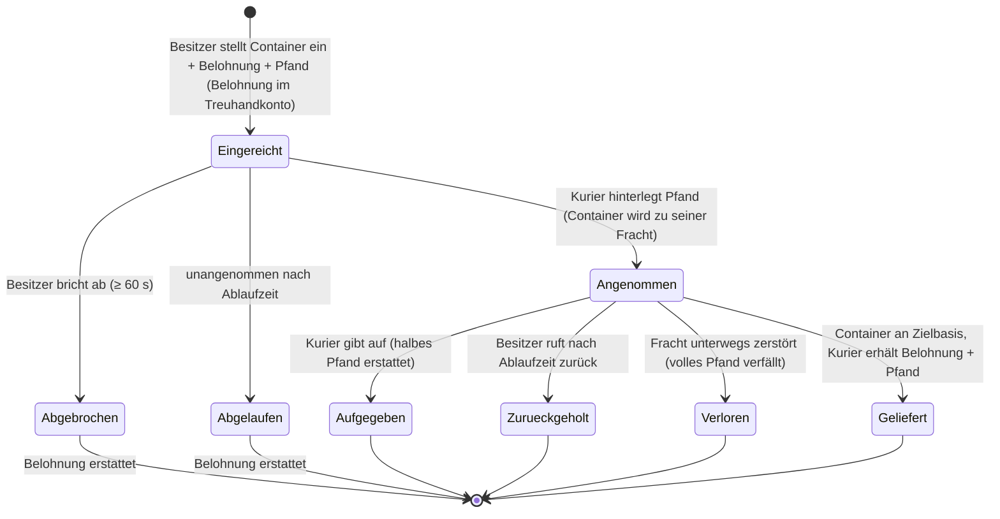

# Transport (Warenversand)

Ein **Transportauftrag** bewegt einen Container mit Gegenständen von einer Basis zu einer anderen mithilfe
eines **freiwilligen Kuriers**, der dafür bezahlt wird. Es ist ein zweiseitiger Markt: Der **Besitzer** stellt
eine Lieferung ein, ein **Kurier** nimmt sie an und liefert sie ab.

> UI-Positionen richten sich nach der [Client-UI-Übersicht](/de/features/ui/) (die Kategorie **Aufträge** in der
> oberen Leiste). Die folgenden Mechaniken sind anhand des Servers bestätigt.

## Die beiden Seiten

- **Besitzer (Auftraggeber)** — stellt eine Lieferung ein: Einen zu bewegenden Container von einer **Startbasis**
  zu einer **Zielbasis**, gegen eine **Belohnung**, mit einem **Pfand** (Sicherheit) und über eine **Laufzeit**.
- **Kurier (Freiwilliger)** — nimmt den Auftrag an, transportiert den Container und liefert ihn ab.

## Einen Transport einstellen (Besitzer)

**Reiche einen Transport ein** mit:
- dem zu transportierenden **Container** (einer Volumenverpackung),
- der **Belohnung**, die du bei Lieferung zahlst,
- dem **Pfand** (einer Kaution, die der Kurier hinterlegt),
- **Startbasis** und **Zielbasis**,
- einer **Laufzeit** (in Tagen), wie lange der Auftrag offen bleibt.

Beim Einreichen wird die **Belohnung einbehalten** und von deinem Guthaben auf ein Treuhandkonto (Escrow) gebucht.

## Einen Transport annehmen (Kurier)

- Einen Auftrag **annehmen** — du hinterlegst das **Pfand** als Kaution, und der Container
  wird zu deiner Fracht zum Transportieren.

## Liefern & Zurückholen

- **Liefern** — bringe den Container zur Zielbasis. Bei der Lieferung wird der **Kurier mit Belohnung + Pfand ausgezahlt**,
  und der Besitzer erhält die Waren.
- **Zurückholen** — der Besitzer (oder der Kurier im entsprechenden Fall) holt den Container an eine Basis zurück;
  beim Zurückholen wird das **Pfand zurückgegeben** und die **Belohnung an den Besitzer zurückgezahlt**.

## Abbrechen / Aufgeben

- **Abbrechen** — den Auftrag abbrechen.
- **Aufgeben** — der Kurier bricht den Transport ab. Das Aufgeben zieht eine **Pfandstrafe** nach sich:
  Nur die **Hälfte** des Pfands wird erstattet (der Rest verfällt) — die Strafkonstante beträgt 0,5 in `TransportAssignment.cs`.

## Überprüfen

- Transporte **auflisten**, den **Inhalt auflisten**, **Container-Info**, **läuft er gerade?**
  sowie das **Transport-Protokoll**.

## Der Geldfluss (auf einen Blick)

Die **Belohnung** ist die Bezahlung des Besitzers, die beim Einstellen auf ein Treuhandkonto gebucht und erst bei
Lieferung ausgezahlt wird. Das **Pfand** ist die Kaution des Kuriers: Beim Annehmen an den Besitzer gezahlt,
während des Transports einbehalten und bei erfolgreicher Lieferung (zusammen mit der Belohnung) zurückgezahlt.

| Ereignis | Bedingung | Besitzer | Kurier | Container |
|---|---|---|---|---|
| Einreichen | — | Belohnung im Treuhandkonto | — | in das Transportlager verschoben |
| Annehmen | unangenommen | erhält Pfandsumme | zahlt Pfand | wird zur Fracht des Kuriers |
| Liefern | an der Zielbasis | Waren erhalten | erhält **Belohnung + Pfand** | geliefert |
| Abbrechen | unangenommen, ≥ 60 s nach Einreichung | Belohnung erstattet | — | zurück an Startbasis |
| Aufgeben | angenommen | Belohnung erstattet | **halbes** Pfand erstattet (0,5 Strafe) | zurück an Startbasis |
| Ablaufen | unangenommen, nach Ablaufzeit | Belohnung erstattet | — | zurück an Startbasis |
| Zurückholen | angenommen **und** Ablaufzeit überschritten | Belohnung erstattet | — | zurück an Startbasis (sofort wenn gedockt, andernfalls beim nächsten Andocken des Kuriers) |
| Fracht zerstört | unterwegs | Belohnung erstattet **+ volles Pfand** | volles Pfand verwirkt | verloren |

## Praktische Hinweise

- **Keine Gebühren** — das einzige Geld, das fließt, sind Belohnung und Pfand.
- **Belohnung liegt im Treuhandkonto** — der Besitzer kann sie nicht anderweitig ausgeben, bis der Transport abgeschlossen ist.
- **Pfand ist die Kaution des Kuriers** — das Hinterlegen erlaubt dir die Übernahme; der Verlust der Fracht unterwegs
  verwirkt den **vollen** Betrag.
- **Aufgeben kostet dich etwas** — wer einen Transport abbricht, verliert die Hälfte seiner Kaution.
- **Die Laufzeit zählt nur, solange der Auftrag unangenommen ist** — die beim Einstellen festgelegte Ablaufzeit
  schließt nur automatisch Aufträge, die niemand angenommen hat (der Server bereinigt unangenommene Aufträge stündlich).
  Ein **angenommener** Auftrag läuft niemals von selbst ab; die Notbremse des Besitzers ist das **Zurückholen**,
  welches verfügbar wird, sobald die Frist abgelaufen ist. Es ruft die Fracht (und die Belohnung) zur Startbasis zurück —
  sofort, wenn der Kurier angedockt ist, oder automatisch beim nächsten Andocken des Kuriers.
- **Prüfe den Inhalt vor dem Annehmen** — überprüfe den Inhalt des Containers und die Route.

<!-- TODO: only the client UI remains (assignments screen layout).
     Money model confirmed: reward escrowed at submit (CashInOnSubmit), collateral paid
     by the volunteer on take (TakeCollateral -> PayCollateralToPrincipal), delivery pays
     volunteer reward+collateral (PayOutReward); cancel needs 60s after creation;
     expiry = submit time + client duration days (<=0 -> 1), cleaned hourly by
     MissionProcessor (_transportAssignmentInterval 1h), taken=0 only; retrieve requires
     expiry passed + taken, auto-completes on next dock; destroyed cargo refunds reward
     and forfeits full collateral to the owner.
     Developer notes: TransportAssignments/TransportAssignmentSubmit.cs;
     Services/MissionEngine/TransportAssignments/TransportAssignment.cs (reward/collateral
     escrow, PayOutReward = reward+collateral, PaybackCollateral, PaybackHalfCollateral
     = COLLATERAL_PENALTY on give-up, RetrieveToBasePublicContainer, expiry);
     TransportAssignmentTake/Deliver/Retrieve/Cancel/GiveUp/List/ListContent/
     ContainerInfo/Running/Log. -->
