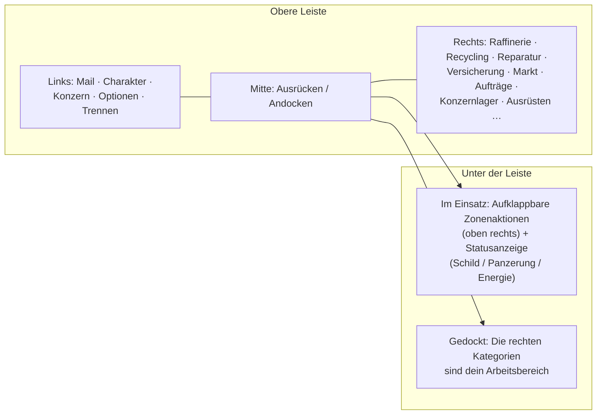

# Client-UI-Übersicht

Der Client verwendet eine Benutzeroberfläche im Stil von **EVE Online**: Eine Vollbild-Ansicht des
Weltraums bzw. der Zone mit frei schwebenden, **größenveränderbaren und verschiebbaren Fenstern**,
die nach Belieben **geschlossen und wieder geöffnet** werden können. Die Funktionsweise richtet
sich nach dem jeweiligen System — siehe die unten verlinkten Seiten.

> Dieses Layout ist ein vom Projekt bereitgestelltes Arbeitsmodell, um zu beschreiben, wo sich Aktionen
> befinden. Genaue Bezeichnungen im Spiel können geringfügig abweichen; maßgeblich ist die Struktur.

## Die obere Leiste

Eine dauerhafte Leiste am oberen Bildschirmrand.

| Bereich | Inhalt |
|---|---|
| **Links** | Hauptschaltflächen: **Mail**, **Charakter**, **Konzern**, weitere **Optionen** und **Trennen** |
| **Mitte** | Die Schaltfläche **Ausrücken / Andocken** — dein primärer Umschalter zwischen gedockt⇄im Einsatz (siehe [Bewegung](/de/features/movement/)) |
| **Rechts** | Aktionskategorien als Schaltflächen: **Raffinerie**, **Recycling**, **Reparatur**, **Versicherung**, **Markt**, **Aufträge** (Transporte), **Konzernlager**, **Ausrüsten**, … |

Die Kategorien auf der rechten Seite öffnen die jeweiligen Systemfenster:

| Schaltfläche | Öffnet / tut | Wiki-Seite |
|---|---|---|
| Raffinerie | Rohe Ressourcen zu Komponenten verarbeiten | [Produktion](/de/features/production/) |
| Recycling | Gegenstände in Basismaterialien zerlegen | [Produktion](/de/features/production/) |
| Reparatur | Beschädigte Roboter/Module reparieren | [Produktion](/de/features/production/) |
| Versicherung | Produktions-/Roboter-Versicherungspolicen | [Produktion](/de/features/production/) |
| Markt | Marktorders und Sofortkäufe | [Markt](/de/features/market/) |
| Aufträge | Transportaufträge (Lieferungen) | [Transport](/de/features/transport/) |
| Konzernlager | Konzern-Hangar / Lager | [Gruppen](/de/features/groups/) |
| Ausrüsten | Module und Munition auf deinem aktiven Roboter ausrüsten | [Roboter](/de/features/robots/) |

## Gedockter Zustand

Während du **gedockt** bist, bilden die Aktionskategorien auf der rechten Seite den Hauptarbeitsbereich: Du verarbeitest
Materialien, handelst, rüstest aus und verwaltest dein Lager, ohne die Basis zu verlassen. Die Ausrücken-Schaltfläche
dockt dich in die Zone ab (siehe [Bewegung](/de/features/movement/) für die Voraussetzungen zum Abdocken).

## Ungedockter Zustand (Im Einsatz)

Während du **ungedockt** bist (deinen aktiven Roboter in einer Zone steuerst):

- Der Bereich **oben rechts** erhält eine **aufklappbare Aktionsschaltfläche**: Klickst du darauf, klappt eine Liste
  zusätzlicher Zonenaktionen nach unten auf (Scannen, Ernte-/Interaktionsaktionen, Zonenwerkzeuge —
  die unter [Sammeln](/de/features/gathering/) und [Kampf](/de/features/combat/) dokumentierten Aktionen).
- Die **Hauptstatusanzeige** zeigt den Zustand deines Roboters: **Schild, Panzerung/Struktur, Energie**
  sowie den zugehörigen Kampfstatus — dieselben Daten, auf die sich die Seite [Kampf](/de/features/combat/) bezieht
  (z. B. die Abdock-Prüfung „Energiesystem intakt“).
- Kategorien, die nur in der Basis verfügbar sind (Raffinerie, Markt, …), bleiben unerreichbar, bis du wieder andockst.

## Häufige Fenster

Die meisten Systeme öffnen sich in einem standardmäßigen frei schwebenden Fenster: Titelleiste, Schließen-Schaltfläche,
anpassbare Kanten, Reiter- oder Listeninhalte. Wiederkehrende Systeme (Inventar/Container, Markt, Produktionslinien)
können mehrere Fenster gleichzeitig geöffnet haben.

- **Inventar / Container** — Inhalte auflisten, Gegenstände verschieben/stapeln/verpacken, umbenennen, zerstören —
  siehe [Gegenstände](/de/features/items/).
- **Charakterfenster** (Schaltfläche oben links) — Profil, Erweiterungen (Forschung), Einstellungen,
  Credits — siehe [Erste Schritte](/de/features/getting-started/) und [Forschung](/de/features/research/).
- **Konzernfenster** (Schaltfläche oben links) — Konzerninfo, Hangar, Dokumente, Abstimmungen,
  Schwarzes Brett — siehe [Gruppen](/de/features/groups/).
- **Mailfenster** (Schaltfläche oben links) — Persönliche und Massennachrichten — siehe [Soziales](/de/features/social/).

## In diesem Wiki verwendete Konventionen

- **„Obere Leiste → X“** = die Schaltfläche namens X in der oberen Leiste.
- **„Zonenaktionen“** = die aufklappbare Liste oben rechts während des Einsatzes in einer Zone.
- **Ausrücken-/Andocken-Schaltfläche** = der zentrale Umschalter in der oberen Leiste.

<!-- Note: this page is the agreed UI model (project-provided). If the real client
     differs in button names or placement, update this page first — every other
     features/ page references the conventions defined here. -->
