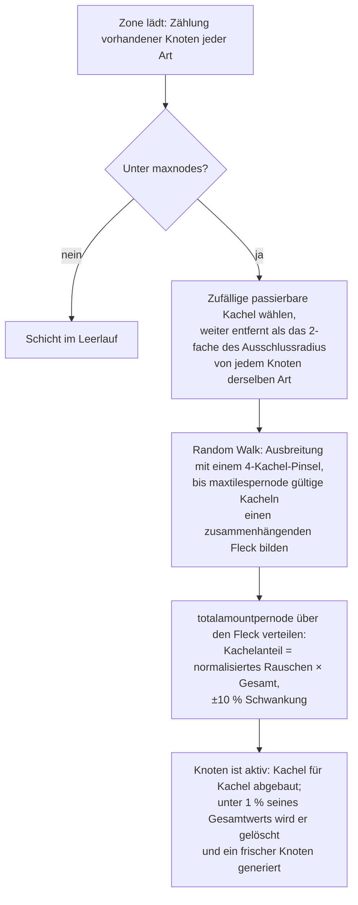

# Zonen-Ressourcengenerierung

Diese Seite erklärt, wie der Server die Ressourcen einer Zone auf Vorrat hält. Beide Systeme laufen
kontinuierlich im Hintergrund, während die Zone geladen ist; es ist keine Spieleraktion
erforderlich, damit sie weitertakten.

## Die Ressourcenkonfiguration der Zone

Jede Zone ist in der Datenbank mit zwei unabhängigen Listen konfiguriert:

- **Erzkonfiguration** (`mineralconfigs`) — eine Zeile pro in der Zone vorhandener Erzart,
  mit vier Einstellwerten pro Art:
  | Spalte | Bedeutung |
  |---|---|
  | `maxnodes` | Wie viele Knoten dieser Art die Zone aufrechterhält |
  | `maxtilespernode` | Maximale Anzahl an Kacheln, die ein einzelner Knoten abdecken kann |
  | `totalamountpernode` | Gesamtes Material in einem frischen Knoten, verteilt über seine Kacheln |
  | `minthreshold` | Minimales Füllverhältnis pro Kachel (0–1); Kacheln darunter nach dem Abbau werden verworfen |
- **Pflanzenkonfiguration** (`zones.fertility` + ein Pflanzenregelsatz) — das Ziel der
  Pflanzenbedeckung der Zone (ein Prozentsatz) und die Liste der Pflanzenarten, die dort wachsen dürfen
  (das Verhalten jeder Art ist eine Regeldatei, dokumentiert unter
  [Pflanzen](/de/content/plants/)).

Zonen ohne Erzkonfiguration (Arenen, Trainingszonen, Festungen, einige Gamma-Zonen)
haben überhaupt keine Erzschichten.

## Erzknoten

### Wie ein Knoten platziert wird

Wenn eine Zone lädt, zählt die Schicht jeder Erzart ihre vorhandenen Knoten (gespeichert in der
Tabelle `mineralnodes`) und generiert neue, bis `maxnodes` erreicht ist. Ein neuer Knoten wird
durch einen **Random Walk** (Zufallsbewegung) platziert:

1. Eine zufällige passierbare Kachel wählen.
2. Sie muss weit vom nächstgelegenen vorhandenen Knoten derselben Art entfernt sein — der Ausschlussradius
   wird aus `maxtilespernode` abgeleitet (`√(maxtilespernode/π) × 2`, und der Startpunkt muss
   mindestens doppelt so weit entfernt sein), damit Knoten niemals zu einer riesigen Lagerstätte verschmelzen.
3. Vom Startpunkt aus breitet sich ein Pfad zufällig nach außen aus (mit einem Pinsel von 4 Kacheln auf einmal)
   und sammelt bis zu `maxtilespernode` gültige Kacheln zu einem zusammenhängenden Fleck.
4. Das Material `totalamountpernode` des Knotens wird über den Fleck verteilt: Der Anteil jeder Kachel
   ist ihr (normalisierter) Rauschwert multipliziert mit der Gesamtsumme, mit einer zufälligen Schwankung von ±10 %,
   sodass keine zwei Knoten derselben Art gleich aussehen.

Eine Kachel ist für einen Knoten nur dann gültig, wenn sie innerhalb der Zone liegt, keine Insel ist, nicht
durch PBS-Terraforming geschützt ist und passierbar ist. Zwei seltene Arten erhalten **Sperrzonen** um
Docking-Basen und Teleporter: **Epriton** hält einen Mindestabstand ein, und **Flux-Erz** hält
den doppelten Abstand — Flux-Erz ist daher nie direkt neben einer Basis zu finden.

### Wie ein Knoten verbraucht wird

- Der Abbau entfernt Material Kachel für Kachel.
- Ein Knoten, der unter **1 % seines konfigurierten Gesamtwerts** fällt, wird gelöscht und ein frischer Knoten
  wird generiert (zurück zu Schritt 1), um die Zone auf `maxnodes` zu halten.
- Flux-Erz-Knoten steuern zusätzlich das **Spawnen von NPCs** — Knoten, die abgebaut (oder entfernt) werden,
  lösen Ereignisse aus, auf die das NPC-System lauscht, weshalb Flux-Erz-Stellen Aufmerksamkeit erregen.

## Pflanzen

### Der Pflanzenscan

Die Zone ist in Blöcke von **32×32 Kacheln** unterteilt. Ein Pflanzen-Handler durchläuft diese Kacheln der Reihe nach,
verarbeitet eine pro Tick und ist so getaktet, dass ein **vollständiger Durchlauf über die Zone etwa 8 Stunden dauert**
(pro Zone überschreibbar). Jeder 32×32-„Würfel“ wird durch eine feste Pipeline verarbeitet:

1. **Validieren** — ungültige Pflanzen verwerfen (falscher Boden, tot, fehl am Platz).
2. **Wachsen** — jede Pflanze durch ihre Wachstumsphasen voranbringen (siehe
   [Sammeln](/de/features/gathering/) für `growRate` und Fruchtbildung).
3. **Erzeugen** — neue Pflanzen hinzufügen, wenn der Würfel unter seinem Fruchtbarkeitsziel liegt.
4. **Mauern beschädigen** — die Blockierhöhe von Pflanzen nimmt mit der Zeit ab.
5. **Nach Abstand entfernen** — Abstand zwischen derselben Art erzwingen (`killDistance`).
6. **Material erneuern** — eine kleine Menge Fruchtmaterial regeneriert sich.

### Wie eine neue Pflanze ausgewählt wird

Eine Kachel kann nur dann sprießen, wenn die Zonendatei ihr ein **Spawnpotenzial** zuweist (ein Kachel-Byte,
das in die Pflanzenschicht der Zone eingebettet ist — 0 bedeutet, dass die Kachel niemals sprießt). Bei jedem Tick gilt für
jede berechtigte Kachel:

- **Zuerst Zonen-Fruchtbarkeitsprüfung**: Wenn die Bedeckung des Würfels mit blockierenden Pflanzen bereits
  `fertility%` seiner Bodenkacheln erreicht, spawnt dort nichts Neues.
- **Chance pro Kachel**: Ein Zufallswurf muss das Spawnpotenzial der Kachel übertreffen.
- **Artenauswahl**:
  - Wenn die Kachel **keine Pflanzennachbarn** hat, wird die Art durch eine gewichtete Zufallsauswahl bestimmt,
    bei der das Gewicht jeder zulässigen Art ihre `fertility` ist (von Spielern gesäte Arten sind
    von natürlichen Spawns ausgeschlossen).
  - Wenn sie Nachbarn **hat**, entscheidet ein Münzwurf: 50 % Chance auf die derzeit *dominierende* Nachbarart
    (die häufigste in der Nähe), 50 % Chance auf eine **Ausbreitungsziehung**, gewichtet nach
    `(Nachbaranzahl × spreading)` für jede Art — dadurch vergrößern Gruppen
    Bestände ihrer eigenen Art.
- **Obergrenzen und Abstände**: Eine Art mit einer `maxAmount`-Obergrenze wird übersprungen, sobald die Zone
  genug davon hat, und eine Kachel innerhalb der `killDistance` einer anderen Pflanze derselben Art wird
  übersprungen.

### Was das für Spieler bedeutet

- Die Pflanzendichte ist durch die Fruchtbarkeit der Zone begrenzt — Sie werden niemals eine Zone mit
  100 % Pflanzenbedeckung sehen, wenn ihre Fruchtbarkeit 20 beträgt.
- Gruppenbildung ist die Norm: Die Ausbreitung führt dazu, dass jede Art ihre eigenen Flächen erweitert, sodass eine
  Zone eher zu Artenrevieren als zu einer bunten Mischung neigt.
- `killDistance`-Arten (z. B. bestimmte hochwertige Pflanzen) sind gleichmäßig verteilt, was
  ihre Standorte vorhersehbar macht, sobald man eine gefunden hat.
- Neue Knoten erscheinen dort, wo der Random Walk endet — es gibt keinen festen „Erzpunkt“ auf einer
  Zone; Scannen ist erforderlich (siehe [Sammeln](/de/features/gathering/)).

<!-- Developer notes: TerrainsModule.cs (per-zone layer construction: OreLayer for
     Solid, LiquidLayer for Liquid, GravelLayer for TrainingZone; LoadMineralNodes
     top-up); MineralLayer.cs (LoadMineralNodes: delete <1% nodes, generate to
     maxnodes; FluxOre -> OreNpcSpawnMessage on decrease/expiry);
     Generators/MineralNodeGeneratorBase.cs (FindStartPosition keep-out + spacing,
     NormalizeNoise, CreateMineralNode jitter); RandomWalkMineralNodeGenerator.cs
     (flood-fill brush 4, 50k step cap); MineralNodeRepository.cs (mineralnodes table,
     compressed per-tile values); PlantHandler.cs (32x32 areas, 8h full pass,
     PlantsGrowthTimerOverrideMin, scanner modes); NatureCube.cs (ProcessAll pipeline,
     SpawnPlants fertility/spawn/killDistance logic, GetNewPlantRule 50/50 ruling vs
     spreading); PlantRuleExtensions.cs (fertility-weighted + spreading-weighted
     draws); PlantInfo.cs (per-tile spawn byte comes from the zone's plant layer
     file, never assigned by server code). -->
