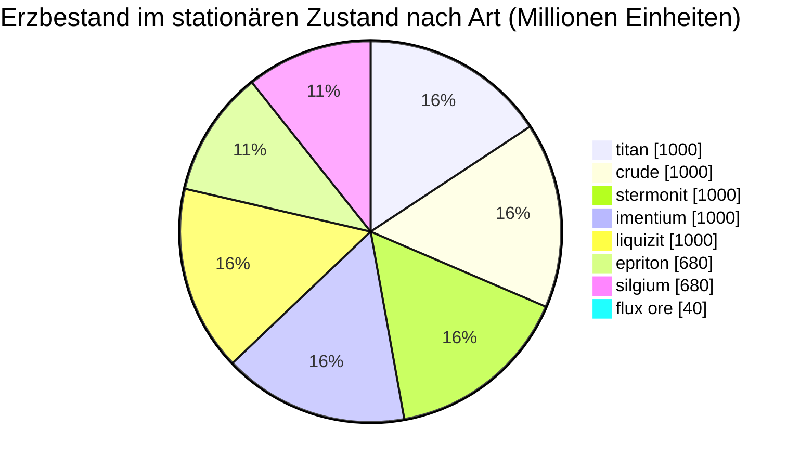

# Daoden (zone_ASI) — Praxisbeispiel

  <a href="/de/zones/map/">
    
    <strong>Weltkarte</strong> — wo diese Zone unter allen anderen liegt, mit den Teleporterverbindungen. Die vollständige Karte öffnen.
  </a>

Wo die Teleportersäulen dieser Zone stehen (Punkte, beschriftet mit dem Ziel — abgeblendet, wenn
die Säule derzeit abgeschaltet ist), die Landepunkte von Teleportern aus anderen
Zonen (gestrichelte Kreise) und die Ausgangstore (Rauten), sofern vorhanden. Die Positionen sind die
vom Server erfassten Kachelkoordinaten.
Die gestrichelten Linien verbinden die Paare lokaler (zoneninterner) Teleportersäulen.

Eine **offene PvP**-Zone der Alpha-Stufe — die reichste Erzkonfiguration im Spiel und
der Ort, an dem die seltenen Arten vorkommen. Alles, was New Virginia hat, plus Epriton, Silgium und
die Flux-Erz-Stellen, die NPC-Angriffe anziehen.

| Fakt | Wert |
|---|---|
| Zonen-ID | 2 |
| Typ | PvP (offen) |
| Schutz | [Beta](/de/zones/protection/) — offenes PvP, Standardgelände |
| Größe | 2048 × 2048 Kacheln |
| Fruchtbarkeit | 20 |
| Pflanzenregelsatz | 2 — 19 Arten (inkl. hochwertiger Erntepflanzen) |
| Erzarten | 8 (titan, crude, stermonit, imentium, liquizit, epriton, silgium, flux ore) |
| Gesamte Erzknoten | 64 (8 pro Art) |

## Erzkonfiguration

| Material | Knoten | Max. Kacheln/Knoten | Gesamt pro Knoten | Mindest-Schwellenwert |
|---|---|---|---|---|
| [titan](/de/content/ores/titan/) | 8 | 500 | 125,000,000 | 0.5 |
| [crude](/de/content/ores/crude/) | 8 | 1257 | 125,000,000 | 0.5 |
| [stermonit](/de/content/ores/stermonit/) | 8 | 500 | 125,000,000 | 0.5 |
| [imentium](/de/content/ores/imentium/) | 8 | 500 | 125,000,000 | 0.5 |
| [liquizit](/de/content/ores/liquizit/) | 8 | 500 | 125,000,000 | 0.5 |
| [epriton](/de/content/ores/epriton/) | 8 | 500 | 85,000,000 | 0.5 |
| [silgium](/de/content/ores/silgium/) | 8 | 500 | 85,000,000 | 0.5 |
| [fluxore](/de/content/ores/fluxore/) | 8 | 300 | 5,000,000 | 0.5 |

Auffällige Punkte:

- **8× mehr Knoten als New Virginia**, aber jeder Knoten ist kleiner (500 Kacheln gegenüber 1.000): Der
  Bewegungsradius sinkt bei den Standarderzen von 34 auf 24 Kacheln. Scannen spielt hier eine größere Rolle —
  Lagerstätten sind dünner und zahlreicher.
- **Epriton und Silgium** weisen reduzierte Gesamtmengen auf (85 M gegenüber 125 M) — höherer Wert, seltenerer
  Bestand. Epriton hält zusätzlich einen **Mindestabstand zu Basen und Teleportern** ein, sodass
  seine Knoten niemals an einem Spawnpunkt liegen.
- **Flux-Erz ist der Extremfall**: nur 5 M pro Knoten über 300 Kacheln (~16.600 pro
  Kachel — ein Rinnsal, keine Lagerstätte), 8 Knoten und eine Sperrzone mit dem **doppelten**
  Epriton-Abstand zu Basen. Das Abbauen eines Flux-Knotens meldet Spawn-Ereignisse an das NPC-System —
  Flux-Standorte sind absichtlich umkämpft (siehe [Intrusion & NPC-Systeme](/de/features/intrusion/)).
- Bestand im stationären Zustand: insgesamt ~6,4 Milliarden Materialeinheiten.

## Pflanzen-Mix

Regelsatz 2 erlaubt 19 Arten — der vollständige Alpha-Mix: die Grundlagen, plus **Devrinol**,
**Wall**, **Titanplant** und die **hochwertigen Erntepflanzen** (hochstufige Electroplant, hochstufiger
Eisenbaum, hochstufiger Rustbush, hochstufiger Slimeroot). Die Fruchtbarkeit beträgt weiterhin 20, die Dichte ist
also dieselbe wie in New Virginia — was sich ändert, ist, *welche* Arten den Fruchtbarkeitswurf gewinnen können. Die
eigenen `fertility`-Gewichte der hochwertigen Erntepflanzen entscheiden, wie oft sie sich gegen
die Gräser durchsetzen.

Regeln pro Art finden Sie unter [Pflanzen](/de/content/plants/); Erträge pro Erz unter
[Erze](/de/content/ores/).

## Was das für einen Spieler bedeutet

- Die gesamte Erzleiter steht zur Verfügung, einschließlich der Flux-Erz-Wirtschaft — allerdings ist es offenes
  PvP, sodass alles, was Sie abbauen, erbeutet werden kann (siehe
  [Transport](/de/features/transport/) für den sicheren Gütertransport zwischen Basen).
- Rechnen Sie mit NPC-Druck in der Nähe von Flux-Erz-Knoten; der Spawner reagiert auf Abbauereignisse an
  diesen Knoten.
- Die Pflanzenernte zielt hier auf die hochstufigen Varianten ab, die bessere Früchte tragen als
  die niedrigstufigen Arten in Starterzonen.

<!-- Developer notes: zones row id 2 (zonetype 2 = PvP, protected 0, fertility 20,
     plantruleset 2); mineralconfigs 8 rows (7 standard + fluxore 8/300/5M);
     MineralNodeGeneratorBase.KeepOutDist: Epriton = MINERAL_DISTANCE_FROM_BASE_MIN,
     FluxOre = 2x; MineralLayer.OnNodeDecrease/OnNodeExpired -> OreNpcSpawnMessage for
     FluxOre; plantrules rulesetid 2 = 19 files (4 harvestable, incl. devrinol and
     wall). -->
