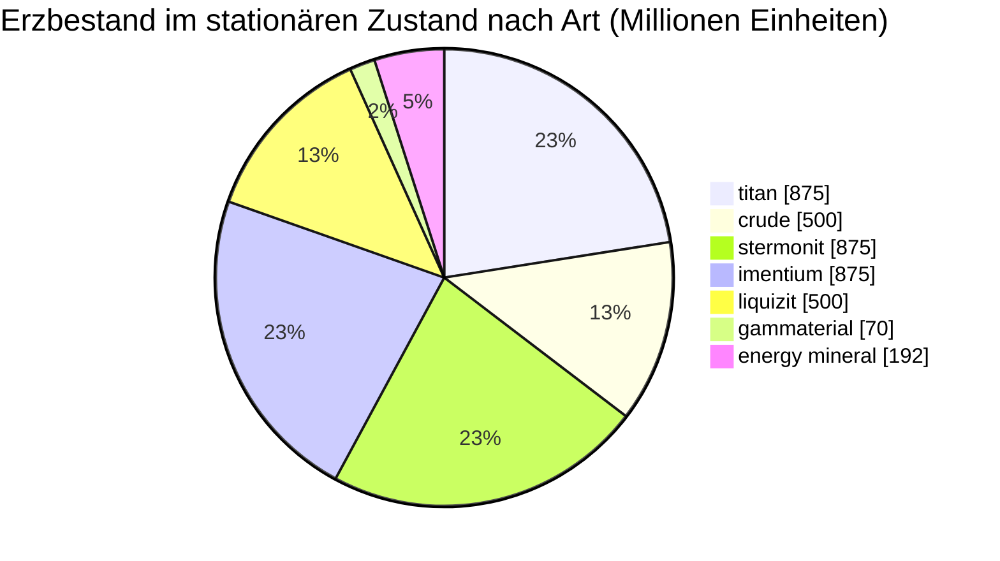

# zone_gamma_z106 — Praxisbeispiel

  <a href="/de/zones/map/">
    
    <strong>Weltkarte</strong> — wo diese Zone unter allen anderen liegt, mit den Teleporterverbindungen. Die vollständige Karte öffnen.
  </a>

Wo die Teleportersäulen dieser Zone stehen (Punkte, beschriftet mit dem Ziel — abgeblendet, wenn
die Säule derzeit abgeschaltet ist), die Landepunkte von Teleportern aus anderen
Zonen (gestrichelte Kreise) und die Ausgangstore (Rauten), sofern vorhanden. Die Positionen sind die
vom Server erfassten Kachelkoordinaten.

Eine **offene PvP**-Zone hoher Stufe: terraformbar, geringe Fruchtbarkeit, Rang-2-Pflanzenvarianten und
eine straffere Erzwirtschaft. Dies ist die typische „Endspiel“-Gestalt einer Zone — weniger, stärker
umkämpfte Ressourcen.

| Fakt | Wert |
|---|---|
| Zonen-ID | 106 |
| Typ | PvP (offen) |
| Schutz | [Gamma](/de/zones/protection/) — offenes PvP, terraformbar |
| Größe | 2048 × 2048 Kacheln |
| Fruchtbarkeit | 15 |
| Terraformbar | ja (PBS-Technologielimit 2) |
| Pflanzenregelsatz | 22 — 17 Arten („Gamma Plant Rules“, Rang-2-Mix) |
| Erzarten | 7 (titan, crude, stermonit, imentium, liquizit, gammaterial, energy mineral) |
| Gesamte Erzknoten | 44 |

## Erzkonfiguration

| Material | Knoten | Max. Kacheln/Knoten | Gesamt pro Knoten | Mindest-Schwellenwert |
|---|---|---|---|---|
| [titan](/de/content/ores/titan/) | 7 | 600 | 125,000,000 | 0.5 |
| [crude](/de/content/ores/crude/) | 4 | 600 | 125,000,000 | 0.5 |
| [stermonit](/de/content/ores/stermonit/) | 7 | 600 | 125,000,000 | 0.5 |
| [imentium](/de/content/ores/imentium/) | 7 | 600 | 125,000,000 | 0.5 |
| [liquizit](/de/content/ores/liquizit/) | 4 | 600 | 125,000,000 | 0.5 |
| [gammaterial](/de/content/ores/gammaterial/) | 7 | 100 | 10,000,000 | 0.5 |
| [energymineral](/de/content/ores/energymineral/) | 8 | 300 | 24,000,000 | 0.5 |

Auffällige Punkte:

- **Weniger Knoten als in Alpha-Zonen** (44 gegenüber 64 in Daoden): Rohöl und Liquizit sinken auf
  jeweils nur 4 Knoten. Dieselben Gesamtmengen pro Knoten wie bei den Standarderzen der Alpha-Stufe, sodass der
  stationäre Zustand (~3,9 Milliarden Einheiten insgesamt) schlanker ist und sich langsamer erholt.
- **Zwei exotische Arten**: **Gammaterial** in winzigen 100-Kachel-Knoten (Bewegungsradius 10 Kacheln —
  klein, leicht zu erkennen, ~1,4 M pro Knoten) und **Energie-Mineral** mit 24 M pro Knoten.
- Kein Epriton, kein Flux-Erz — die seltenen/wirtschaftlichen Erze verbleiben auf der Alpha-Stufe.

## Pflanzen-Mix

Regelsatz 22 erlaubt 17 Arten: die Grundlagen, plus die **Rang-2-Varianten** — hochstufiger Eisenbaum T2
und hochstufiger Rustbush T2 als wilde Erntepflanzen sowie die **gesäten Rang-2-Pflanzen**
(hochstufige Electroplant T2, hochstufiger Slimeroot T2). Die gesäten Pflanzen tragen das Merkmal `playerSeeded` — sie
spawnen **niemals** natürlich; sie existieren nur in Spielergärten (siehe
[Sammeln → Pflanzen](/de/features/gathering/)).

Die Fruchtbarkeit liegt bei **15**, nicht 20: Ein 32×32-Würfel darf höchstens ~15 % blockierende Pflanzen enthalten, daher
ist die Pflanzenbedeckung sichtbar spärlicher als in Alpha-Zonen, und der Fruchtbarkeitswurf hat
etwas weniger Spielraum, bevor der Würfel „gesättigt“ ist.

Regeln pro Art (einschließlich der T2-Fruchtmengen) finden Sie unter
[Pflanzen](/de/content/plants/); Erträge pro Erz unter [Erze](/de/content/ores/).

## Was das für einen Spieler bedeutet

- Schlankere, langsamere Wirtschaft: Weniger Knoten der gewöhnlichen Erze bedeuten, dass sich Abbaudruck
  schneller bemerkbar macht — ein erschöpfter Rohölknoten braucht länger, um von der Zone ersetzt zu werden.
- Spärlichere Vegetation: Bei 15 % Fruchtbarkeit ist offener Boden die Norm und Pflanzenflecken
  die Ausnahme.
- Das hochwertige Sammeln konzentriert sich hier auf die wilden Rang-2-Pflanzen Eisenbaum / Rustbush sowie
  das Betreiben von Spielergärten mit den gesäten T2-Pflanzen Electroplant und Slimeroot.
- Terraforming (PBS-Technologielimit 2) bedeutet, dass der Boden selbst von Spielern umgeformt werden kann
  (siehe [Power Base Stations (PBS)](/de/features/pbs/)).

<!-- Developer notes: zones row id 106 (zonetype 2 = PvP, protected 0, fertility 15,
     terraformable 1, pbsTechLimit 2, plantruleset 22); mineralconfigs 7 rows (crude
     and liquizit 4 nodes each); plantrules rulesetid 22 = 17 files, note "Gamma
     Plant Rules"; electroplant_seeded_t2.txt / slimeroot_seeded_t2.txt set
     playerSeeded=n1 (inherited via source= from electroplant_hi.txt /
     slimeroot_hi.txt) -> excluded from natural spawns in
     PlantRuleExtensions.GetWinnerPlantTypeBasedOnFertility. -->
