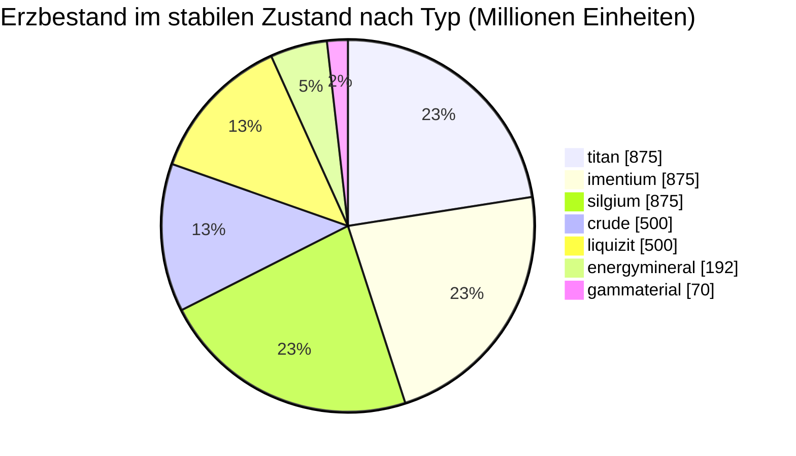

<!-- Generated by tools/generate from the live database (source: zones, mineralconfigs, plantrules, teleportdescriptions, strongholdexitconfig).
     Do not edit by hand; regenerate instead. -->
# zone_gamma_z121

  <a href="/de/zones/map/">
    
    <strong>Weltkarte</strong> — wo diese Zone unter allen anderen liegt, mit den Teleportverbindungen. Vollständige Karte öffnen.
  </a>

Standorte der Teleportsäulen dieser Zone (Punkte mit Zielbeschriftung — gedimmt, wenn die Säule inaktiv ist), Landepunkte eingehender Teleporte aus anderen Zonen (gestrichelte Kreise) und Ausgangstore (Rauten), sofern vorhanden. Die Positionen entsprechen den vom Server erfassten Kachelkoordinaten.

Eine offene, terraformbare PvP-(Gamma-)Insel von frontier belt — das Gelände kann von Spielern umgeformt werden. Sie verwaltet 7 Erzarten.

| Tatsache | Wert |
|---|---|
| Zonen-ID | 121 |
| Typ | PvP |
| Schutz | [Gamma](/de/zones/protection/) — offenes PvP, terraformbar |
| Größe | 2048×2048 Kacheln |
| Tier | T2 (vom Server erfasst) |
| Fruchtbarkeit | 15 |
| Pflanzenarten | 17 (Regelsatz 12) |
| Erzarten | 7 |
| Erzvorkommen insgesamt | 44 |
| PBS-Technologielimit | 2 |
| Max. Andockbasen | 2 |

## Erzkonfiguration

Die Knotengenerierung, die diese Zone aufrechterhält. Erträge pro Erz und die Generierungsformeln finden Sie unter [Erze](/de/content/ores/) (der Abschnitt dieser Zone ist unten verlinkt).

| Material | Knoten | Max. Kacheln/Knoten | Gesamt pro Knoten | Min. Schwellenwert |
|---|---|---|---|---|
| [titan](/de/content/ores/titan/) | 7 | 600 | 125M | 0.5 |
| [crude](/de/content/ores/crude/) | 4 | 600 | 125M | 0.5 |
| [imentium](/de/content/ores/imentium/) | 7 | 600 | 125M | 0.5 |
| [liquizit](/de/content/ores/liquizit/) | 4 | 600 | 125M | 0.5 |
| [silgium](/de/content/ores/silgium/) | 7 | 600 | 125M | 0.5 |
| [gammaterial](/de/content/ores/gammaterial/) | 7 | 100 | 10M | 0.5 |
| [energymineral](/de/content/ores/energymineral/) | 8 | 300 | 24M | 0.5 |

[Zonenindex](/de/zones/zone-index/) · [Weltkarte](/de/zones/map/#t2) · [Schutzstufen](/de/zones/protection/)
