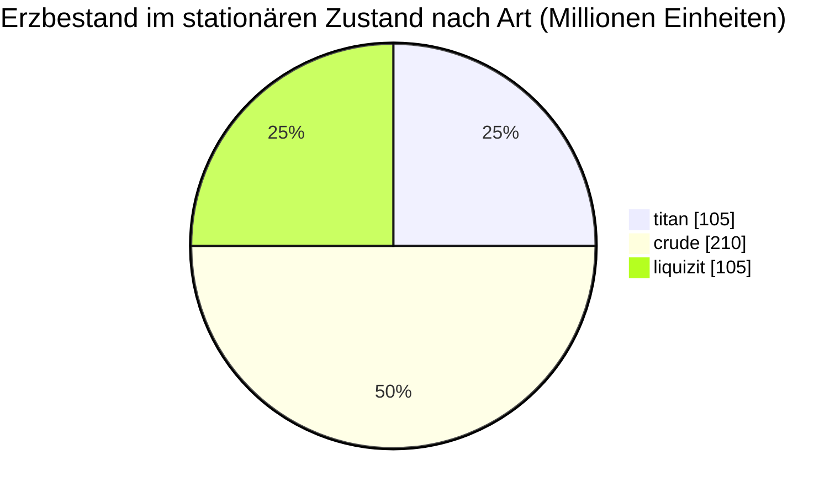

# New Virginia (zone_TM) — Praxisbeispiel

  <a href="/de/zones/map/">
    
    <strong>Weltkarte</strong> — wo diese Zone unter allen anderen liegt, mit den Teleporterverbindungen. Die vollständige Karte öffnen.
  </a>

Wo die Teleportersäulen dieser Zone stehen (Punkte, beschriftet mit dem Ziel — abgeblendet, wenn
die Säule derzeit abgeschaltet ist), die Landepunkte von Teleportern aus anderen
Zonen (gestrichelte Kreise) und die Ausgangstore (Rauten), sofern vorhanden. Die Positionen sind die
vom Server erfassten Kachelkoordinaten.
Die gestrichelten Linien verbinden die Paare lokaler (zoneninterner) Teleportersäulen.

Eine **geschützte PvE**-Zone niedriger Stufe — ein sicherer Ort, an dem neue Charaktere Ressourcen sammeln. Ihre
Konfiguration zeigt das einfachste Ende des Spektrums: wenige Erzarten, große Knoten und
der grundlegende Pflanzen-Mix.

| Fakt | Wert |
|---|---|
| Zonen-ID | 0 |
| Typ | PvE (geschützt) |
| Schutz | [Alpha](/de/zones/protection/) — geschützt, PvP deaktiviert |
| Größe | 2048 × 2048 Kacheln |
| Fruchtbarkeit | 20 |
| Pflanzenregelsatz | 0 — 15 Arten (Basis-Mix „tm pve“) |
| Erzarten | 3 (titan, crude, liquizit) |
| Gesamte Erzknoten | 21 (7 pro Art) |

## Erzkonfiguration

| Material | Knoten | Max. Kacheln/Knoten | Gesamt pro Knoten | Mindest-Schwellenwert |
|---|---|---|---|---|
| [titan](/de/content/ores/titan/) | 7 | 1000 | 15,000,000 | 0.5 |
| [crude](/de/content/ores/crude/) | 7 | 1257 | 30,000,000 | 0.5 |
| [liquizit](/de/content/ores/liquizit/) | 7 | 1000 | 15,000,000 | 0.5 |

Auffällige Punkte:

- **Große, weit verstreute Knoten** — 1.000–1.257 Kacheln jeweils (Bewegungsradius
  `(int)√(tiles/π)×2` = 34–40 Kacheln), sodass jeder Knoten ein großer Fleck ist, und es gibt nur 7
  jeder Art pro Zone. Der Bestand im stationären Zustand beträgt insgesamt rund 420 Millionen Materialeinheiten
  (105 M Titan + 210 M Rohöl + 105 M Liquizit).
- **Keine seltenen Arten** — kein Epriton, kein Flux-Erz, daher gibt es keine Sperrzonen um
  Basen und keine Erzstellen, die NPCs spawnen.
- `minthreshold` 0.5 bedeutet, dass eine Kachel nur nutzbar ist, wenn die Rauschfüllung des Knotens dort mindestens
  die Hälfte ihres Maximums beträgt — die Ränder jedes Flecks sind dünn.

Erträge pro Art (was eine Einheit jedes Erzes beim Raffinieren ergibt und die Formeln zur Knotengenerierung
hinter den obigen Zahlen) finden Sie unter [Erze](/de/content/ores/).

## Pflanzen-Mix

Regelsatz 0 erlaubt 15 Arten — das grundlegende Starter-Set: Gras (a/b), Kiefer, Büsche (a/b),
Rango, Kupferbaum, Schilf, Nanoweizen, niedrigstufige Rustbush/Slimeroot/Electroplant, Bonsai
und niedrigstufiger Eisenbaum. Keine Mauern, kein Devrinol, keine hochwertigen Erntepflanzen.

Bei einer Fruchtbarkeit von 20 darf ein 32×32-Würfel höchstens ~20 % blockierende Pflanzen enthalten; über die gesamte
2048×2048-Karte hinweg ist das eine Obergrenze von rund 838.000 Pflanzenkacheln (in der Praxis weniger —
Wasser und Inseln zählen nicht als Boden). Die Artenauswahl wird durch die `fertility` jeder Regel gewichtet,
sodass die grundlegenden Gräser und Büsche dominieren, während die niedrigstufigen Erntepflanzen selten bleiben.

Vollständige Regeln pro Art (growRate, Frucht, Gesundheit) finden Sie unter [Pflanzen](/de/content/plants/).

## Was das für einen Spieler bedeutet

- Sichere Starterwirtschaft: drei gewöhnliche Erze in großen, leicht zu scannenden Flecken.
- Erntepflanzen hier sind die niedrigstufigen Varianten — hochwertige Pflanzen (hochstufige
  Electroplant/Eisenbaum/Rustbush/Slimeroot) erscheinen in späteren Zonen.
- Da die Zone geschützt ist, fehlt dem Sammelkreislauf lediglich das PvP-Risiko
  (siehe [Bewegung](/de/features/movement/) für den Zonenbeitritt).

<!-- Developer notes: zones row id 0 (zonetype 1 = PvE, protected 1, fertility 20,
     plantruleset 0); mineralconfigs 3 rows (titan/crude/liquizit, 7 nodes each);
     plantrules rulesetid 0 = 15 files, note "tm pve". Node radius formula and
     threshold semantics: see generation.md. -->
