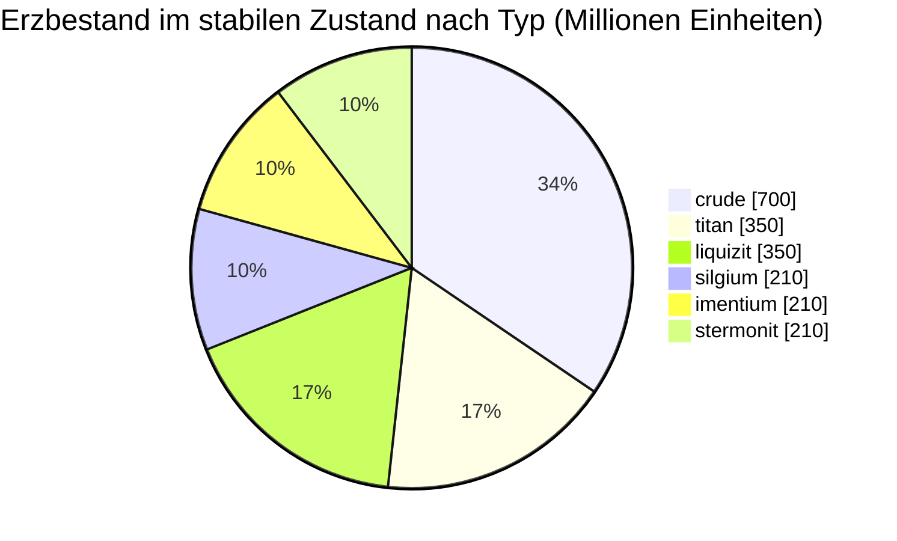

<!-- Generated by tools/generate from the live database (source: zones, mineralconfigs, plantrules, teleportdescriptions, strongholdexitconfig).
     Do not edit by hand; regenerate instead. -->
# Hershfield (zone_TM_pve)

  <a href="/de/zones/map/">
    
    <strong>Weltkarte</strong> — wo diese Zone unter allen anderen liegt, mit den Teleportverbindungen. Vollständige Karte öffnen.
  </a>

Standorte der Teleportsäulen dieser Zone (Punkte mit Zielbeschriftung — gedimmt, wenn die Säule inaktiv ist), Landepunkte eingehender Teleporte aus anderen Zonen (gestrichelte Kreise) und Ausgangstore (Rauten), sofern vorhanden. Die Positionen entsprechen den vom Server erfassten Kachelkoordinaten. Die gestrichelten Linien verbinden lokale (zoneninterne) Teleportsäulenpaare.

Eine geschützte (Alpha) New Virginia (TM)-Zone — sicher vor Spielerangriffen, das reguläre Sammelgebiet der New Virginia (TM)-Galaxie. Sie verwaltet 6 Erzarten.

| Tatsache | Wert |
|---|---|
| Zonen-ID | 8 |
| Typ | PvE |
| Schutz | [Alpha](/de/zones/protection/) — geschützt, PvP deaktiviert |
| Größe | 2048×2048 Kacheln |
| Fruchtbarkeit | 20 |
| Pflanzenarten | 15 (Regelsatz 0) |
| Erzarten | 6 |
| Erzvorkommen insgesamt | 42 |
| Max. Andockbasen | keine |

## Erzkonfiguration

Die Knotengenerierung, die diese Zone aufrechterhält. Erträge pro Erz und die Generierungsformeln finden Sie unter [Erze](/de/content/ores/) (der Abschnitt dieser Zone ist unten verlinkt).

| Material | Knoten | Max. Kacheln/Knoten | Gesamt pro Knoten | Min. Schwellenwert |
|---|---|---|---|---|
| [titan](/de/content/ores/titan/) | 7 | 750 | 50M | 0.5 |
| [crude](/de/content/ores/crude/) | 7 | 750 | 100M | 0.5 |
| [stermonit](/de/content/ores/stermonit/) | 7 | 750 | 30M | 0.5 |
| [imentium](/de/content/ores/imentium/) | 7 | 750 | 30M | 0.5 |
| [liquizit](/de/content/ores/liquizit/) | 7 | 750 | 50M | 0.5 |
| [silgium](/de/content/ores/silgium/) | 7 | 750 | 30M | 0.5 |

[Zonenindex](/de/zones/zone-index/) · [Weltkarte](/de/zones/map/#alpha) · [Schutzstufen](/de/zones/protection/)
