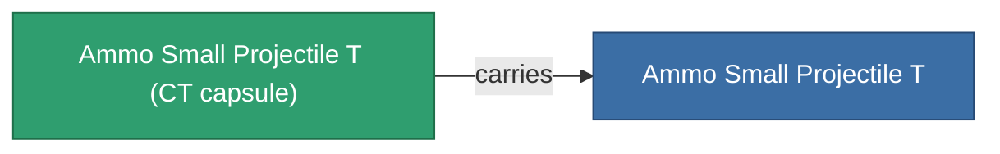

<!-- Generated by tools/generate from the live database (source: entitydefaults definition 5924, aggregatevalues via aggregatefields).
     Do not edit by hand; regenerate instead. -->

# Ammo Small Projectile T

|  |  |
|---|---|
| Definición | `def_ammo_small_projectile_t` |
| Nivel | – |
| Salud | 100 |
| Volumen | 0.5 |
| Masa | 0.1 |
| Categoría | Ammo / Projectiles |
| Nota | toxic ammo small |

## Estadísticas

| Campo | Valor |
|---|---|
| damage_chemical | 6 |
| damage_explosive | 1 |
| damage_kinetic | 1 |
| damage_thermal | 1 |
| damage_toxic | 20 |

## Cápsula de transporte

A transport capsule (CT) exists for this item — it is how the item moves between players and zones.

<!-- production:generated -->
## Producción

**Producido desde 5 componentes** — ensambla los componentes para construirlo (lista completa en [Recetas](/es/content/recipes/)):

**Planos:** [Ammo Small Projectile T Cprg](/content/items/ammo-small-projectile-t-cprg/)

<svg class="prod-card-icon" aria-hidden="true"><use href="#mi-grid"/></svg><a class="prod-card-name" href="/es/content/items/axicoline/">Axicoline</a>

requerido: <b>100</b>

<svg class="prod-card-icon" aria-hidden="true"><use href="#mi-grid"/></svg><a class="prod-card-name" href="/es/content/items/phlobotil/">Phlobotil</a>

requerido: <b>100</b>

<svg class="prod-card-icon" aria-hidden="true"><use href="#mi-grid"/></svg><a class="prod-card-name" href="/es/content/items/polynitrocol/">Polynitrocol</a>

requerido: <b>100</b>

<svg class="prod-card-icon" aria-hidden="true"><use href="#mi-grid"/></svg><a class="prod-card-name" href="/es/content/items/polynucleit/">Polynucleit</a>

requerido: <b>100</b>

<svg class="prod-card-icon" aria-hidden="true"><use href="#mi-grid"/></svg><a class="prod-card-name" href="/es/content/items/titanium/">Titanium</a>

requerido: <b>100</b>

