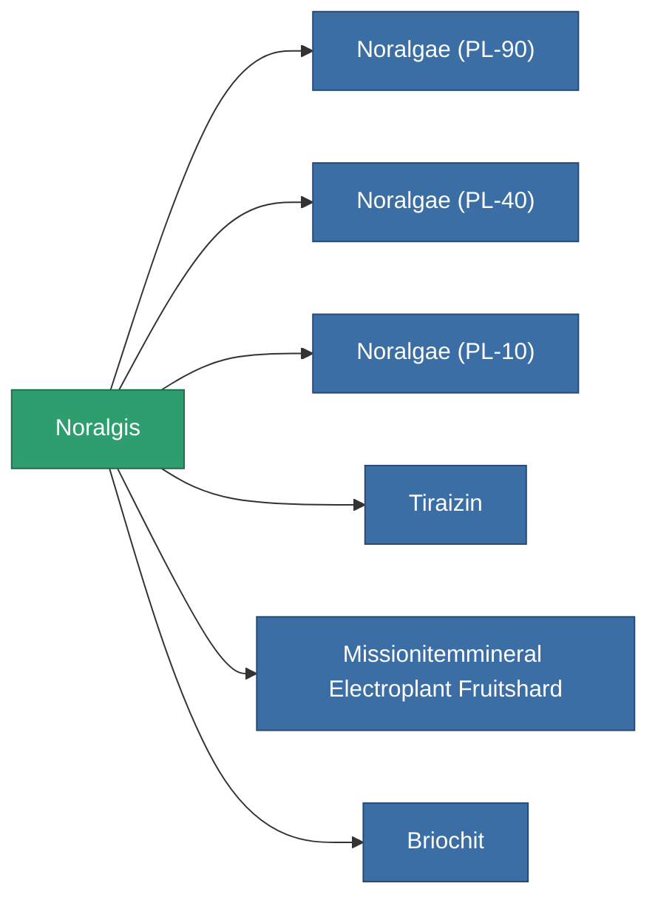

<!-- Generated by tools/generate from the live database (source: entitydefaults definition 2909, aggregatevalues via aggregatefields).
     Do not edit by hand; regenerate instead. -->

# Noralgis

|  |  |
|---|---|
| Definición | `def_electroplant_fruit` |
| Nivel | – |
| Salud | 100 |
| Volumen | 0 |
| Masa | 0.02 |
| Categoría | Materials |

_Sin estadísticas — este elemento no porta valores agregados._

<!-- production:generated -->
## Usado en producción

**Componente de 6 elementos** — todo lo que lo usa en producción:

