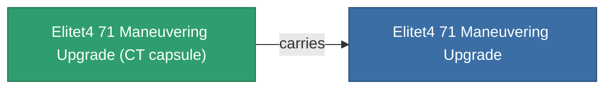

<!-- Generated by tools/generate from the live database (source: entitydefaults definition 6057, aggregatevalues via aggregatefields).
     Do not edit by hand; regenerate instead. -->

# Elitet4 71 Maneuvering Upgrade

|  |  |
|---|---|
| Definición | `def_elitet4_71_maneuvering_upgrade` |
| Nivel | T4 (special) |
| Salud | 100 |
| Volumen | 0.5 |
| Masa | 25 |
| Categoría | Modules / Enhancements |
| Nota | elite module |

## Estadísticas

| Campo | Valor |
|---|---|
| armor_max | 180 |
| cpu_usage | 27 |
| massiveness | 0.075 |
| powergrid_usage | 26 |
| signature_radius | -1.2 |

## Cápsula de transporte

A transport capsule (CT) exists for this item — it is how the item moves between players and zones.

## Dónde comprar

Fixed-price vendors that sell this item (see the [Item shop](/es/content/shop/) for the full catalog).

| Vendor | Qty | Credits | UniCoin |
|---|---|---|---|
| Daoden outpost | ∞ | 500M | 25k |

<!-- production:generated -->
## Producción

**Producido desde 2 componentes** — ensambla los componentes para construirlo (lista completa en [Recetas](/es/content/recipes/)):

**Planos:** [Elitet4 71 Maneuvering Upgrade Cprg](/content/items/elitet4-71-maneuvering-upgrade-cprg/)

<svg class="prod-card-icon" aria-hidden="true"><use href="#mi-grid"/></svg><a class="prod-card-name" href="/es/content/items/material-boss-z71/">Material Boss Z71</a>

requerido: <b>400</b>

<svg class="prod-card-icon" aria-hidden="true"><use href="#mi-panel"/></svg><a class="prod-card-name" href="/es/content/items/named3-maneuvering-upgrade/">Yridan RCD evasive module</a>

requerido: <b>1</b>

