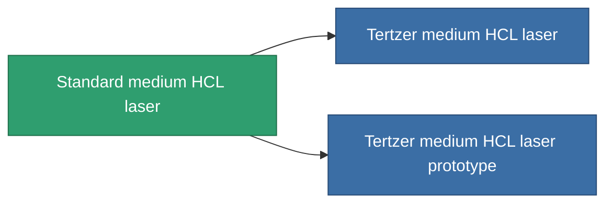

<!-- Generated by tools/generate from the live database (source: entitydefaults definition 1002, aggregatevalues via aggregatefields).
     Do not edit by hand; regenerate instead. -->

# Standard medium HCL laser

|  |  |
|---|---|
| Definición | `def_longrange_standard_medium_laser` |
| Nivel | T1 |
| Salud | 100 |
| Volumen | 1 |
| Masa | 650 |
| Categoría | Modules / Weapons |

## Estadísticas

| Campo | Valor |
|---|---|
| accuracy | 12 |
| core_usage | 20 |
| cpu_usage | 30 |
| cycle_time | 6k |
| damage_modifier | 1 |
| falloff | 10 |
| least_optimal | 11 |
| optimal_range | 35 |
| powergrid_usage | 230 |

<!-- production:generated -->
## Producción

**Producido desde 5 componentes, nivel de investigación 4** — ensambla los componentes para construirlo (lista completa en [Recetas](/es/content/recipes/)):

**Planos:** [Standard medium HCL laser CT](/es/content/items/longrange-standard-medium-laser-cprg/)

<svg class="prod-card-icon" aria-hidden="true"><use href="#mi-grid"/></svg><a class="prod-card-name" href="/es/content/items/axicol/">Cryoperine</a>

requerido: <b>50</b>

<svg class="prod-card-icon" aria-hidden="true"><use href="#mi-grid"/></svg><a class="prod-card-name" href="/es/content/items/axicoline/">Axicoline</a>

requerido: <b>100</b>

<svg class="prod-card-icon" aria-hidden="true"><use href="#mi-grid"/></svg><a class="prod-card-name" href="/es/content/items/polynucleit/">Polynucleit</a>

requerido: <b>100</b>

<svg class="prod-card-icon" aria-hidden="true"><use href="#mi-grid"/></svg><a class="prod-card-name" href="/es/content/items/prilumium/">Prilumium</a>

requerido: <b>50</b>

<svg class="prod-card-icon" aria-hidden="true"><use href="#mi-grid"/></svg><a class="prod-card-name" href="/es/content/items/titanium/">Titanium</a>

requerido: <b>100</b>

## Usado en producción

**Componente de 2 elementos** — todo lo que lo usa en producción:

