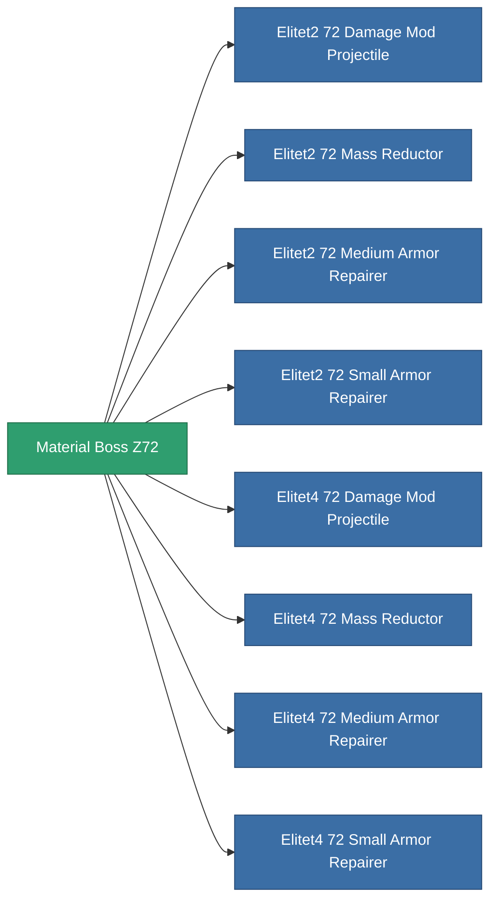

<!-- Generated by tools/generate from the live database (source: entitydefaults definition 6041, aggregatevalues via aggregatefields).
     Do not edit by hand; regenerate instead. -->

# Material Boss Z72

|  |  |
|---|---|
| Definición | `def_material_boss_z72` |
| Nivel | – |
| Salud | 100 |
| Volumen | 0.01 |
| Masa | 0.5 |
| Categoría | Materials |
| Nota | elite module material |

_Sin estadísticas — este elemento no porta valores agregados._

<!-- production:generated -->
## Usado en producción

**Componente de 8 elementos** — todo lo que lo usa en producción:

