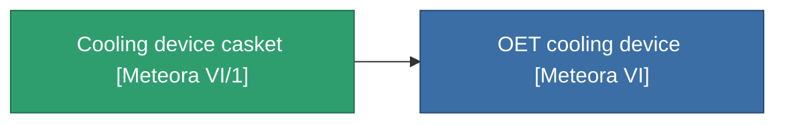

<!-- Generated by tools/generate from the live database (source: entitydefaults definition 4090, aggregatevalues via aggregatefields).
     Do not edit by hand; regenerate instead. -->

# Cooling device casket [Meteora VI/1]

|  |  |
|---|---|
| Definición | `def_missionitem_ics_ii_level02_exp3_06_t01` |
| Nivel | – |
| Salud | 100 |
| Volumen | 1 |
| Masa | 50 |
| Categoría | Mission items |

_Sin estadísticas — este elemento no porta valores agregados._

<!-- production:generated -->
## Usado en producción

**Componente de 1 elementos** — todo lo que lo usa en producción:

