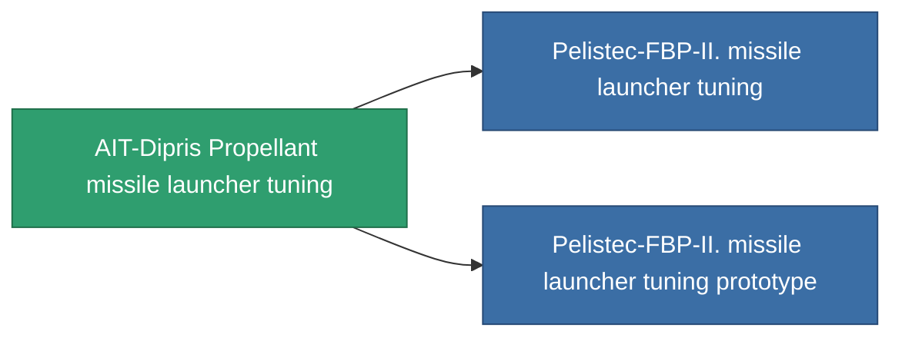

<!-- Generated by tools/generate from the live database (source: entitydefaults definition 927, aggregatevalues via aggregatefields).
     Do not edit by hand; regenerate instead. -->

# AIT-Dipris Propellant missile launcher tuning

|  |  |
|---|---|
| Definición | `def_named1_damage_mod_missile` |
| Nivel | T2 |
| Salud | 100 |
| Volumen | 0.5 |
| Masa | 90 |
| Categoría | Modules / Enhancements |
| Tier line | [Standard missile launcher tuning](/es/content/items/standard-damage-mod-missile/) (T1) → **AIT-Dipris Propellant missile launcher tuning** (T2) → [Pelistec-FBP-II. missile launcher tuning](/es/content/items/named2-damage-mod-missile/) (T3) → [Dozer-IMT missile launcher tuning](/es/content/items/named3-damage-mod-missile/) (T4) |

## Estadísticas

| Campo | Valor |
|---|---|
| cpu_usage | 23 |
| damage_missile_modifier | 0.15 |
| powergrid_usage | 4 |

<!-- production:generated -->
## Producción

**Producido desde 8 componentes, nivel de investigación 4** — ensambla los componentes para construirlo (lista completa en [Recetas](/es/content/recipes/)):

**Planos:** [AIT-Dipris Propellant missile launcher tuning CT](/content/items/named1-damage-mod-missile-cprg/)

<svg class="prod-card-icon" aria-hidden="true"><use href="#mi-grid"/></svg><a class="prod-card-name" href="/es/content/items/axicol/">Cryoperine</a>

requerido: <b>100</b>

<svg class="prod-card-icon" aria-hidden="true"><use href="#mi-grid"/></svg><a class="prod-card-name" href="/es/content/items/axicoline/">Axicoline</a>

requerido: <b>50</b>

<svg class="prod-card-icon" aria-hidden="true"><use href="#mi-grid"/></svg><a class="prod-card-name" href="/es/content/items/phlobotil/">Phlobotil</a>

requerido: <b>50</b>

<svg class="prod-card-icon" aria-hidden="true"><use href="#mi-crystal"/></svg><a class="prod-card-name" href="/es/content/items/robotshard-common-basic/">Damaged common fragment</a>

requerido: <b>15</b>

<svg class="prod-card-icon" aria-hidden="true"><use href="#mi-crystal"/></svg><a class="prod-card-name" href="/es/content/items/robotshard-pelistal-basic/">Damaged pelistal fragment</a>

requerido: <b>15</b>

<svg class="prod-card-icon" aria-hidden="true"><use href="#mi-star"/></svg><a class="prod-card-name" href="/es/content/items/standard-damage-mod-missile/">Standard missile launcher tuning</a>

requerido: <b>1</b>

<svg class="prod-card-icon" aria-hidden="true"><use href="#mi-grid"/></svg><a class="prod-card-name" href="/es/content/items/titanium/">Titanium</a>

requerido: <b>50</b>

<svg class="prod-card-icon" aria-hidden="true"><use href="#mi-grid"/></svg><a class="prod-card-name" href="/es/content/items/vitricyl/">Vitricyl</a>

requerido: <b>100</b>

## Usado en producción

**Componente de 2 elementos** — todo lo que lo usa en producción:

