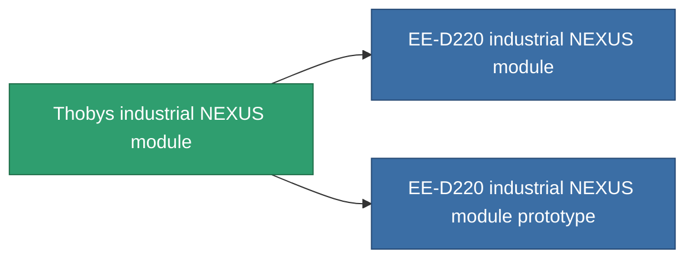

<!-- Generated by tools/generate from the live database (source: entitydefaults definition 2574, aggregatevalues via aggregatefields).
     Do not edit by hand; regenerate instead. -->

# Thobys industrial NEXUS module

|  |  |
|---|---|
| Definición | `def_named1_gang_assist_industry_module` |
| Nivel | T2 |
| Salud | 100 |
| Volumen | 0.2 |
| Masa | 10 |
| Categoría | Modules / Enhancements |
| Tier line | [Standard industrial NEXUS module](/es/content/items/standard-gang-assist-industry-module/) (T1) → **Thobys industrial NEXUS module** (T2) → [EE-D220 industrial NEXUS module](/es/content/items/named2-gang-assist-industry-module/) (T3) → [Rypoa industrial NEXUS module](/es/content/items/named3-gang-assist-industry-module/) (T4) |
| Nota | core_usage gathering  1.5% / ext lvl   |

## Estadísticas

| Campo | Valor |
|---|---|
| core_usage | 31 |
| cpu_usage | 78 |
| cycle_time | 10k |
| default_effect_range | 100 |
| effect_core_usage_gathering_modifier | 0.98 |
| powergrid_usage | 31 |

<!-- production:generated -->
## Producción

**Producido desde 5 componentes, nivel de investigación 5** — ensambla los componentes para construirlo (lista completa en [Recetas](/es/content/recipes/)):

**Planos:** [Thobys industrial NEXUS module CT](/content/items/named1-gang-assist-industry-module-cprg/)

<svg class="prod-card-icon" aria-hidden="true"><use href="#mi-grid"/></svg><a class="prod-card-name" href="/es/content/items/axicol/">Cryoperine</a>

requerido: <b>500</b>

<svg class="prod-card-icon" aria-hidden="true"><use href="#mi-grid"/></svg><a class="prod-card-name" href="/es/content/items/plasteosine/">Plasteosine</a>

requerido: <b>100</b>

<svg class="prod-card-icon" aria-hidden="true"><use href="#mi-crystal"/></svg><a class="prod-card-name" href="/es/content/items/robotshard-common-basic/">Damaged common fragment</a>

requerido: <b>30</b>

<svg class="prod-card-icon" aria-hidden="true"><use href="#mi-panel"/></svg><a class="prod-card-name" href="/es/content/items/standard-gang-assist-industry-module/">Standard industrial NEXUS module</a>

requerido: <b>1</b>

<svg class="prod-card-icon" aria-hidden="true"><use href="#mi-grid"/></svg><a class="prod-card-name" href="/es/content/items/titanium/">Titanium</a>

requerido: <b>50</b>

## Usado en producción

**Componente de 2 elementos** — todo lo que lo usa en producción:

