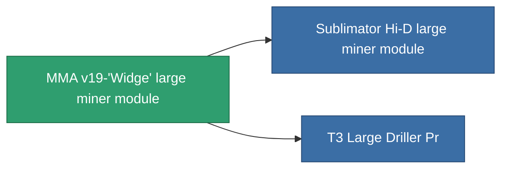

<!-- Generated by tools/generate from the live database (source: entitydefaults definition 8680, aggregatevalues via aggregatefields).
     Do not edit by hand; regenerate instead. -->

# MMA v19-'Widge' large miner module

|  |  |
|---|---|
| Definición | `def_named1_large_driller` |
| Nivel | T2 |
| Salud | 100 |
| Volumen | 2.5 |
| Masa | 1500 |
| Categoría | Modules / Enhancements |
| Tier line | [Standard large miner module](/es/content/items/standard-large-driller/) (T1) → **MMA v19-'Widge' large miner module** (T2) → [Sublimator Hi-D large miner module](/es/content/items/named2-large-driller/) (T3) → [Pellex large miner module](/es/content/items/named3-large-driller/) (T4) |

## Estadísticas

| Campo | Valor |
|---|---|
| core_usage | 135 |
| cpu_usage | 432 |
| cycle_time | 12k |
| powergrid_usage | 1.215k |

<!-- production:generated -->
## Producción

**Producido desde 4 componentes** — ensambla los componentes para construirlo (lista completa en [Recetas](/es/content/recipes/)):

**Planos:** [T2 Large Driller Cprg](/content/items/named1-large-driller-cprg/)

<svg class="prod-card-icon" aria-hidden="true"><use href="#mi-grid"/></svg><a class="prod-card-name" href="/es/content/items/axicol/">Cryoperine</a>

requerido: <b>600</b>

<svg class="prod-card-icon" aria-hidden="true"><use href="#mi-crystal"/></svg><a class="prod-card-name" href="/es/content/items/robotshard-common-basic/">Damaged common fragment</a>

requerido: <b>120</b>

<svg class="prod-card-icon" aria-hidden="true"><use href="#mi-panel"/></svg><a class="prod-card-name" href="/es/content/items/standard-large-driller/">Standard large miner module</a>

requerido: <b>1</b>

<svg class="prod-card-icon" aria-hidden="true"><use href="#mi-grid"/></svg><a class="prod-card-name" href="/es/content/items/titanium/">Titanium</a>

requerido: <b>2.4k</b>

## Usado en producción

**Componente de 2 elementos** — todo lo que lo usa en producción:

