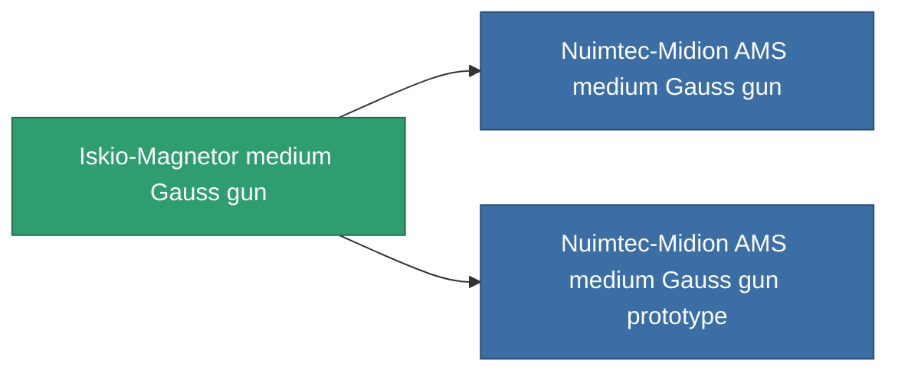

<!-- Generated by tools/generate from the live database (source: entitydefaults definition 861, aggregatevalues via aggregatefields).
     Do not edit by hand; regenerate instead. -->

# Iskio-Magnetor medium Gauss gun

|  |  |
|---|---|
| Definición | `def_named1_medium_railgun` |
| Nivel | T2 |
| Salud | 100 |
| Volumen | 1 |
| Masa | 450 |
| Categoría | Modules / Weapons |
| Tier line | [Standard medium Gauss gun](/es/content/items/standard-medium-railgun/) (T1) → **Iskio-Magnetor medium Gauss gun** (T2) → [Nuimtec-Midion AMS medium Gauss gun](/es/content/items/named2-medium-railgun/) (T3) → [Prompt medium Gauss gun](/es/content/items/named3-medium-railgun/) (T4) |

## Estadísticas

| Campo | Valor |
|---|---|
| accuracy | 13.5 |
| core_usage | 12 |
| cpu_usage | 29 |
| cycle_time | 6k |
| damage_modifier | 1.7 |
| falloff | 7.5 |
| least_optimal | 12 |
| optimal_range | 15 |
| powergrid_usage | 135 |

<!-- production:generated -->
## Producción

**Producido desde 6 componentes, nivel de investigación 5** — ensambla los componentes para construirlo (lista completa en [Recetas](/es/content/recipes/)):

**Planos:** [Iskio-Magnetor medium Gauss gun CT](/es/content/items/named1-medium-railgun-cprg/)

<svg class="prod-card-icon" aria-hidden="true"><use href="#mi-grid"/></svg><a class="prod-card-name" href="/es/content/items/axicoline/">Axicoline</a>

requerido: <b>100</b>

<svg class="prod-card-icon" aria-hidden="true"><use href="#mi-grid"/></svg><a class="prod-card-name" href="/es/content/items/polynitrocol/">Polynitrocol</a>

requerido: <b>100</b>

<svg class="prod-card-icon" aria-hidden="true"><use href="#mi-crystal"/></svg><a class="prod-card-name" href="/es/content/items/robotshard-common-basic/">Damaged common fragment</a>

requerido: <b>30</b>

<svg class="prod-card-icon" aria-hidden="true"><use href="#mi-crystal"/></svg><a class="prod-card-name" href="/es/content/items/robotshard-nuimqol-basic/">Damaged nuimqol fragment</a>

requerido: <b>30</b>

<svg class="prod-card-icon" aria-hidden="true"><use href="#mi-grid"/></svg><a class="prod-card-name" href="/es/content/items/standard-medium-railgun/">Standard medium Gauss gun</a>

requerido: <b>1</b>

<svg class="prod-card-icon" aria-hidden="true"><use href="#mi-grid"/></svg><a class="prod-card-name" href="/es/content/items/titanium/">Titanium</a>

requerido: <b>100</b>

## Usado en producción

**Componente de 2 elementos** — todo lo que lo usa en producción:

