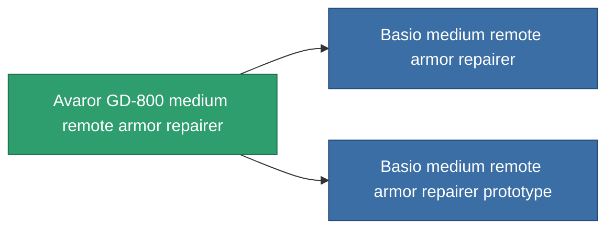

<!-- Generated by tools/generate from the live database (source: entitydefaults definition 705, aggregatevalues via aggregatefields).
     Do not edit by hand; regenerate instead. -->

# Avaror GD-800 medium remote armor repairer

|  |  |
|---|---|
| Definición | `def_named1_medium_remote_armor_repairer` |
| Nivel | T2 |
| Salud | 100 |
| Volumen | 1.5 |
| Masa | 450 |
| Categoría | Modules / Repair |
| Tier line | [Standard medium remote armor repairer](/es/content/items/standard-medium-remote-armor-repairer/) (T1) → **Avaror GD-800 medium remote armor repairer** (T2) → [Basio medium remote armor repairer](/es/content/items/named2-medium-remote-armor-repairer/) (T3) → [ALS medium remote armor repairer](/es/content/items/named3-medium-remote-armor-repairer/) (T4) |

## Estadísticas

| Campo | Valor |
|---|---|
| armor_repair_amount | 180 |
| core_usage | 340 |
| cpu_usage | 55 |
| cycle_time | 20k |
| falloff | 0 |
| optimal_range | 20 |
| powergrid_usage | 110 |

<!-- production:generated -->
## Producción

**Producido desde 5 componentes, nivel de investigación 5** — ensambla los componentes para construirlo (lista completa en [Recetas](/es/content/recipes/)):

**Planos:** [Avaror GD-800 medium remote armor repairer CT](/content/items/named1-medium-remote-armor-repairer-cprg/)

<svg class="prod-card-icon" aria-hidden="true"><use href="#mi-grid"/></svg><a class="prod-card-name" href="/es/content/items/axicol/">Cryoperine</a>

requerido: <b>100</b>

<svg class="prod-card-icon" aria-hidden="true"><use href="#mi-grid"/></svg><a class="prod-card-name" href="/es/content/items/plasteosine/">Plasteosine</a>

requerido: <b>500</b>

<svg class="prod-card-icon" aria-hidden="true"><use href="#mi-crystal"/></svg><a class="prod-card-name" href="/es/content/items/robotshard-common-basic/">Damaged common fragment</a>

requerido: <b>60</b>

<svg class="prod-card-icon" aria-hidden="true"><use href="#mi-tree"/></svg><a class="prod-card-name" href="/es/content/items/standard-medium-remote-armor-repairer/">Standard medium remote armor repairer</a>

requerido: <b>1</b>

<svg class="prod-card-icon" aria-hidden="true"><use href="#mi-grid"/></svg><a class="prod-card-name" href="/es/content/items/titanium/">Titanium</a>

requerido: <b>200</b>

## Usado en producción

**Componente de 2 elementos** — todo lo que lo usa en producción:

