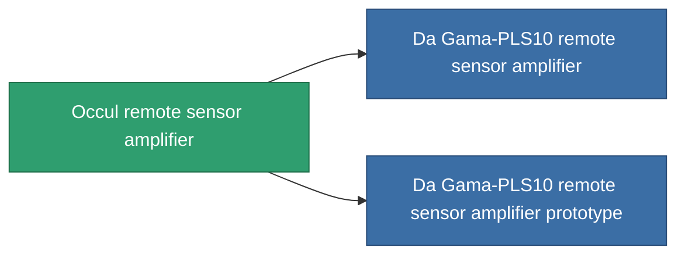

<!-- Generated by tools/generate from the live database (source: entitydefaults definition 771, aggregatevalues via aggregatefields).
     Do not edit by hand; regenerate instead. -->

# Occul remote sensor amplifier

|  |  |
|---|---|
| Definición | `def_named1_remote_sensor_booster` |
| Nivel | T2 |
| Salud | 100 |
| Volumen | 0.5 |
| Masa | 90 |
| Categoría | Modules / Sensors & scanning |
| Tier line | [Standard remote sensor amplifier](/es/content/items/standard-remote-sensor-booster/) (T1) → **Occul remote sensor amplifier** (T2) → [Da Gama-PLS10 remote sensor amplifier](/es/content/items/named2-remote-sensor-booster/) (T3) → [Ambassador-RU2 remote sensor amplifier](/es/content/items/named3-remote-sensor-booster/) (T4) |

## Estadísticas

| Campo | Valor |
|---|---|
| core_usage | 14 |
| cpu_usage | 18 |
| cycle_time | 10k |
| effect_sensor_booster_locking_range_modifier | 1.3 |
| effect_sensor_booster_locking_time_modifier | 0.8 |
| falloff | 0 |
| optimal_range | 30 |
| powergrid_usage | 6 |

<!-- production:generated -->
## Producción

**Producido desde 4 componentes, nivel de investigación 4** — ensambla los componentes para construirlo (lista completa en [Recetas](/es/content/recipes/)):

**Planos:** [Occul remote sensor amplifier CT](/content/items/named1-remote-sensor-booster-cprg/)

<svg class="prod-card-icon" aria-hidden="true"><use href="#mi-grid"/></svg><a class="prod-card-name" href="/es/content/items/axicol/">Cryoperine</a>

requerido: <b>400</b>

<svg class="prod-card-icon" aria-hidden="true"><use href="#mi-crystal"/></svg><a class="prod-card-name" href="/es/content/items/robotshard-common-basic/">Damaged common fragment</a>

requerido: <b>30</b>

<svg class="prod-card-icon" aria-hidden="true"><use href="#mi-grid"/></svg><a class="prod-card-name" href="/es/content/items/standard-remote-sensor-booster/">Standard remote sensor amplifier</a>

requerido: <b>1</b>

<svg class="prod-card-icon" aria-hidden="true"><use href="#mi-grid"/></svg><a class="prod-card-name" href="/es/content/items/titanium/">Titanium</a>

requerido: <b>100</b>

## Usado en producción

**Componente de 2 elementos** — todo lo que lo usa en producción:

