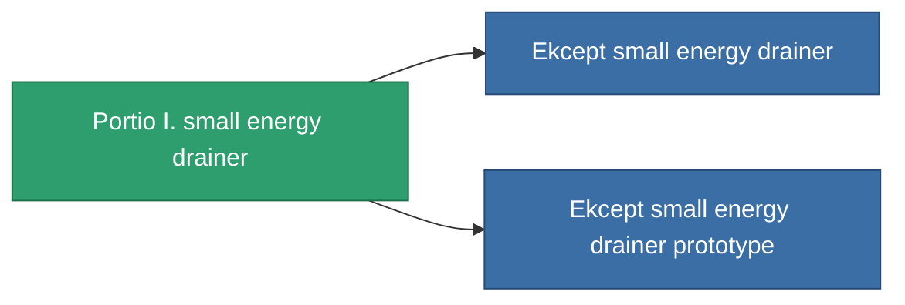

<!-- Generated by tools/generate from the live database (source: entitydefaults definition 744, aggregatevalues via aggregatefields).
     Do not edit by hand; regenerate instead. -->

# Portio I. small energy drainer

|  |  |
|---|---|
| Definición | `def_named1_small_energy_vampire` |
| Nivel | T2 |
| Salud | 100 |
| Volumen | 0.5 |
| Masa | 94 |
| Categoría | Modules / Shield |
| Tier line | [Standard small energy drainer](/es/content/items/standard-small-energy-vampire/) (T1) → **Portio I. small energy drainer** (T2) → [Ekcept small energy drainer](/es/content/items/named2-small-energy-vampire/) (T3) → [Io-trail SVU small energy drainer](/es/content/items/named3-small-energy-vampire/) (T4) |
| Nota | range = optimal_range *  energy_transferers_optimal_range_modifier    cel core -= energy_vampired_amount  sajat core += energy_vampired_amount    csak akkor mukodik ha a cel coreja nagyobb mint a tied. |

## Estadísticas

| Campo | Valor |
|---|---|
| core_usage | 5 |
| cpu_usage | 43 |
| cycle_time | 8k |
| energy_dispersion | 4 |
| energy_vampired_amount | 20 |
| falloff | 0 |
| optimal_range | 12.5 |
| powergrid_usage | 33 |

<!-- production:generated -->
## Producción

**Producido desde 6 componentes, nivel de investigación 3** — ensambla los componentes para construirlo (lista completa en [Recetas](/es/content/recipes/)):

**Planos:** [Portio I. small energy drainer CT](/content/items/named1-small-energy-vampire-cprg/)

<svg class="prod-card-icon" aria-hidden="true"><use href="#mi-grid"/></svg><a class="prod-card-name" href="/es/content/items/axicol/">Cryoperine</a>

requerido: <b>200</b>

<svg class="prod-card-icon" aria-hidden="true"><use href="#mi-grid"/></svg><a class="prod-card-name" href="/es/content/items/axicoline/">Axicoline</a>

requerido: <b>100</b>

<svg class="prod-card-icon" aria-hidden="true"><use href="#mi-crystal"/></svg><a class="prod-card-name" href="/es/content/items/robotshard-common-basic/">Damaged common fragment</a>

requerido: <b>15</b>

<svg class="prod-card-icon" aria-hidden="true"><use href="#mi-crystal"/></svg><a class="prod-card-name" href="/es/content/items/robotshard-pelistal-basic/">Damaged pelistal fragment</a>

requerido: <b>15</b>

<svg class="prod-card-icon" aria-hidden="true"><use href="#mi-grid"/></svg><a class="prod-card-name" href="/es/content/items/standard-small-energy-vampire/">Standard small energy drainer</a>

requerido: <b>1</b>

<svg class="prod-card-icon" aria-hidden="true"><use href="#mi-grid"/></svg><a class="prod-card-name" href="/es/content/items/titanium/">Titanium</a>

requerido: <b>100</b>

## Usado en producción

**Componente de 2 elementos** — todo lo que lo usa en producción:

