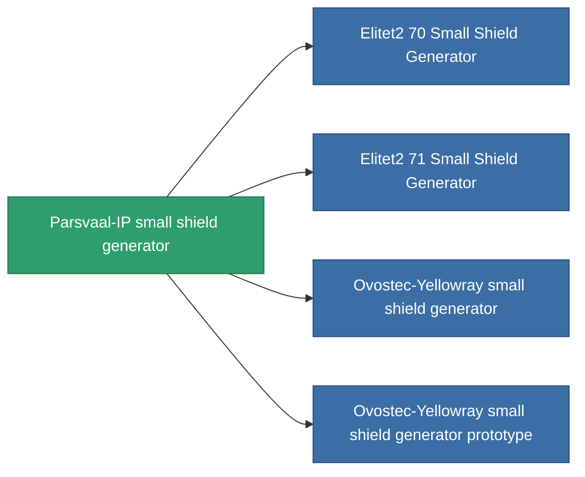

<!-- Generated by tools/generate from the live database (source: entitydefaults definition 723, aggregatevalues via aggregatefields).
     Do not edit by hand; regenerate instead. -->

# Parsvaal-IP small shield generator

|  |  |
|---|---|
| Definición | `def_named1_small_shield_generator` |
| Nivel | T2 |
| Salud | 100 |
| Volumen | 0.3 |
| Masa | 180 |
| Categoría | Modules / Shield |
| Tier line | [Standard small shield generator](/es/content/items/standard-small-shield-generator/) (T1) → **Parsvaal-IP small shield generator** (T2) → [Ovostec-Yellowray small shield generator](/es/content/items/named2-small-shield-generator/) (T3) → [SBA-200 Forebrace small shield generator](/es/content/items/named3-small-shield-generator/) (T4) |
| Nota | damage to core = shield_absorbtion * shield_absorbtion_modifier  amig ez a modul fut addig nincs damage, csak a core-bol von le.  |

## Estadísticas

| Campo | Valor |
|---|---|
| core_usage | 1 |
| cpu_usage | 40 |
| cycle_time | 2.5k |
| powergrid_usage | 45 |
| shield_absorbtion | 2 |
| shield_radius | 4.5 |

<!-- production:generated -->
## Producción

**Producido desde 7 componentes, nivel de investigación 3** — ensambla los componentes para construirlo (lista completa en [Recetas](/es/content/recipes/)):

**Planos:** [Parsvaal-IP small shield generator CT](/content/items/named1-small-shield-generator-cprg/)

<svg class="prod-card-icon" aria-hidden="true"><use href="#mi-grid"/></svg><a class="prod-card-name" href="/es/content/items/axicol/">Cryoperine</a>

requerido: <b>100</b>

<svg class="prod-card-icon" aria-hidden="true"><use href="#mi-grid"/></svg><a class="prod-card-name" href="/es/content/items/isopropentol/">Isopropentol</a>

requerido: <b>200</b>

<svg class="prod-card-icon" aria-hidden="true"><use href="#mi-grid"/></svg><a class="prod-card-name" href="/es/content/items/plasteosine/">Plasteosine</a>

requerido: <b>200</b>

<svg class="prod-card-icon" aria-hidden="true"><use href="#mi-crystal"/></svg><a class="prod-card-name" href="/es/content/items/robotshard-common-basic/">Damaged common fragment</a>

requerido: <b>30</b>

<svg class="prod-card-icon" aria-hidden="true"><use href="#mi-tree"/></svg><a class="prod-card-name" href="/es/content/items/standard-small-shield-generator/">Standard small shield generator</a>

requerido: <b>1</b>

<svg class="prod-card-icon" aria-hidden="true"><use href="#mi-grid"/></svg><a class="prod-card-name" href="/es/content/items/titanium/">Titanium</a>

requerido: <b>100</b>

<svg class="prod-card-icon" aria-hidden="true"><use href="#mi-grid"/></svg><a class="prod-card-name" href="/es/content/items/vitricyl/">Vitricyl</a>

requerido: <b>100</b>

## Usado en producción

**Componente de 4 elementos** — todo lo que lo usa en producción:

