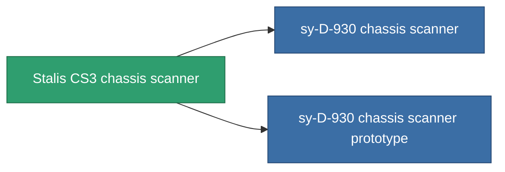

<!-- Generated by tools/generate from the live database (source: entitydefaults definition 778, aggregatevalues via aggregatefields).
     Do not edit by hand; regenerate instead. -->

# Stalis CS3 chassis scanner

|  |  |
|---|---|
| Definición | `def_named2_chassis_scanner` |
| Nivel | T3 |
| Salud | 100 |
| Volumen | 0.5 |
| Masa | 200 |
| Categoría | Modules / Sensors & scanning |
| Tier line | [Standard chassis scanner](/es/content/items/standard-chassis-scanner/) (T1) → [Distalfrisk-MDO2 chassis scanner](/es/content/items/named1-chassis-scanner/) (T2) → **Stalis CS3 chassis scanner** (T3) → [sy-D-930 chassis scanner](/es/content/items/named3-chassis-scanner/) (T4) |

## Estadísticas

| Campo | Valor |
|---|---|
| core_usage | 20 |
| cpu_usage | 17 |
| cycle_time | 5k |
| falloff | 10 |
| optimal_range | 30 |
| powergrid_usage | 5 |

<!-- production:generated -->
## Producción

**Producido desde 6 componentes, nivel de investigación 5** — ensambla los componentes para construirlo (lista completa en [Recetas](/es/content/recipes/)):

**Planos:** [Stalis CS3 chassis scanner CT](/es/content/items/named2-chassis-scanner-cprg/)

<svg class="prod-card-icon" aria-hidden="true"><use href="#mi-grid"/></svg><a class="prod-card-name" href="/es/content/items/axicol/">Cryoperine</a>

requerido: <b>125</b>

<svg class="prod-card-icon" aria-hidden="true"><use href="#mi-grid"/></svg><a class="prod-card-name" href="/es/content/items/espitium/">Espitium</a>

requerido: <b>125</b>

<svg class="prod-card-icon" aria-hidden="true"><use href="#mi-grid"/></svg><a class="prod-card-name" href="/es/content/items/named1-chassis-scanner/">Distalfrisk-MDO2 chassis scanner</a>

requerido: <b>1</b>

<svg class="prod-card-icon" aria-hidden="true"><use href="#mi-crystal"/></svg><a class="prod-card-name" href="/es/content/items/robotshard-common-advanced/">Functional common fragment</a>

requerido: <b>20</b>

<svg class="prod-card-icon" aria-hidden="true"><use href="#mi-crystal"/></svg><a class="prod-card-name" href="/es/content/items/robotshard-common-basic/">Damaged common fragment</a>

requerido: <b>20</b>

<svg class="prod-card-icon" aria-hidden="true"><use href="#mi-grid"/></svg><a class="prod-card-name" href="/es/content/items/titanium/">Titanium</a>

requerido: <b>50</b>

## Usado en producción

**Componente de 2 elementos** — todo lo que lo usa en producción:

