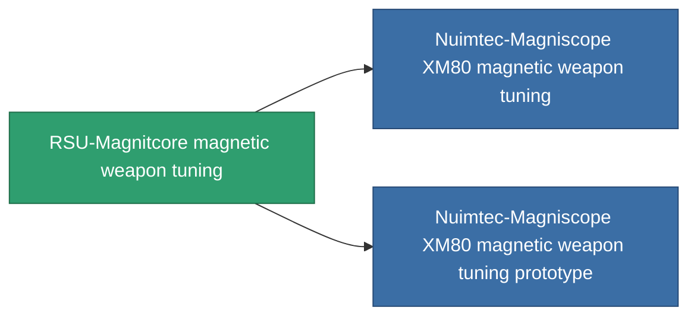

<!-- Generated by tools/generate from the live database (source: entitydefaults definition 925, aggregatevalues via aggregatefields).
     Do not edit by hand; regenerate instead. -->

# RSU-Magnitcore magnetic weapon tuning

|  |  |
|---|---|
| Definición | `def_named2_damage_mod_railgun` |
| Nivel | T3 |
| Salud | 100 |
| Volumen | 0.5 |
| Masa | 100 |
| Categoría | Modules / Weapons |
| Tier line | [Standard magnetic weapon tuning](/es/content/items/standard-damage-mod-railgun/) (T1) → [Nuimtec-Spilster magnetic weapon tuning](/es/content/items/named1-damage-mod-railgun/) (T2) → **RSU-Magnitcore magnetic weapon tuning** (T3) → [Nuimtec-Magniscope XM80 magnetic weapon tuning](/es/content/items/named3-damage-mod-railgun/) (T4) |

## Estadísticas

| Campo | Valor |
|---|---|
| cpu_usage | 27 |
| damage_railgun_modifier | 0.2 |
| powergrid_usage | 5 |

<!-- production:generated -->
## Producción

**Producido desde 10 componentes, nivel de investigación 5** — ensambla los componentes para construirlo (lista completa en [Recetas](/es/content/recipes/)):

**Planos:** [RSU-Magnitcore magnetic weapon tuning CT](/es/content/items/named2-damage-mod-railgun-cprg/)

<svg class="prod-card-icon" aria-hidden="true"><use href="#mi-grid"/></svg><a class="prod-card-name" href="/es/content/items/chollonin/">Chollonin</a>

requerido: <b>100</b>

<svg class="prod-card-icon" aria-hidden="true"><use href="#mi-grid"/></svg><a class="prod-card-name" href="/es/content/items/espitium/">Espitium</a>

requerido: <b>100</b>

<svg class="prod-card-icon" aria-hidden="true"><use href="#mi-grid"/></svg><a class="prod-card-name" href="/es/content/items/hydrobenol/">Hydrobenol</a>

requerido: <b>50</b>

<svg class="prod-card-icon" aria-hidden="true"><use href="#mi-robots"/></svg><a class="prod-card-name" href="/es/content/items/named1-damage-mod-railgun/">Nuimtec-Spilster magnetic weapon tuning</a>

requerido: <b>1</b>

<svg class="prod-card-icon" aria-hidden="true"><use href="#mi-grid"/></svg><a class="prod-card-name" href="/es/content/items/polynitrocol/">Polynitrocol</a>

requerido: <b>50</b>

<svg class="prod-card-icon" aria-hidden="true"><use href="#mi-crystal"/></svg><a class="prod-card-name" href="/es/content/items/robotshard-common-advanced/">Functional common fragment</a>

requerido: <b>10</b>

<svg class="prod-card-icon" aria-hidden="true"><use href="#mi-crystal"/></svg><a class="prod-card-name" href="/es/content/items/robotshard-common-basic/">Damaged common fragment</a>

requerido: <b>10</b>

<svg class="prod-card-icon" aria-hidden="true"><use href="#mi-crystal"/></svg><a class="prod-card-name" href="/es/content/items/robotshard-nuimqol-advanced/">Functional nuimqol fragment</a>

requerido: <b>10</b>

<svg class="prod-card-icon" aria-hidden="true"><use href="#mi-crystal"/></svg><a class="prod-card-name" href="/es/content/items/robotshard-nuimqol-basic/">Damaged nuimqol fragment</a>

requerido: <b>10</b>

<svg class="prod-card-icon" aria-hidden="true"><use href="#mi-grid"/></svg><a class="prod-card-name" href="/es/content/items/titanium/">Titanium</a>

requerido: <b>50</b>

## Usado en producción

**Componente de 2 elementos** — todo lo que lo usa en producción:

