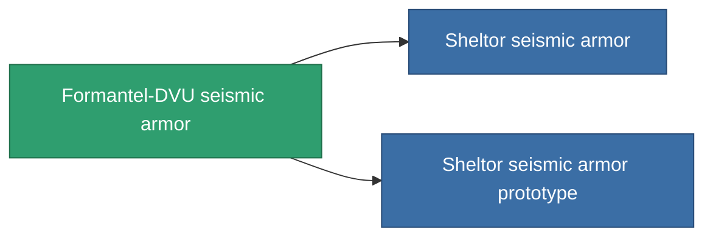

<!-- Generated by tools/generate from the live database (source: entitydefaults definition 718, aggregatevalues via aggregatefields).
     Do not edit by hand; regenerate instead. -->

# Formantel-DVU seismic armor

|  |  |
|---|---|
| Definición | `def_named2_exp_armor_hardener` |
| Nivel | T3 |
| Salud | 100 |
| Volumen | 1 |
| Masa | 100 |
| Categoría | Modules / Armor |
| Tier line | [Standard seismic armor](/es/content/items/standard-exp-armor-hardener/) (T1) → [Ballistris I. seismic armor](/es/content/items/named1-exp-armor-hardener/) (T2) → **Formantel-DVU seismic armor** (T3) → [Sheltor seismic armor](/es/content/items/named3-exp-armor-hardener/) (T4) |

## Estadísticas

| Campo | Valor |
|---|---|
| core_usage | 13 |
| cpu_usage | 25 |
| cycle_time | 10k |
| effect_resist_explosive | 110 |
| powergrid_usage | 5 |
| resist_explosive | 25 |

<!-- production:generated -->
## Producción

**Producido desde 10 componentes, nivel de investigación 5** — ensambla los componentes para construirlo (lista completa en [Recetas](/es/content/recipes/)):

**Planos:** [Formantel-DVU seismic armor CT](/content/items/named2-exp-armor-hardener-cprg/)

<svg class="prod-card-icon" aria-hidden="true"><use href="#mi-grid"/></svg><a class="prod-card-name" href="/es/content/items/alligior/">Alligior</a>

requerido: <b>125</b>

<svg class="prod-card-icon" aria-hidden="true"><use href="#mi-grid"/></svg><a class="prod-card-name" href="/es/content/items/chollonin/">Chollonin</a>

requerido: <b>50</b>

<svg class="prod-card-icon" aria-hidden="true"><use href="#mi-grid"/></svg><a class="prod-card-name" href="/es/content/items/espitium/">Espitium</a>

requerido: <b>50</b>

<svg class="prod-card-icon" aria-hidden="true"><use href="#mi-tree"/></svg><a class="prod-card-name" href="/es/content/items/named1-exp-armor-hardener/">Ballistris I. seismic armor</a>

requerido: <b>1</b>

<svg class="prod-card-icon" aria-hidden="true"><use href="#mi-crystal"/></svg><a class="prod-card-name" href="/es/content/items/robotshard-common-advanced/">Functional common fragment</a>

requerido: <b>10</b>

<svg class="prod-card-icon" aria-hidden="true"><use href="#mi-crystal"/></svg><a class="prod-card-name" href="/es/content/items/robotshard-common-basic/">Damaged common fragment</a>

requerido: <b>10</b>

<svg class="prod-card-icon" aria-hidden="true"><use href="#mi-crystal"/></svg><a class="prod-card-name" href="/es/content/items/robotshard-thelodica-advanced/">Functional thelodica fragment</a>

requerido: <b>10</b>

<svg class="prod-card-icon" aria-hidden="true"><use href="#mi-crystal"/></svg><a class="prod-card-name" href="/es/content/items/robotshard-thelodica-basic/">Damaged thelodica fragment</a>

requerido: <b>10</b>

<svg class="prod-card-icon" aria-hidden="true"><use href="#mi-grid"/></svg><a class="prod-card-name" href="/es/content/items/statichnol/">Statichnol</a>

requerido: <b>125</b>

<svg class="prod-card-icon" aria-hidden="true"><use href="#mi-grid"/></svg><a class="prod-card-name" href="/es/content/items/titanium/">Titanium</a>

requerido: <b>100</b>

## Usado en producción

**Componente de 2 elementos** — todo lo que lo usa en producción:

