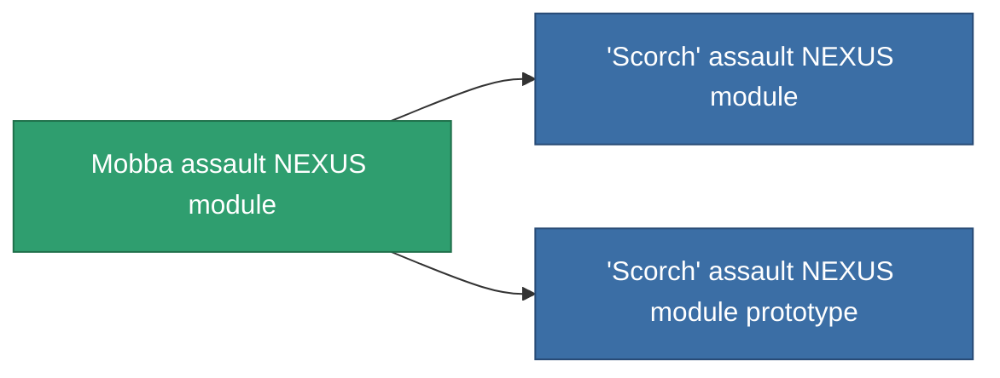

<!-- Generated by tools/generate from the live database (source: entitydefaults definition 2578, aggregatevalues via aggregatefields).
     Do not edit by hand; regenerate instead. -->

# Mobba assault NEXUS module

|  |  |
|---|---|
| Definición | `def_named2_gang_assist_siege_module` |
| Nivel | T3 |
| Salud | 100 |
| Volumen | 0.2 |
| Masa | 10 |
| Categoría | Modules / Enhancements |
| Tier line | [Standard assault NEXUS module](/es/content/items/standard-gang-assist-siege-module/) (T1) → [Myrmidon assault NEXUS module](/es/content/items/named1-gang-assist-siege-module/) (T2) → **Mobba assault NEXUS module** (T3) → ['Scorch' assault NEXUS module](/es/content/items/named3-gang-assist-siege-module/) (T4) |
| Nota | weapon cycletime 1.0% / ext lvl |

## Estadísticas

| Campo | Valor |
|---|---|
| core_usage | 36 |
| cpu_usage | 88 |
| cycle_time | 10k |
| default_effect_range | 100 |
| effect_weapon_cycle_time_modifier | 0.95 |
| powergrid_usage | 36 |

<!-- production:generated -->
## Producción

**Producido desde 10 componentes, nivel de investigación 6** — ensambla los componentes para construirlo (lista completa en [Recetas](/es/content/recipes/)):

**Planos:** [Mobba assault NEXUS module CT](/es/content/items/named2-gang-assist-siege-module-cprg/)

<svg class="prod-card-icon" aria-hidden="true"><use href="#mi-grid"/></svg><a class="prod-card-name" href="/es/content/items/chollonin/">Chollonin</a>

requerido: <b>250</b>

<svg class="prod-card-icon" aria-hidden="true"><use href="#mi-grid"/></svg><a class="prod-card-name" href="/es/content/items/espitium/">Espitium</a>

requerido: <b>250</b>

<svg class="prod-card-icon" aria-hidden="true"><use href="#mi-grid"/></svg><a class="prod-card-name" href="/es/content/items/hydrobenol/">Hydrobenol</a>

requerido: <b>50</b>

<svg class="prod-card-icon" aria-hidden="true"><use href="#mi-panel"/></svg><a class="prod-card-name" href="/es/content/items/named1-gang-assist-siege-module/">Myrmidon assault NEXUS module</a>

requerido: <b>1</b>

<svg class="prod-card-icon" aria-hidden="true"><use href="#mi-grid"/></svg><a class="prod-card-name" href="/es/content/items/polynitrocol/">Polynitrocol</a>

requerido: <b>50</b>

<svg class="prod-card-icon" aria-hidden="true"><use href="#mi-crystal"/></svg><a class="prod-card-name" href="/es/content/items/robotshard-nuimqol-advanced/">Functional nuimqol fragment</a>

requerido: <b>10</b>

<svg class="prod-card-icon" aria-hidden="true"><use href="#mi-crystal"/></svg><a class="prod-card-name" href="/es/content/items/robotshard-nuimqol-basic/">Damaged nuimqol fragment</a>

requerido: <b>10</b>

<svg class="prod-card-icon" aria-hidden="true"><use href="#mi-crystal"/></svg><a class="prod-card-name" href="/es/content/items/robotshard-thelodica-advanced/">Functional thelodica fragment</a>

requerido: <b>10</b>

<svg class="prod-card-icon" aria-hidden="true"><use href="#mi-crystal"/></svg><a class="prod-card-name" href="/es/content/items/robotshard-thelodica-basic/">Damaged thelodica fragment</a>

requerido: <b>10</b>

<svg class="prod-card-icon" aria-hidden="true"><use href="#mi-grid"/></svg><a class="prod-card-name" href="/es/content/items/titanium/">Titanium</a>

requerido: <b>50</b>

## Usado en producción

**Componente de 2 elementos** — todo lo que lo usa en producción:

