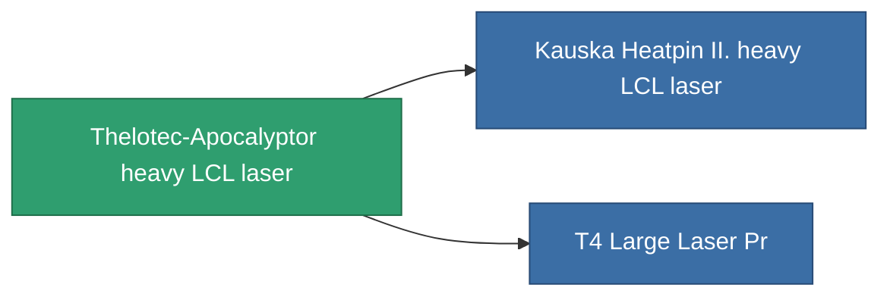

<!-- Generated by tools/generate from the live database (source: entitydefaults definition 838, aggregatevalues via aggregatefields).
     Do not edit by hand; regenerate instead. -->

# Thelotec-Apocalyptor heavy LCL laser

|  |  |
|---|---|
| Definición | `def_named2_large_laser` |
| Nivel | T3 |
| Salud | 100 |
| Volumen | 1.5 |
| Masa | 1000 |
| Categoría | Modules / Weapons |
| Tier line | [Standard heavy LCL laser](/es/content/items/standard-large-laser/) (T1) → [Thelotec-Etequitor heavy LCL laser](/es/content/items/named1-large-laser/) (T2) → **Thelotec-Apocalyptor heavy LCL laser** (T3) → [Kauska Heatpin II. heavy LCL laser](/es/content/items/named3-large-laser/) (T4) |

## Estadísticas

| Campo | Valor |
|---|---|
| accuracy | 34.5 |
| core_usage | 11.2 |
| cpu_usage | 70 |
| cycle_time | 4.5k |
| damage_modifier | 2.07 |
| falloff | 10 |
| optimal_range | 23.5 |
| powergrid_usage | 394 |

<!-- production:generated -->
## Producción

**Producido desde 9 componentes** — ensambla los componentes para construirlo (lista completa en [Recetas](/es/content/recipes/)):

**Planos:** [T3 Large Laser Cprg](/es/content/items/named2-large-laser-cprg/)

<svg class="prod-card-icon" aria-hidden="true"><use href="#mi-grid"/></svg><a class="prod-card-name" href="/es/content/items/hydrobenol/">Hydrobenol</a>

requerido: <b>150</b>

<svg class="prod-card-icon" aria-hidden="true"><use href="#mi-robots"/></svg><a class="prod-card-name" href="/es/content/items/named1-large-laser/">Thelotec-Etequitor heavy LCL laser</a>

requerido: <b>1</b>

<svg class="prod-card-icon" aria-hidden="true"><use href="#mi-grid"/></svg><a class="prod-card-name" href="/es/content/items/polynucleit/">Polynucleit</a>

requerido: <b>150</b>

<svg class="prod-card-icon" aria-hidden="true"><use href="#mi-crystal"/></svg><a class="prod-card-name" href="/es/content/items/robotshard-common-advanced/">Functional common fragment</a>

requerido: <b>30</b>

<svg class="prod-card-icon" aria-hidden="true"><use href="#mi-crystal"/></svg><a class="prod-card-name" href="/es/content/items/robotshard-common-basic/">Damaged common fragment</a>

requerido: <b>30</b>

<svg class="prod-card-icon" aria-hidden="true"><use href="#mi-crystal"/></svg><a class="prod-card-name" href="/es/content/items/robotshard-thelodica-advanced/">Functional thelodica fragment</a>

requerido: <b>30</b>

<svg class="prod-card-icon" aria-hidden="true"><use href="#mi-crystal"/></svg><a class="prod-card-name" href="/es/content/items/robotshard-thelodica-basic/">Damaged thelodica fragment</a>

requerido: <b>30</b>

<svg class="prod-card-icon" aria-hidden="true"><use href="#mi-grid"/></svg><a class="prod-card-name" href="/es/content/items/specimen-sap-item-flux/">Specimen Sap Item Flux</a>

requerido: <b>25</b>

<svg class="prod-card-icon" aria-hidden="true"><use href="#mi-grid"/></svg><a class="prod-card-name" href="/es/content/items/titanium/">Titanium</a>

requerido: <b>150</b>

## Usado en producción

**Componente de 2 elementos** — todo lo que lo usa en producción:

