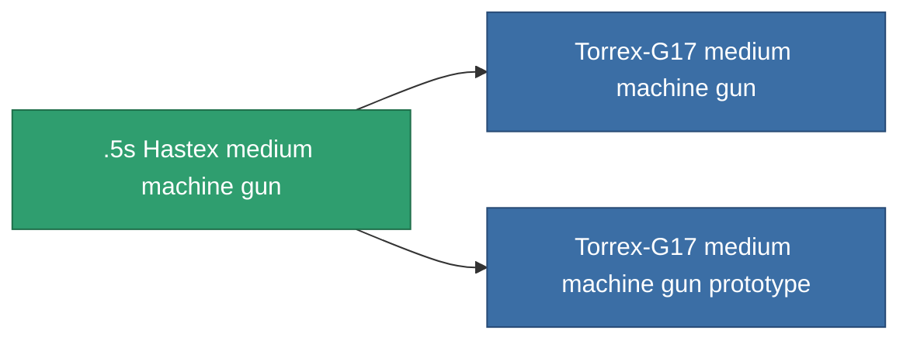

<!-- Generated by tools/generate from the live database (source: entitydefaults definition 844, aggregatevalues via aggregatefields).
     Do not edit by hand; regenerate instead. -->

# .5s Hastex medium machine gun

|  |  |
|---|---|
| Definición | `def_named2_medium_autocannon` |
| Nivel | T3 |
| Salud | 100 |
| Volumen | 1.2 |
| Masa | 500 |
| Categoría | Modules / Weapons |
| Tier line | [Standard medium machine gun](/es/content/items/standard-medium-autocannon/) (T1) → [Grenber 28d medium machine gun](/es/content/items/named1-medium-autocannon/) (T2) → **.5s Hastex medium machine gun** (T3) → [Torrex-G17 medium machine gun](/es/content/items/named3-medium-autocannon/) (T4) |

## Estadísticas

| Campo | Valor |
|---|---|
| accuracy | 17 |
| core_usage | 2 |
| cpu_usage | 11 |
| cycle_time | 4k |
| damage_modifier | 1.7 |
| falloff | 21.5 |
| least_optimal | 3 |
| optimal_range | 14.5 |
| powergrid_usage | 125 |

<!-- production:generated -->
## Producción

**Producido desde 4 componentes, nivel de investigación 5** — ensambla los componentes para construirlo (lista completa en [Recetas](/es/content/recipes/)):

**Planos:** [.5s Hastex medium machine gun CT](/es/content/items/named2-medium-autocannon-cprg/)

<svg class="prod-card-icon" aria-hidden="true"><use href="#mi-grid"/></svg><a class="prod-card-name" href="/es/content/items/axicoline/">Axicoline</a>

requerido: <b>100</b>

<svg class="prod-card-icon" aria-hidden="true"><use href="#mi-grid"/></svg><a class="prod-card-name" href="/es/content/items/hydrobenol/">Hydrobenol</a>

requerido: <b>100</b>

<svg class="prod-card-icon" aria-hidden="true"><use href="#mi-grid"/></svg><a class="prod-card-name" href="/es/content/items/named1-medium-autocannon/">Grenber 28d medium machine gun</a>

requerido: <b>1</b>

<svg class="prod-card-icon" aria-hidden="true"><use href="#mi-grid"/></svg><a class="prod-card-name" href="/es/content/items/titanium/">Titanium</a>

requerido: <b>100</b>

## Usado en producción

**Componente de 2 elementos** — todo lo que lo usa en producción:

