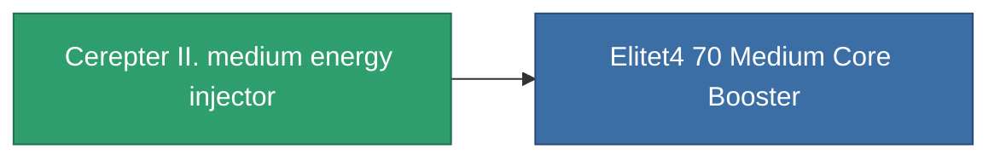

<!-- Generated by tools/generate from the live database (source: entitydefaults definition 827, aggregatevalues via aggregatefields).
     Do not edit by hand; regenerate instead. -->

# Cerepter II. medium energy injector

|  |  |
|---|---|
| Definición | `def_named3_medium_core_booster` |
| Nivel | T4 |
| Salud | 100 |
| Volumen | 1 |
| Masa | 200 |
| Categoría | Modules / Enhancements |
| Tier line | [Standard medium energy injector](/es/content/items/standard-medium-core-booster/) (T1) → [Shoxit Parter I. medium energy injector](/es/content/items/named1-medium-core-booster/) (T2) → [Follypsos medium energy injector](/es/content/items/named2-medium-core-booster/) (T3) → **Cerepter II. medium energy injector** (T4) |

## Estadísticas

| Campo | Valor |
|---|---|
| core_usage | 0 |
| cpu_usage | 27 |
| cycle_time | 9k |
| powergrid_usage | 300 |

<!-- production:generated -->
## Producción

**Producido desde 8 componentes, nivel de investigación 7** — ensambla los componentes para construirlo (lista completa en [Recetas](/es/content/recipes/)):

**Planos:** [Cerepter II. medium energy injector CT](/content/items/named3-medium-core-booster-cprg/)

<svg class="prod-card-icon" aria-hidden="true"><use href="#mi-grid"/></svg><a class="prod-card-name" href="/es/content/items/axicol/">Cryoperine</a>

requerido: <b>200</b>

<svg class="prod-card-icon" aria-hidden="true"><use href="#mi-grid"/></svg><a class="prod-card-name" href="/es/content/items/espitium/">Espitium</a>

requerido: <b>200</b>

<svg class="prod-card-icon" aria-hidden="true"><use href="#mi-grid"/></svg><a class="prod-card-name" href="/es/content/items/named2-medium-core-booster/">Follypsos medium energy injector</a>

requerido: <b>1</b>

<svg class="prod-card-icon" aria-hidden="true"><use href="#mi-crystal"/></svg><a class="prod-card-name" href="/es/content/items/robotshard-common-advanced/">Functional common fragment</a>

requerido: <b>60</b>

<svg class="prod-card-icon" aria-hidden="true"><use href="#mi-crystal"/></svg><a class="prod-card-name" href="/es/content/items/robotshard-common-basic/">Damaged common fragment</a>

requerido: <b>30</b>

<svg class="prod-card-icon" aria-hidden="true"><use href="#mi-crystal"/></svg><a class="prod-card-name" href="/es/content/items/robotshard-common-expert/">Perfect common fragment</a>

requerido: <b>90</b>

<svg class="prod-card-icon" aria-hidden="true"><use href="#mi-grid"/></svg><a class="prod-card-name" href="/es/content/items/titanium/">Titanium</a>

requerido: <b>200</b>

<svg class="prod-card-icon" aria-hidden="true"><use href="#mi-grid"/></svg><a class="prod-card-name" href="/es/content/items/unimetal/">Briochit</a>

requerido: <b>200</b>

## Usado en producción

**Componente de 1 elementos** — todo lo que lo usa en producción:

