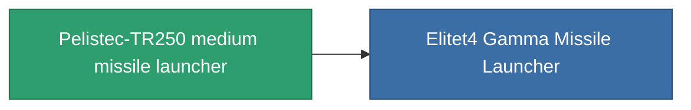

<!-- Generated by tools/generate from the live database (source: entitydefaults definition 854, aggregatevalues via aggregatefields).
     Do not edit by hand; regenerate instead. -->

# Pelistec-TR250 medium missile launcher

|  |  |
|---|---|
| Definición | `def_named3_missile_launcher` |
| Nivel | T4 |
| Salud | 100 |
| Volumen | 2 |
| Masa | 550 |
| Categoría | Modules / Weapons |
| Tier line | [Standard medium missile launcher](/es/content/items/standard-missile-launcher/) (T1) → [ST-Dupot medium missile launcher](/es/content/items/named1-missile-launcher/) (T2) → [Vollert medium missile launcher](/es/content/items/named2-missile-launcher/) (T3) → **Pelistec-TR250 medium missile launcher** (T4) |

## Estadísticas

| Campo | Valor |
|---|---|
| accuracy | 1 |
| core_usage | 2 |
| cpu_usage | 45 |
| cycle_time | 10.5k |
| damage_modifier | 1 |
| module_missile_range_modifier | 1.2 |
| powergrid_usage | 170 |

<!-- production:generated -->
## Producción

**Producido desde 10 componentes, nivel de investigación 7** — ensambla los componentes para construirlo (lista completa en [Recetas](/es/content/recipes/)):

**Planos:** [Pelistec-TR250 medium missile launcher CT](/es/content/items/named3-missile-launcher-cprg/)

<svg class="prod-card-icon" aria-hidden="true"><use href="#mi-grid"/></svg><a class="prod-card-name" href="/es/content/items/hydrobenol/">Hydrobenol</a>

requerido: <b>200</b>

<svg class="prod-card-icon" aria-hidden="true"><use href="#mi-star"/></svg><a class="prod-card-name" href="/es/content/items/named2-missile-launcher/">Vollert medium missile launcher</a>

requerido: <b>1</b>

<svg class="prod-card-icon" aria-hidden="true"><use href="#mi-grid"/></svg><a class="prod-card-name" href="/es/content/items/phlobotil/">Phlobotil</a>

requerido: <b>200</b>

<svg class="prod-card-icon" aria-hidden="true"><use href="#mi-crystal"/></svg><a class="prod-card-name" href="/es/content/items/robotshard-common-advanced/">Functional common fragment</a>

requerido: <b>30</b>

<svg class="prod-card-icon" aria-hidden="true"><use href="#mi-crystal"/></svg><a class="prod-card-name" href="/es/content/items/robotshard-common-basic/">Damaged common fragment</a>

requerido: <b>15</b>

<svg class="prod-card-icon" aria-hidden="true"><use href="#mi-crystal"/></svg><a class="prod-card-name" href="/es/content/items/robotshard-common-expert/">Perfect common fragment</a>

requerido: <b>45</b>

<svg class="prod-card-icon" aria-hidden="true"><use href="#mi-crystal"/></svg><a class="prod-card-name" href="/es/content/items/robotshard-pelistal-advanced/">Functional pelistal fragment</a>

requerido: <b>30</b>

<svg class="prod-card-icon" aria-hidden="true"><use href="#mi-crystal"/></svg><a class="prod-card-name" href="/es/content/items/robotshard-pelistal-basic/">Damaged pelistal fragment</a>

requerido: <b>15</b>

<svg class="prod-card-icon" aria-hidden="true"><use href="#mi-crystal"/></svg><a class="prod-card-name" href="/es/content/items/robotshard-pelistal-expert/">Perfect pelistal fragment</a>

requerido: <b>45</b>

<svg class="prod-card-icon" aria-hidden="true"><use href="#mi-grid"/></svg><a class="prod-card-name" href="/es/content/items/unimetal/">Briochit</a>

requerido: <b>200</b>

## Usado en producción

**Componente de 1 elementos** — todo lo que lo usa en producción:

