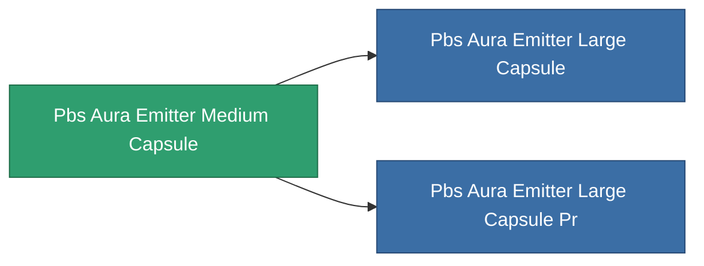

<!-- Generated by tools/generate from the live database (source: entitydefaults definition 5193, aggregatevalues via aggregatefields).
     Do not edit by hand; regenerate instead. -->

# Pbs Aura Emitter Medium Capsule

|  |  |
|---|---|
| Definición | `def_pbs_aura_emitter_medium_capsule` |
| Nivel | T2 |
| Salud | 100 |
| Volumen | 10 |
| Masa | 10000 |
| Categoría | Special & other / Miscellaneous |

## Estadísticas

| Campo | Valor |
|---|---|
| armor_max | 65k |
| core_max | 41.25k |
| resist_chemical | 75 |
| resist_explosive | 75 |
| resist_kinetic | 75 |
| resist_thermal | 75 |
| signature_radius | 25 |
| stealth_strength | 50 |

<!-- production:generated -->
## Producción

**Producido desde 10 componentes** — ensambla los componentes para construirlo (lista completa en [Recetas](/es/content/recipes/)):

**Planos:** [Advanced Aura emitter foundation CT](/content/items/pbs-aura-emitter-medium-capsule-cprg/)

<svg class="prod-card-icon" aria-hidden="true"><use href="#mi-grid"/></svg><a class="prod-card-name" href="/es/content/items/axicol/">Cryoperine</a>

requerido: <b>250</b>

<svg class="prod-card-icon" aria-hidden="true"><use href="#mi-grid"/></svg><a class="prod-card-name" href="/es/content/items/axicoline/">Axicoline</a>

requerido: <b>125</b>

<svg class="prod-card-icon" aria-hidden="true"><use href="#mi-grid"/></svg><a class="prod-card-name" href="/es/content/items/espitium/">Espitium</a>

requerido: <b>500</b>

<svg class="prod-card-icon" aria-hidden="true"><use href="#mi-grid"/></svg><a class="prod-card-name" href="/es/content/items/gamma-buildblock/">Coalimin</a>

requerido: <b>125</b>

<svg class="prod-card-icon" aria-hidden="true"><use href="#mi-grid"/></svg><a class="prod-card-name" href="/es/content/items/gamma-energyblock/">Tiraizin</a>

requerido: <b>250</b>

<svg class="prod-card-icon" aria-hidden="true"><use href="#mi-grid"/></svg><a class="prod-card-name" href="/es/content/items/gamma-offenseblock/">Turilium</a>

requerido: <b>125</b>

<svg class="prod-card-icon" aria-hidden="true"><use href="#mi-grid"/></svg><a class="prod-card-name" href="/es/content/items/hydrobenol/">Hydrobenol</a>

requerido: <b>250</b>

<svg class="prod-card-icon" aria-hidden="true"><use href="#mi-home"/></svg><a class="prod-card-name" href="/es/content/items/pbs-aura-emitter-small-capsule/">Pbs Aura Emitter Small Capsule</a>

requerido: <b>1</b>

<svg class="prod-card-icon" aria-hidden="true"><use href="#mi-grid"/></svg><a class="prod-card-name" href="/es/content/items/titanium/">Titanium</a>

requerido: <b>125</b>

<svg class="prod-card-icon" aria-hidden="true"><use href="#mi-grid"/></svg><a class="prod-card-name" href="/es/content/items/unimetal/">Briochit</a>

requerido: <b>250</b>

## Usado en producción

**Componente de 2 elementos** — todo lo que lo usa en producción:

