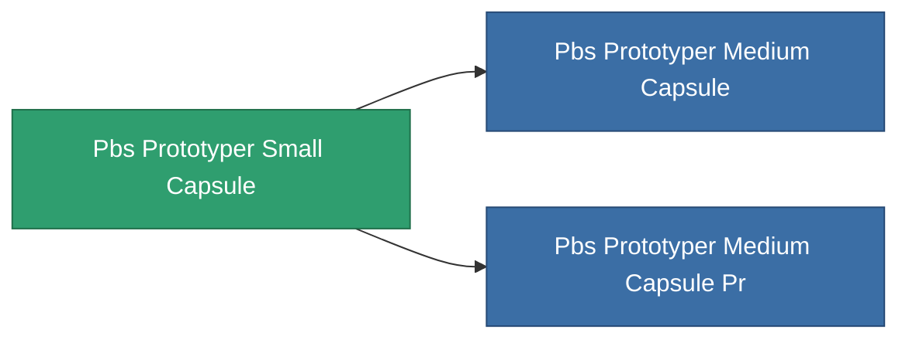

<!-- Generated by tools/generate from the live database (source: entitydefaults definition 4759, aggregatevalues via aggregatefields).
     Do not edit by hand; regenerate instead. -->

# Pbs Prototyper Small Capsule

|  |  |
|---|---|
| Definición | `def_pbs_prototyper_small_capsule` |
| Nivel | T1 |
| Salud | 100 |
| Volumen | 125 |
| Masa | 125000 |
| Categoría | Special & other / Miscellaneous |

## Estadísticas

| Campo | Valor |
|---|---|
| armor_max | 200k |
| core_max | 2.5k |
| resist_chemical | 30 |
| resist_explosive | 30 |
| resist_kinetic | 30 |
| resist_thermal | 30 |
| signature_radius | 50 |
| stealth_strength | 50 |

<!-- production:generated -->
## Producción

**Producido desde 8 componentes** — ensambla los componentes para construirlo (lista completa en [Recetas](/es/content/recipes/)):

**Planos:** [Standard prototype facility foundation CT](/content/items/pbs-prototyper-small-capsule-cprg/)

<svg class="prod-card-icon" aria-hidden="true"><use href="#mi-grid"/></svg><a class="prod-card-name" href="/es/content/items/alligior/">Alligior</a>

requerido: <b>2.5k</b>

<svg class="prod-card-icon" aria-hidden="true"><use href="#mi-grid"/></svg><a class="prod-card-name" href="/es/content/items/axicol/">Cryoperine</a>

requerido: <b>2.5k</b>

<svg class="prod-card-icon" aria-hidden="true"><use href="#mi-grid"/></svg><a class="prod-card-name" href="/es/content/items/axicoline/">Axicoline</a>

requerido: <b>2.5k</b>

<svg class="prod-card-icon" aria-hidden="true"><use href="#mi-grid"/></svg><a class="prod-card-name" href="/es/content/items/espitium/">Espitium</a>

requerido: <b>2.5k</b>

<svg class="prod-card-icon" aria-hidden="true"><use href="#mi-grid"/></svg><a class="prod-card-name" href="/es/content/items/hydrobenol/">Hydrobenol</a>

requerido: <b>2.5k</b>

<svg class="prod-card-icon" aria-hidden="true"><use href="#mi-grid"/></svg><a class="prod-card-name" href="/es/content/items/plasteosine/">Plasteosine</a>

requerido: <b>2.5k</b>

<svg class="prod-card-icon" aria-hidden="true"><use href="#mi-grid"/></svg><a class="prod-card-name" href="/es/content/items/titanium/">Titanium</a>

requerido: <b>5.0k</b>

<svg class="prod-card-icon" aria-hidden="true"><use href="#mi-grid"/></svg><a class="prod-card-name" href="/es/content/items/unimetal/">Briochit</a>

requerido: <b>5.0k</b>

## Usado en producción

**Componente de 2 elementos** — todo lo que lo usa en producción:

