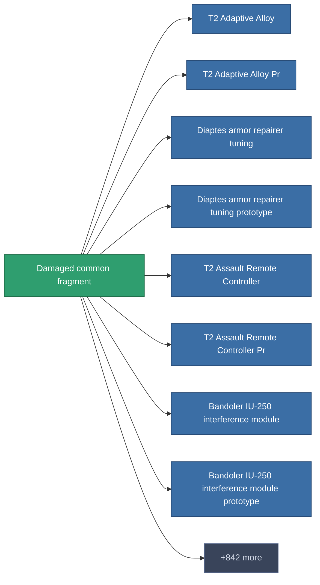

<!-- Generated by tools/generate from the live database (source: entitydefaults definition 1980, aggregatevalues via aggregatefields).
     Do not edit by hand; regenerate instead. -->

# Damaged common fragment

|  |  |
|---|---|
| Definición | `def_robotshard_common_basic` |
| Nivel | – |
| Salud | 100 |
| Volumen | 0.01 |
| Masa | 1 |
| Categoría | Materials |

_Sin estadísticas — este elemento no porta valores agregados._

<!-- production:generated -->
## Producción

**Producido desde 4 componentes** — ensambla los componentes para construirlo (lista completa en [Recetas](/es/content/recipes/)):

<svg class="prod-card-icon" aria-hidden="true"><use href="#mi-grid"/></svg><a class="prod-card-name" href="/es/content/items/axicol/">Cryoperine</a>

requerido: <b>1</b>

<svg class="prod-card-icon" aria-hidden="true"><use href="#mi-grid"/></svg><a class="prod-card-name" href="/es/content/items/axicoline/">Axicoline</a>

requerido: <b>1</b>

<svg class="prod-card-icon" aria-hidden="true"><use href="#mi-grid"/></svg><a class="prod-card-name" href="/es/content/items/plasteosine/">Plasteosine</a>

requerido: <b>1</b>

<svg class="prod-card-icon" aria-hidden="true"><use href="#mi-grid"/></svg><a class="prod-card-name" href="/es/content/items/titanium/">Titanium</a>

requerido: <b>1</b>

## Usado en producción

**Componente de 850 elementos** — una muestra de lo que se puede producir con él (lista completa en [Recetas](/es/content/recipes/)).

