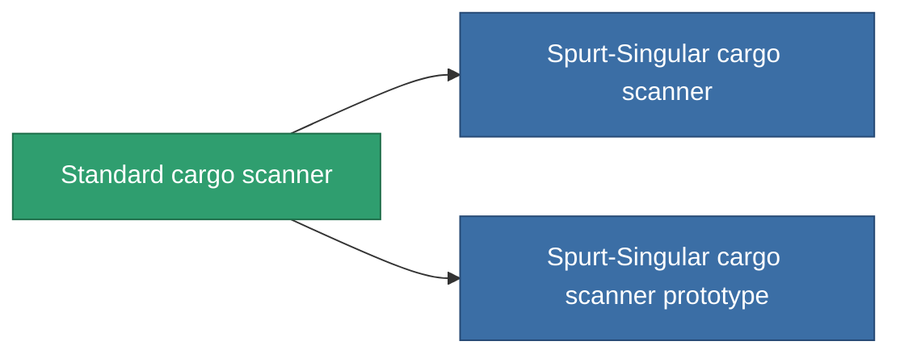

<!-- Generated by tools/generate from the live database (source: entitydefaults definition 45, aggregatevalues via aggregatefields).
     Do not edit by hand; regenerate instead. -->

# Standard cargo scanner

|  |  |
|---|---|
| Definición | `def_standard_cargo_scanner` |
| Nivel | T1 |
| Salud | 100 |
| Volumen | 0.5 |
| Masa | 100 |
| Categoría | Modules / Sensors & scanning |
| Tier line | **Standard cargo scanner** (T1) → [Spurt-Singular cargo scanner](/es/content/items/named1-cargo-scanner/) (T2) → [Nomothetor cargo scanner](/es/content/items/named2-cargo-scanner/) (T3) → [Visioner cargo scanner](/es/content/items/named3-cargo-scanner/) (T4) |

## Estadísticas

| Campo | Valor |
|---|---|
| core_usage | 50 |
| cpu_usage | 20 |
| cycle_time | 10k |
| falloff | 20 |
| optimal_range | 15 |
| powergrid_usage | 10 |

<!-- production:generated -->
## Producción

**Producido desde 2 componentes, nivel de investigación 3** — ensambla los componentes para construirlo (lista completa en [Recetas](/es/content/recipes/)):

**Planos:** [Standard cargo scanner CT](/es/content/items/standard-cargo-scanner-cprg/)

<svg class="prod-card-icon" aria-hidden="true"><use href="#mi-grid"/></svg><a class="prod-card-name" href="/es/content/items/axicol/">Cryoperine</a>

requerido: <b>250</b>

<svg class="prod-card-icon" aria-hidden="true"><use href="#mi-grid"/></svg><a class="prod-card-name" href="/es/content/items/titanium/">Titanium</a>

requerido: <b>50</b>

## Usado en producción

**Componente de 2 elementos** — todo lo que lo usa en producción:

