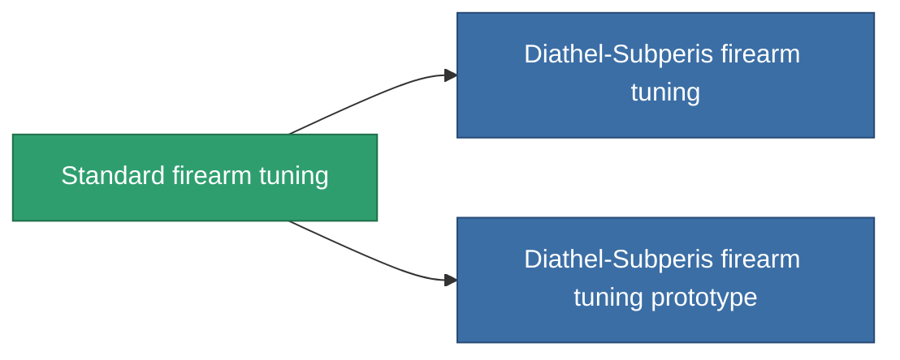

<!-- Generated by tools/generate from the live database (source: entitydefaults definition 912, aggregatevalues via aggregatefields).
     Do not edit by hand; regenerate instead. -->

# Standard firearm tuning

|  |  |
|---|---|
| Definición | `def_standard_damage_mod_projectile` |
| Nivel | T1 |
| Salud | 100 |
| Volumen | 0.5 |
| Masa | 100 |
| Categoría | Modules / Enhancements |
| Tier line | **Standard firearm tuning** (T1) → [Diathel-Subperis firearm tuning](/es/content/items/named1-damage-mod-projectile/) (T2) → [Plasmidwad-9000 firearm tuning](/es/content/items/named2-damage-mod-projectile/) (T3) → [DVT-800g firearm tuning](/es/content/items/named3-damage-mod-projectile/) (T4) |

## Estadísticas

| Campo | Valor |
|---|---|
| cpu_usage | 15 |
| damage_projectile_modifier | 0.15 |
| powergrid_usage | 5 |

<!-- production:generated -->
## Producción

**Producido desde 3 componentes, nivel de investigación 3** — ensambla los componentes para construirlo (lista completa en [Recetas](/es/content/recipes/)):

**Planos:** [Standard firearm tuning CT](/content/items/standard-damage-mod-projectile-cprg/)

<svg class="prod-card-icon" aria-hidden="true"><use href="#mi-grid"/></svg><a class="prod-card-name" href="/es/content/items/axicol/">Cryoperine</a>

requerido: <b>200</b>

<svg class="prod-card-icon" aria-hidden="true"><use href="#mi-grid"/></svg><a class="prod-card-name" href="/es/content/items/axicoline/">Axicoline</a>

requerido: <b>100</b>

<svg class="prod-card-icon" aria-hidden="true"><use href="#mi-grid"/></svg><a class="prod-card-name" href="/es/content/items/titanium/">Titanium</a>

requerido: <b>100</b>

## Usado en producción

**Componente de 2 elementos** — todo lo que lo usa en producción:

