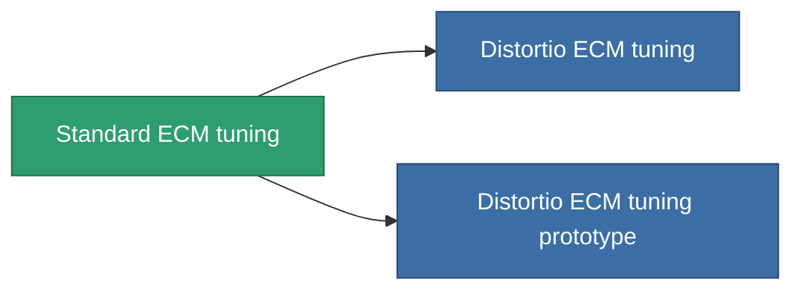

<!-- Generated by tools/generate from the live database (source: entitydefaults definition 4578, aggregatevalues via aggregatefields).
     Do not edit by hand; regenerate instead. -->

# Standard ECM tuning

|  |  |
|---|---|
| Definición | `def_standard_ecm_booster` |
| Nivel | T1 |
| Salud | 100 |
| Volumen | 0.5 |
| Masa | 150 |
| Categoría | Modules / Enhancements |
| Tier line | **Standard ECM tuning** (T1) → [Distortio ECM tuning](/es/content/items/named1-ecm-booster/) (T2) → [Hodge ECM tuning](/es/content/items/named2-ecm-booster/) (T3) → [Sludge ECM tuning](/es/content/items/named3-ecm-booster/) (T4) |

## Estadísticas

| Campo | Valor |
|---|---|
| core_usage_sensor_jammer_modifier | 1.1 |
| cpu_usage | 65 |
| ecm_strength_modifier | 1.25 |
| powergrid_usage | 25 |

<!-- production:generated -->
## Producción

**Producido desde 3 componentes, nivel de investigación 5** — ensambla los componentes para construirlo (lista completa en [Recetas](/es/content/recipes/)):

**Planos:** [Standard ECM tuning CT](/content/items/standard-ecm-booster-cprg/)

<svg class="prod-card-icon" aria-hidden="true"><use href="#mi-grid"/></svg><a class="prod-card-name" href="/es/content/items/axicol/">Cryoperine</a>

requerido: <b>150</b>

<svg class="prod-card-icon" aria-hidden="true"><use href="#mi-grid"/></svg><a class="prod-card-name" href="/es/content/items/chollonin/">Chollonin</a>

requerido: <b>150</b>

<svg class="prod-card-icon" aria-hidden="true"><use href="#mi-grid"/></svg><a class="prod-card-name" href="/es/content/items/titanium/">Titanium</a>

requerido: <b>50</b>

## Usado en producción

**Componente de 2 elementos** — todo lo que lo usa en producción:

