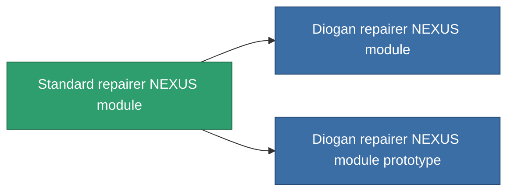

<!-- Generated by tools/generate from the live database (source: entitydefaults definition 2554, aggregatevalues via aggregatefields).
     Do not edit by hand; regenerate instead. -->

# Standard repairer NEXUS module

|  |  |
|---|---|
| Definición | `def_standard_gang_assist_maintance_module` |
| Nivel | T1 |
| Salud | 100 |
| Volumen | 0.2 |
| Masa | 50 |
| Categoría | Modules / Enhancements |
| Tier line | **Standard repairer NEXUS module** (T1) → [Diogan repairer NEXUS module](/es/content/items/named1-gang-assist-maintance-module/) (T2) → [Pawish repairer NEXUS module](/es/content/items/named2-gang-assist-maintance-module/) (T3) → [ACF-9900 repairer NEXUS module](/es/content/items/named3-gang-assist-maintance-module/) (T4) |
| Nota | repaired ammountot novel |

## Estadísticas

| Campo | Valor |
|---|---|
| core_usage | 35 |
| cpu_usage | 85 |
| cycle_time | 10k |
| default_effect_range | 100 |
| effect_repair_amount_modifier | 1.02 |
| powergrid_usage | 35 |

<!-- production:generated -->
## Producción

**Producido desde 5 componentes, nivel de investigación 4** — ensambla los componentes para construirlo (lista completa en [Recetas](/es/content/recipes/)):

**Planos:** [Standard repairer NEXUS module CT](/es/content/items/standard-gang-assist-maintance-module-cprg/)

<svg class="prod-card-icon" aria-hidden="true"><use href="#mi-grid"/></svg><a class="prod-card-name" href="/es/content/items/axicol/">Cryoperine</a>

requerido: <b>150</b>

<svg class="prod-card-icon" aria-hidden="true"><use href="#mi-grid"/></svg><a class="prod-card-name" href="/es/content/items/chollonin/">Chollonin</a>

requerido: <b>150</b>

<svg class="prod-card-icon" aria-hidden="true"><use href="#mi-grid"/></svg><a class="prod-card-name" href="/es/content/items/plasteosine/">Plasteosine</a>

requerido: <b>150</b>

<svg class="prod-card-icon" aria-hidden="true"><use href="#mi-grid"/></svg><a class="prod-card-name" href="/es/content/items/statichnol/">Statichnol</a>

requerido: <b>150</b>

<svg class="prod-card-icon" aria-hidden="true"><use href="#mi-grid"/></svg><a class="prod-card-name" href="/es/content/items/titanium/">Titanium</a>

requerido: <b>50</b>

## Usado en producción

**Componente de 2 elementos** — todo lo que lo usa en producción:

